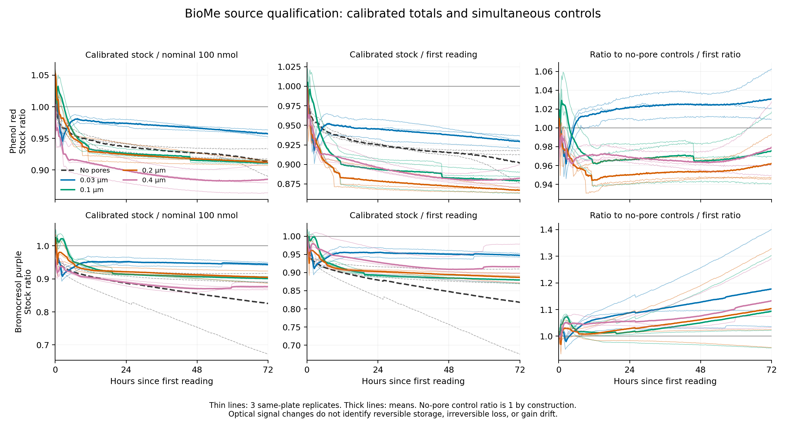

# BioMe stock audit: accessible data, unqualified connector capacity

23–24 October 2026. **The archive does not yet support an independent connector
capacity bound.** The calibrated no-pore controls themselves show 8.22–32.30%
apparent stock loss between the first reading and the final-hour average.
That prevents assigning the porous-pair deficits uniquely to connector storage.
This is a descriptive source qualification, not a new confirmatory law test,
a failure of complete-system conservation, or a network experiment.

The [protocol](biome-stock-audit-protocol-2026-10-23.md) was committed/pushed at
`43b1bd2`, followed by pre-access error-handling amendment `59bd2b7`.
Both precede numerical calibration and response decoding. The source's
qualitative sequestration discussion was known. All 30 pairs and both dyes
were retained; no exchange, loss or capacity model was fitted. Reference
measure: physical chamber volume, neither log-orthopolic nor linear-orthopolic
size allocation.

## What the measurements show

Percentages below compare the final five readings (71–72 h after the first
reading) with the first reading. Entries are means and **replicate ranges**,
not confidence intervals; there are three same-plate replicates per condition.
The control ratio compares a pair with its same-row no-pore dye/water controls.

| Dye | Pore size, micrometres | Calibrated stock, % of first reading | Control ratio, % of first ratio |
| --- | ---: | ---: | ---: |
| Phenol red | No pores | 90.24 [87.69, 91.78] | 100 by construction |
| Phenol red | 0.03 | 92.96 [92.07, 93.68] | 103.05 [100.91, 106.16] |
| Phenol red | 0.1 | 87.93 [86.31, 89.02] | 97.52 [94.07, 101.52] |
| Phenol red | 0.2 | 86.71 [86.38, 87.00] | 96.17 [94.56, 99.23] |
| Phenol red | 0.4 | 88.22 [87.12, 89.92] | 97.85 [94.94, 102.54] |
| Bromocresol purple | No pores | 81.87 [67.70, 90.99] | 100 by construction |
| Bromocresol purple | 0.03 | 94.75 [94.27, 95.27] | 117.63 [103.59, 139.73] |
| Bromocresol purple | 0.1 | 87.96 [86.97, 88.85] | 109.25 [95.59, 129.97] |
| Bromocresol purple | 0.2 | 88.68 [87.13, 89.81] | 110.27 [95.77, 132.54] |
| Bromocresol purple | 0.4 | 91.62 [87.25, 97.83] | 113.16 [103.25, 128.76] |

No control has a nonpositive absorbance contrast, so all ratios are
computable. That does not make the controls physically stable. No-pore
donor concentration estimates fall by 33.75–50.91 micromolar for phenol red
and 36.69–129.09 micromolar for bromocresol purple. Recipients change by only
0.29–0.87 and 0.39–0.51 micromolar, respectively. Thus an apparent donor loss
is not balanced by a measured recipient gain in these controls.

Optical-standard well-mean RMSE is 6.38 micromolar for phenol red and 10.41
for bromocresol purple. Maximum leave-one-concentration-out errors are
17.80 and 36.02 micromolar. Standards were acquired on a later date and only
span six hours; they do not establish optical stability over the 72-hour
diffusion run. The final ratios do not identify dye degradation, adsorption,
settling, spatial sampling, evaporation or instrumental changes separately.
Unverified well mixing and unknown loading delays remain relevant.

## Why normalization does not repair the qualification

The same-row normalization can remove a shared optical offset and gain under
fixed control concentrations. It also divides by any physical depletion in the
no-pore donor. The observed bromocresol-purple ratio can consequently rise to
139.73% even while its independently calibrated stock estimate declines.
This is a demonstrated observation problem for this archive, not evidence of
resource creation. Synthetic checks independently show that equal fractional
physical loss in test and control makes the ratio exactly constant.

Even a precise total deficit would not establish reversible connector capacity:
the connector's loading, partitioning and subsequent recovery are not separately
measured. Nominal geometric pore volume cannot substitute for chemical storage
capacity. The archive also supplies isolated pairs rather than a matched network.
Do not infer a correction from these exposed responses and call its application
to those same responses an independent prediction.

## Source implementation and verification

Both deposited scripts assign the bromocresol-purple mass from `uM_PR`, using
478 nm data and phenol-red calibration. Our implementation uses the documented
490 nm data and independent bromocresol-purple standards. The retained originals
show the assignment directly; we have not established which script version
generated each published figure or quantified the published result's error.
No upstream file was changed and no message was sent to the authors.

Seven synthetic tests cover wavelength mapping, calibration, units, negative
estimates, optical drift, physical losses and unusable controls. An independent
`openpyxl` decoder exactly matches all **18,840** retained optical cells
(1,500 standards and 17,340 responses). Separate covariance formulas and
explicit-loop calculations verify **26,799** numerical comparisons, with
maximum absolute difference **4.55e-13**. The verifier imports no production
calculation. All 628 time cells and plate headers also agree. The full curves,
calibration diagnostics, all replicate summaries
and verification receipt are retained in
`results/biome-stock-audit-2026-10-23/`.

Replay with `make biome-stock-audit PY=build/main-venv-2026-10-09/bin/python`.
The 44-study confirmatory/analysis registry is unchanged. The
[fresh network-source follow-up](network-source-followup-2026-10-23.md)
records the other leads and the established diffusion-memory prior art.
The next useful experiment or archive needs independently characterized
connector loading/recovery and stable stock observations before a new network
trajectory. This audit supplies a specific qualification failure, rather than
another inaccessible download or an unsupported capacity estimate.
