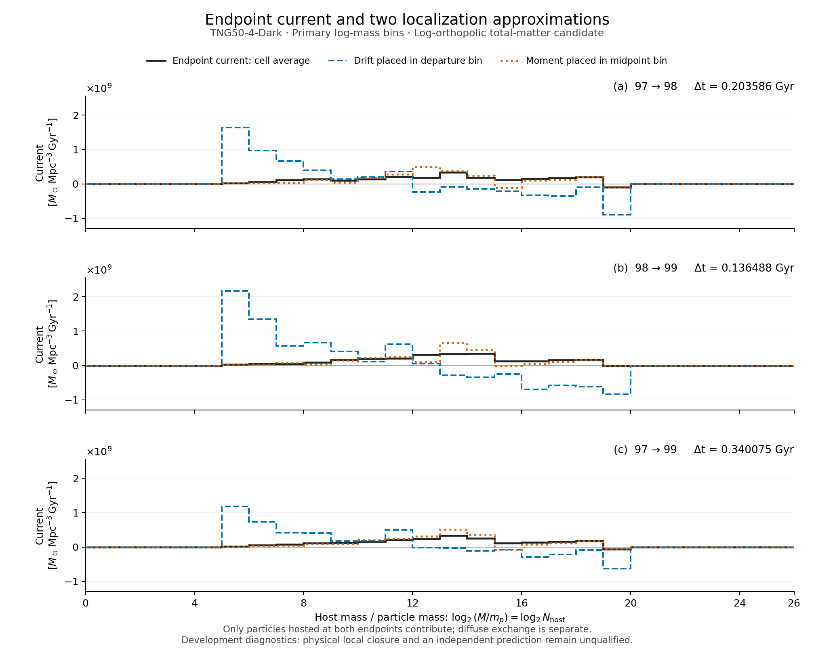

# Can local drift explain how matter moves between host masses?

**In these three TNG50-4-Dark outputs, assigning each particle's host-mass change to its starting bin gives a poor account of where mass crosses the spectrum.** For example, consider hosts containing 16,384 to 32,767 particles. Between outputs 98 and 99, the measured average current through that bin was **+3.45 × 10⁸** solar masses per comoving Mpc³ per Gyr, toward larger host masses. The departure-bin estimate gave **−3.45 × 10⁸** in the same units. Both estimates use the same particles and agree on their total signed displacement across the whole domain. They disagree even on direction inside this bin.

This matters for the proposed **log-orthopolic allocation of collisionless total-matter mass**. The model connects equal stocks per logarithmic mass interval to a nearly constant through-current and drift. An abundance forecast built on that connection needs to locate the current accurately. **Stop this local-drift forecast route for the present outputs.** The measured discrepancies, diffuse exchange and limited output cadence leave its physical error unbounded by this pilot. The D3 development decision is complete for this run. D4 and D5 remain conditional on new evidence. [Measurement design](cosmic-test-design-2026-11-11.md) · [Fixed development plan](cosmic-transport-development-plan-2026-11-22.md)

## What the curves measure

For each particle hosted at both ends of an interval, we know its host mass at departure and arrival. Imagine a change from a host of 64 particles to one of 4,096. It crosses several mass boundaries. The black curve credits each intervening bin with the part of the log-mass displacement inside it. The blue curve credits the entire change to the departure bin. The orange curve credits it to the bin containing the geometric midpoint, here 512. Downward changes enter with a negative sign. Only the endpoints are observed, so these assignments cannot identify the particle's intervening trajectory.



Each primary bin spans a factor of two in host mass. We fixed grids of 13, 26 and 52 bins over the same full domain before computing these summaries. Every particle has a bin or a diffuse state at each output. Diffuse material has no host mass, so its entry and exit appear as separate source terms. The entire simulation is development data and the earlier whole-box statistics were already known. [Full numerical results](../results/cosmic-binned-transport-2026-11-22/transport.json) · [Vector figure](../results/cosmic-binned-transport-2026-11-22/figures/endpoint-current-primary.svg)

## How large is the discrepancy?

The table compares the black curve with each approximation. The discrepancy is the sum of the absolute differences weighted by logarithmic bin width, divided by the combined absolute sizes of the two curves with the same weights. **Zero means exact agreement and one is the maximum.** These are descriptive distances. We set no acceptance threshold.

| Host-mass grid | 97 → 98 departure / midpoint | 98 → 99 departure / midpoint | 97 → 99 departure / midpoint |
|---|---:|---:|---:|
| Coarse, 13 bins | 0.827 / 0.227 | 0.870 / 0.102 | 0.783 / 0.159 |
| Primary, 26 bins | 0.809 / 0.224 | 0.873 / 0.241 | 0.770 / 0.188 |
| Fine, 52 bins | 0.831 / 0.258 | 0.869 / 0.344 | 0.753 / 0.226 |

The midpoint approximation is closer across all nine comparisons. It uses the arrival mass as an input, which limits its use in forecasting abundance at an unseen endpoint.

## Where the crossings and stock changes come from

| Primary grid | 97 → 98 | 98 → 99 | 97 → 99 |
|---|---:|---:|---:|
| Gross mass-boundary crossings by particles hosted at both endpoints | 1,074,888 | 903,610 | 1,334,843 |
| Share from host-mass ratios of at least two in either direction | 74.84% | 85.09% | 77.05% |
| Share from transitions skipping at least one whole bin | 73.86% | 84.14% | 76.00% |
| Net particle gain from the diffuse reservoir | 42,318 | 27,066 | 69,384 |
| Sum of absolute particle-stock changes over the host bins | 274,296 | 129,344 | 372,992 |

One particle counts once per boundary crossed. Only about 1.29% and 1.26% of particles hosted at both endpoints experienced a factor-two or larger change in the adjacent intervals, yet these changes contributed most of the crossings. This is why a small fraction of large jumps matters to a flow model. [Earlier particle-weighted statistics](cosmic-development-results-2026-11-21.md)

The stocks also provide a direct reading of the log-orthopolic prediction. At output 99, positive stocks occupied 15 of the 26 primary bins. Across those 15 equally wide bins the smallest stock contained **393,647 particles** and the largest **1,323,034**, a factor of **3.36**. The resource is each bin's particle count times a common particle mass. The observed full occupied spectrum therefore departs from exact equal allocation. Finite host counts and the numerical resolution limit interpretation, especially near the mass extremes. The fixed interval analysis supplies no narrower validated plateau.

Among the **9,569,584 particles hosted at all three outputs**, omitting output 98 hides **481,898 of 1,685,846** resolved gross primary-grid crossings (**28.58%**). The fraction is **27.95%** on the coarse grid and **29.59%** on the fine grid. Signed crossings telescope exactly for that common population. Across the full population, a particle can leave hosts and return. In every bin the difference between adjacent and coarsened net currents is exactly compensated in the balance by the change in diffuse source accounting. Finer time sampling would be needed to quantify excursions that both adjacent intervals miss.

## What passed, and how to reproduce it

All three grids and all three intervals passed exact integer checks on matrix marginals, bin stock changes, currents, and diffuse sources for **19,683,000** persistent particle IDs. Net crossing counts at shared boundaries agree across grids. Each deposition also recovers the same width-integrated signed displacement to floating precision. These checks establish the endpoint accounting used in the comparisons. Temporal convergence, a physical local-current error bound, and independent abundance prediction remain open scientific requirements.

The [manifest](../configs/cosmic-transport-development-2026-11-22.json) binds the hashes of the original inventory, binary reader and acquisition configuration. The [analysis](../experiments/check_cosmic_binned_transport.py) rechecks the local raw files. Under the project's Python 3.11 environment with its optional HDF5 dependency, the following commands write a fresh replay under the ignored build directory:

```sh
PYTHONPATH=src:build/cosmic-tools build/main-venv-2026-10-09/bin/python \
  experiments/check_cosmic_binned_transport.py --output-dir build/transport-replay
MPLCONFIGDIR=build/matplotlib build/main-venv-2026-10-09/bin/python \
  experiments/plot_cosmic_binned_transport.py --input build/transport-replay/transport.json \
  --output-dir build/transport-replay/figures
```

The replay needs the 27 HDF5 files described in the [acquisition record](cosmic-development-acquisition-2026-11-20.md). The published figure and numerical tables can be read without those files. The live run used **1.04 GiB** peak resident memory. The test suite passed **839 Python tests and 27 JavaScript tests**, including an exact midpoint-edge regression in both directions.
