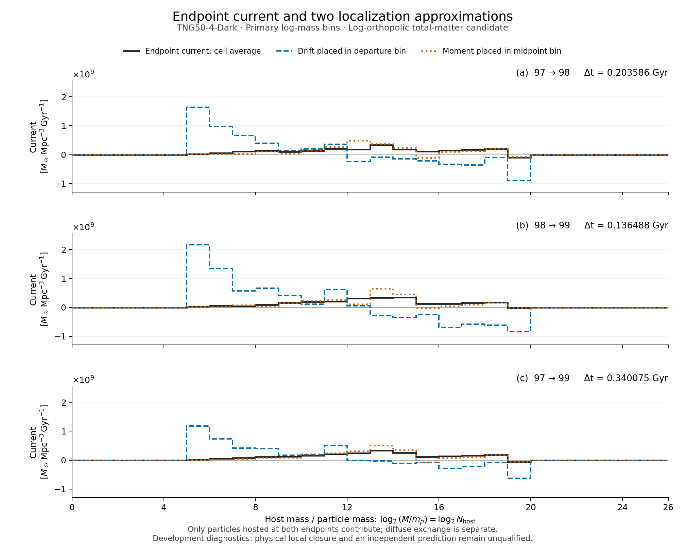

# Orthopolity and cosmic structure

**Cosmological extension, revised 22 November 2026.** This appendix asks whether gravitational assembly can produce the log-orthopolic
allocation proposed in the [main article](paper.md). Published stellar and galaxy
distributions motivate the question. A development analysis of three outputs
from TNG50-4-Dark checks the local transport mechanism against particle histories.

## 1. The cosmological conjecture

**We conjecture that gravitational assembly produces finite regimes of
approximately equal matter allocation per logarithmic host-mass interval.**
The substantive physical proposal is that these regimes arise when material
current and residence time per logarithmic interval become approximately
independent of host mass.
This is a proposed **log-orthopolic cosmological principle**. Its domain must
be located from independently specified dynamics and observational eligibility,
so finding a convenient straight segment in a mass function cannot establish it.

Here "cosmological" concerns the assembly and distribution of cosmic structure.
The standard cosmological principle concerns approximate spatial homogeneity
and isotropy on very large scales: sameness across locations and directions
([ESA, Planck and the cosmic microwave background](https://www.esa.int/Science_Exploration/Space_Science/Planck/Planck_and_the_cosmic_microwave_background)).
Our conjecture concerns allocation across object masses; that spatial symmetry
does not determine a mass spectrum.
The allocation constant $C$ below is set by the selected inventory and mass
range. It is not identified with the cosmological constant $\Lambda$, which
enters the gravitational description of vacuum energy
([Carroll, 2001](https://arxiv.org/abs/astro-ph/0004075)).

## 2. Stars, galaxies and the question to test

Consider a fixed stellar inventory at one epoch. Assign each included star to
exactly one galaxy, and let $\bar k$ be the average number of included stars per
galaxy. Then

$$N_{\rm galaxies}\,\bar k=N_{\rm stars}.$$

Every complete grouping of that same inventory obeys this identity. It is the
exact accounting content of the framework, with a predefined grouping measure;
it is neither a log-orthopolic nor a linear-orthopolic size-allocation test.
Different galaxy-size distributions can have the same total. Diffuse stars
must be included as an explicit additional component or excluded from the
declared inventory. Stellar birth and death also prevent this snapshot identity
from implying conservation of stellar number through time.

The distributional question is sharper. Let $k$ denote stars per galaxy and
$\phi(k)=dN_{\rm galaxies}/dk$ a smooth richness density over a declared range.
The number of stars per logarithmic richness interval is

$$\frac{dN_{\rm stars}}{d\ln k}=k^2\phi(k).$$

**Log-orthopolic allocation predicts $k^2\phi(k)=C$: each decade of galaxy
richness contains the same total number of stars.** Moving to a decade with
ten times richer galaxies gives ten times fewer galaxies. The corresponding
linear-orthopolic prediction would instead be $k\phi(k)=C$; it expresses equal
stars per unit richness, a different physical hypothesis.

Galaxy stellar mass offers an observationally accessible analogue. Turning
stellar mass into star number additionally requires an independently justified
mean stellar mass for each population. A stellar mass function therefore does
not directly measure the richness distribution above.

For either stellar mass or halo mass, define
$n(M,t)=dN/(dV_c\,dM)$ in comoving volume $V_c$ at epoch $t$. Choose one resource
and one object definition. The mass density per logarithmic interval is

$$r(M,t)=\frac{d\rho}{d\ln M}=M^2n(M,t).$$

Log-orthopolic mass allocation has $r=C$ and $n=C/M^2$. Over a finite interval
$I=[M_{\min},M_{\max}]$, its normalization is fixed:

$$\rho_I=C\ln\!\left(\frac{M_{\max}}{M_{\min}}\right).$$

This cannot extend over arbitrarily many decades at fixed positive $C$ and
finite mass density. Both bounds, the epoch window, completeness and mass
estimator belong to the hypothesis. A host and its subhalos must not contribute
the same material twice: use disjoint hosts, an exclusive material assignment,
or a separately declared subhalo population with its own budget.

## 3. Published signs and departures

For $n(M)\propto M^{-\alpha}$, our conversion gives
$r(M)\propto M^{2-\alpha}$. Thus $\alpha=2$ is neutral in mass under the
logarithmic measure; a nearby exponent gives a tilted resource profile. The
following readings were made after seeing the published exponents and remain
exploratory. Their domains and resource definitions are different.

| Population and published result | Log-orthopolic mass reading |
|---|---|
| COSMOS2015 galaxies near $z=5$: low-mass Schechter slope $-2.11_{-0.13}^{+0.30}$. | The fitted low-mass component has $r\propto M^{-0.11}$, compatible with neutrality within the quoted uncertainty. The inferred slope depends on the observational error model used in correcting Eddington bias. [Davidzon et al. (2017)](https://arxiv.org/abs/1701.02734). |
| Aquarius dark-matter subhalos: simulated $dN/dM\propto M^{-1.9}$ over resolved ranges. | $r\propto M^{0.1}$ is close to flat per decade but differs systematically over a wide range. This is a simulation result, with stripping and subhalo selection relevant to interpretation. [Springel et al. (2008), Section 3.1](https://arxiv.org/html/0809.0898v1). |
| GAMA nearby galaxies, $z<0.06$: double Schechter fit with low-mass exponent $-1.47$. | Where that component dominates well below the cutoff, $r\propto M^{0.53}$. The full mass function includes a second component and an exponential cutoff; it is not neutral mass allocation. [Baldry et al. (2012)](https://arxiv.org/abs/1111.5707). |
| Stellar initial mass function: adopted high-mass exponent approximately $-2.3$ in Kroupa's Galactic-field description. | The corresponding birth-mass allocation has $r\propto M^{-0.3}$, with slope changes at lower masses. Birth masses of individual stars are a different population from total stellar masses of galaxies. [Kroupa (2001), Section 2](https://arxiv.org/html/astro-ph/0009005v2). |

The early-to-late galaxy contrast suggests a useful question: can independently
measured assembly, star formation and loss processes predict the change in
resource profile? The table itself cannot identify such a mechanism. Replacing
physical mass by a power of mass chosen to flatten each row would only construct
a new resource hypothesis.

## 4. A conditional mechanism with a further prediction

Equal current through size classes does not by itself imply equal stored mass.
The amount present also depends on how long material stays in each class.
To make that distinction explicit, track fixed mass elements by their host-mass
coordinate $x=\ln(M/M_0)$, where $M_0$ is a fixed reference mass. The assigned
resource must equal the catalogue mass of each host for $r=M^2n$ to hold;
tracking only a tracer subset would require its own resource per host. In a
local transport approximation, let $r(x,t)$ be the mass density per $dx$,
$J(x,t)$ its current, and $s(x,t)$ its source or loss density:

$$\partial_t r+\partial_x J=s,\qquad J=v(x,t)r(x,t).$$

Here $v$ is the material-weighted drift in log host mass. In a stationary,
source-free interior, $J$ is constant in $x$. If $v=v_0>0$ is also independent
of $x$, then

$$r=\frac{J}{v_0}=C,\qquad n(M)=\frac{J}{v_0M^2}.$$

This is an exact conditional derivation within the transport model. It describes
throughflow maintained at the interval boundaries. Its cosmological hypothesis
is that gravitational assembly supplies those conditions over a finite regime.
Tracking material matters: a continuity equation for halo counts would miss
the mass reassigned by mergers. Large merger jumps can invalidate the local
approximation, diffusion requires an additional flux term, and accretion from
an untracked diffuse component introduces sources. These effects require a
justified transport model before applying the stationary result. Applying it
to galaxy stellar mass additionally requires the effects of star formation
and stellar mass loss to be specified independently.

The same model gives a prediction beyond matching an exponent. Independently
specified positive currents $J_i$ and drifts $v_i$ in two eligible environments
predict, for $0<a<b$ within the second environment's declared mass interval,

$$\frac{C_2}{C_1}=\frac{J_2/v_2}{J_1/v_1},\qquad
\frac{N_{[a,b],2}}{V_{c,2}}=\frac{J_2}{v_2}
\left(\frac1a-\frac1b\right).$$

The target is the second environment's abundance, including its normalization.
Estimating $J_2$ as $v_2r_2$ from that target would make the test circular.
Independent development data or a separately calibrated dynamical model must
supply the inputs before the target mass function is examined. With variable
$v(x)$, the stationary prediction becomes $r(x)=J/v(x)$, providing a specified
departure that can also fail.

## 5. Where mass crosses the spectrum in TNG50-4-Dark

We tracked all 19,683,000 equal-mass particles in the last three outputs (97--99)
of TNG50-4-Dark, a gravity-only simulation of collisionless total matter.
Each particle belonged to one friends-of-friends halo or the diffuse population.
We fixed the bins after inspecting whole-box statistics but before computing
binned currents. Host mass doubles in each of the 26 primary bins. Two other
grids cover the same domain in 13 and 52 bins. The data and simulation are described by
[Nelson et al. (2019a)](https://doi.org/10.1186/s40668-019-0028-x),
[Pillepich et al. (2019)](https://doi.org/10.1093/mnras/stz2338) and
[Nelson et al. (2019b)](https://doi.org/10.1093/mnras/stz2306).

Consider a particle whose host mass changes from 64 to 4,096 particle masses.
Its endpoints span six doublings. The measured current credits each mass bin
with the signed displacement through it. The local drift estimate credits
all six doublings to the starting bin. Both calculations recover the same
total displacement, yet place it at different masses. We compare the two as
currents averaged over each bin, using particles hosted at both endpoints.
Entry from and exit to the diffuse population enter the mass balance separately.

In the two consecutive intervals, 1.29% and 1.26% of particles hosted at both
endpoints underwent at least a twofold change in host mass in either direction.
They accounted for 74.84% and 85.09% of gross crossings on the primary grid.
Each particle counts once per boundary crossed. Between outputs 98 and 99, the
current through the bin for 16,384 to 32,767 particle masses was $+3.45\times10^8$ solar
masses per comoving cubic megaparsec per Gyr, toward larger hosts. The
departure-bin estimate gave $-3.45\times10^8$ in the same units (Figure S21).

*Figure S21. Mass current through equal logarithmic host-mass bins in TNG50-4-Dark.
Black credits each bin with the displacement between observed endpoints that lies
inside it. Blue assigns the whole displacement to the starting bin. Orange assigns
it to the bin containing the geometric mean of the two endpoint masses. The first
two panels use adjacent outputs. The third omits the middle output.*

At output 99 the 15 occupied primary bins contained between 393,647 and
1,323,034 particles each, a factor of 3.36 in mass across bins of equal
logarithmic width. Among particles hosted at all three outputs, omitting
output 98 hid 28.58% of the gross primary-grid crossings visible in the two
shorter intervals. Thus a complete inventory can coexist with unresolved
motion between outputs. The departure-bin estimate disagreed with the measured
current at all three bin widths. The closer midpoint estimate uses arrival
masses, which are unknown in an abundance forecast.
[Development analysis, figure and numerical results](cosmic-transport-development-results-2026-11-22.md)

## 6. What would advance the conjecture

Self-similarity alone does not establish the needed residence times. Scale-free
cosmological simulations retain power-spectrum dependence in fitted halo mass
functions ([Bagla, Khandai and Kulkarni, 2010](https://arxiv.org/abs/0908.2702));
calibrated halo mass functions also vary with epoch and mass definition
([Tinker et al., 2008](https://arxiv.org/abs/0803.2706)). These are substantive
comparators for any proposed cosmic mechanism.

We therefore stop the local-drift abundance forecast for these three outputs.
Reopening it requires a model that accounts for large changes in host mass and
exchange with diffuse matter, and bounds the error from finite output spacing.
Its decisive prediction would be the absolute host counts in a separate
population, using transport inputs fixed before inspecting that population.
Established halo mass-function models should predict the same counts under
the same mass definition. That comparison would test what the proposed
log-orthopolic mechanism adds beyond its conditional mathematical result.
