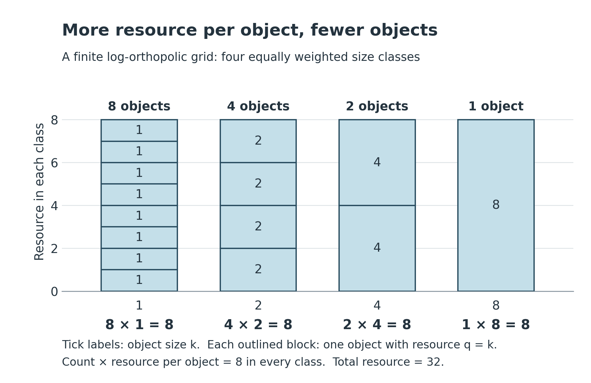
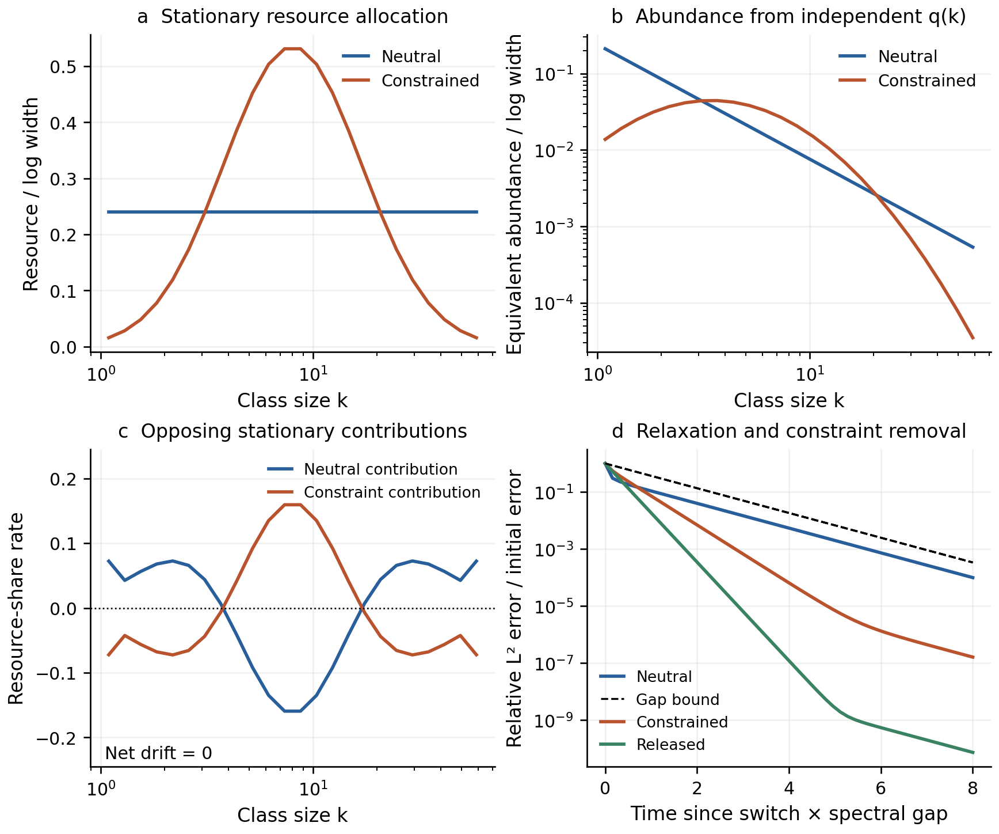

# Orthopolity: a general law of resource allocation

**A natural-law proposal, physical realizations and cosmic implications**

> Research manuscript, revised 26 November 2026. [Supporting material](https://raw.githubusercontent.com/ttm/orthopolity/78fcfc7247400702ccdb57c593dfcb6380849cd0/docs/supporting-material.pdf) contains the derivations, study designs and full comparisons.

## Abstract

We propose orthopolity as a natural law of resource allocation. Nature tends
to distribute a resource equally among classes of objects that concentrate
it, relative to a physically specified measure. If the mean resource per
object doubles, equal allocation requires half as many objects per unit of
that measure. Conservation alone allows many other distributions. We derive
equal allocation for a model of exchange between classes and show how a
specified constraint changes the equilibrium. We then test a prediction in a
computer experiment. Five workers competed for processor time. We replaced
the worker handling the largest matrices with a second worker on the smallest.
Under equal time per worker, the measured job costs predicted that the smallest
matrices would account for 78.8% of completed multiplications. Their observed
share rose from 65.7% to 79.0%. In mixed algal cultures, a forecast based on
two nutrient budgets after a nitrogen pulse fared no better than assuming
that each algal group would retain its pre-pulse share of algal nitrogen. We also
examine a cosmological conjecture about equal mass per doubling of halo mass.
The evidence supports particular allocation mechanisms. How widely natural
systems approach equal allocation remains an empirical question.

## 1. The law in one picture

How many small objects does it take to hold as much material as one large
object? Figure 1 gives four classes the same allotment of eight units. An
object in the smallest class holds one unit, so eight are needed. An object
in the largest class holds all eight units on its own. Reading from small to
large, the class totals are

$$8\times1=4\times2=2\times4=1\times8=8.$$

*Figure 1. Each block represents one object and its height represents the
resource it holds. The four stacks have equal height. Object sizes double
from one class to the next, so this constructed example gives equal weight
to four logarithmically spaced classes. The total budget is 32 units.*

**We propose orthopolity as a natural law. Nature tends to allocate equal
amounts of a resource to equally weighted classes of its concentrations.**
A concentration can be an organism holding biomass, for example. The choice
of classes matters. Grouping organisms by successive doublings of body mass
asks whether each doubling holds the same biomass. Grouping them in one-gram
intervals asks a different question. The opening example uses the first
comparison, termed *log-orthopolic*.

The proposal originates with Fabbri and Oliveira Jr. (2017) and Fabbri
(2024). Figure 1 shows the arithmetic once each class has been assigned eight
units. The physical question is what would give the classes equal shares in
the first place. We derive one mechanism, change its conditions, and examine
which predictions survive in measured systems. Before measuring abundance,
a test should specify the resource, the class widths, the range of sizes
and the period over which equality is expected. It should also say how large
a departure would count against the prediction.

## 2. From the picture to a prediction

### 2.1 The allocation relation

Within any class, multiplying the number of objects by the arithmetic mean
resource per object gives the amount of resource in that class. To make the
same calculation for continuous sizes $k$, let $n_\mu=dN/d\mu$ denote the
number of objects per unit of a chosen measure $\mu$, and let $\bar q(k)>0$
be the mean resource per object at size $k$. The resource per unit measure is

$$\mathcal O_\mu(k)=\frac{dR}{d\mu}=\bar q(k)n_\mu(k). \tag{1}$$

Equation (1) holds for any allocation. Neutral allocation requires the resource
per unit measure to have a common value throughout the specified size range.

$$\mathcal O_\mu(k)=C>0,\qquad n_\mu(k)=\frac{C}{\bar q(k)}. \tag{2}$$

A budget $B$ spread evenly over a domain $D$ of finite positive measure sets
the level $C=B/\mu(D)$. Doubling the mean requirement then halves the number
of objects per unit measure.

An example shows why it matters whether one measures a snapshot or an average.
Suppose the entire budget goes to one of four classes chosen with equal
probability. Each class receives one quarter of the budget on average, although
every snapshot has three empty classes. More generally, a fixed total and a
distribution of shares invariant under class permutations give equal expected
shares to equally weighted classes. A physical explanation must justify that
symmetry and specify the average to which its prediction applies.

### 2.2 The measure changes the exponent

The intervals 1–2, 2–4 and 4–8 have equal logarithmic width. The intervals
1–2, 2–3 and 3–4 have equal linear width. Consider a probability density
$p_\mu=n_\mu/N$, where $N$ is the total count on the chosen domain, and a
mean requirement $\bar q(k)=q_0(k/k_0)^\alpha$. Here $q_0$ is the mean
requirement at a reference size $k_0>0$. In the neutral case,

$$(k/k_0)^\alpha p_\mu(k)=\frac{C}{Nq_0}.$$

This is the relation $k^\alpha p(k)=\mathrm{constant}$ when size is measured
in units of $k_0$. To read an exponent from a published density, one must know
which size intervals its denominator counts. Since $d\ln k=dk/k$, the densities
per logarithmic size and per linear size satisfy $p_{\log}=k p_{\rm lin}$.

| Where resource is equal | Constant product | Predicted density per unit size |
|---|---|---|
| Equal linear widths (linear-orthopolic) | $\bar q p_{\rm lin}$ | $p_{\rm lin}\propto k^{-\alpha}$ |
| Equal logarithmic widths (log-orthopolic) | $\bar q k p_{\rm lin}$ | $p_{\rm lin}\propto k^{-(\alpha+1)}$ |

*Table 1. Abundance per unit of linear size under two equal-resource hypotheses.
Each constant product equals $C/N$ for its chosen measure.*

For objects compared by their own mass $k$, equal mass per doubling predicts
$p_{\rm lin}\propto k^{-2}$. Equal mass per gram predicts
$p_{\rm lin}\propto k^{-1}$. The extra factor of $k$ comes from the interval
width. A resource requirement can also vary with size in ways other than a
power law. For any positive $\bar q$, let $Z=\int_D (1/\bar q)\,d\mu$.
When $0<Z<\infty$, the neutral probability density is
$p_\mu=1/(Z\bar q)$. We call these *natural (orthopolic) distributions*.

### 2.3 What accounting makes unavoidable

A budget of 32 units can support at most four objects requiring eight units
each. It can also support none. In general, if each of a set of disjoint objects
requires at least $t>0$ units of an additive resource, their number is at most
$B/t$. A second exact result holds for any complete partition of the budget.
If it has $N$ objects of mean resource content $\bar q$, then $N\bar q=B$.

Consider a harvest weighed first by crate and then by apple, with packaging
excluded. Both inventories give the same mass. Sorting the apples by size
asks how that mass is divided among coexisting classes. Class $j$ now contains
mass $N_j\bar q_j=Bf_j$, where $f_j$ is its share.
Conservation fixes the sum of the shares for a complete inventory. A mechanism
is needed to determine their individual values. Supporting S1.1 and S1.4 extend
the accounting to incomplete and overlapping inventories.

### 2.4 Resources, constraints and a second prediction

A class can receive a larger share because it has more opportunities to draw on
the resource. Let $a(k)>0$ give this independently specified relative opportunity
on the occupied domain. Allowing also for an effective cost that combines
several physical requirements gives

$$\bar q_{\mathrm{eff}}(k)n_\mu(k)=C a(k). \tag{3}$$

Only ratios of $a$ matter here. For a complete budget, $C=B/\int_D a\,d\mu$.
In the worker experiment below, a class can gain an additional worker while
the cost per job stays fixed. Counting the workers and measuring job cost
before the change makes the new job shares predictable. Inverting an observed
abundance to define cost as $1/n_\mu$ would reproduce any positive profile.
A resource inferred that way needs a second, independently evaluated prediction.

One such prediction concerns how the abundance slope changes between
environments. Suppose a common effective cost takes the form
$Q=Q_0\prod_\ell X_\ell^{\theta_\ell}$, with positive constituents expressed
in fixed reference units. In environment $s$, measure the constituent slopes
$X_{s\ell}\propto k^{D_{s\ell}}$ and the constraint $a_s\propto k^{-v_s}$
independently. If the density per linear size varies as $k^{-\gamma_s}$,
applying equation (3) per unit logarithmic size gives

$$b=D\theta,\qquad b_s=\gamma_s-1-v_s. \tag{4}$$

For example, if two environments have constituent slopes $(1,1)$ and $(1,2)$,
their measured $b_1$ and $b_2$ determine the two cost exponents. In a third environment
with constituent slopes $(2,1)$, the model then predicts $b_3=3b_1-b_2$.
Given $v_3$, one can predict the third abundance slope before measuring it.
The derivation assumes deterministic class requirements or size-independent
moments of their multiplicative residuals. A nonlinear composite also needs a
fixed physical partition because subdivision can change its value. Supporting
S1.2–S1.5 give the conditions for identification and relate this construction
to established inverse methods (Keshavarz et al., 2011; Habeck, 2014).

## 3. Ideal mechanisms and physical realizations

What physical process could keep the resource per class nearly equal? Marine
size spectra illustrate the question (Sheldon et al., 1972; Gaedke, 1993).
In a reconstruction of the preindustrial upper ocean, many tenfold intervals
of organism mass each held about one gigatonne of biomass (Hatton et al.,
2021). The largest bin total was 1.7 times the smallest across 16 central
intervals selected after inspection, and 38.8 times the smallest across all
23 intervals (Supporting S4.7). Approximate log-orthopolic allocation describes
the central range. Its cause remains open.

Under the *orthopolic umbrella*, a distribution can suggest a resource and a
measure, as in the ocean example. We call such a reading an *orthopolic interpretation*.
A mechanism goes further by specifying what
sets the class shares. Once its inputs are known, it can predict how those
shares change when a constraint is imposed or removed.

### 3.1 Equalization, a constraint and its removal

Consider classes that can exchange resource. Class $i$ holds a stock $R_i$
over a reference width $w_i>0$, so $R_i/w_i$ measures how densely it is
supplied. Suppose each link carries resource from its more densely supplied
end to its less densely supplied end. With symmetric conductances
$g_{ij}=g_{ji}\ge0$, the current from $i$ to $j$ is

$$J^0_{ij}=g_{ij}\left(\frac{R_i}{w_i}-\frac{R_j}{w_j}\right).$$

Whatever leaves one class enters another, so the total $B=\sum_i R_i$ stays
fixed. If the network is connected, the densities converge to a common value.
The equilibrium stock is $R_i^0=Bw_i/\sum_jw_j$. At fixed positive cost $q_i$
per object, this stock supports an equivalent count $N_i^0=R_i^0/q_i$.
Figure 2 uses equal logarithmic widths, giving a log-orthopolic equilibrium.

Now favor classes with lower values of a fixed, dimensionless $V_i$. Increasing
the rate from $i$ to $j$ to $(g_{ij}/w_i)\exp[\max(V_i-V_j,0)]$ speeds transfer
toward a favored class. The forward and reverse flows on each link balance at

$$R_i^V=\frac{Bw_i e^{-V_i}}{\sum_jw_j e^{-V_j}}.$$

The neutral current still drains densely supplied classes. At equilibrium
the preference drives an equal current back. Switch off the preference and
the existing stocks immediately begin to relax toward $R_i^0$. The spectral
gap of the neutral exchange rates bounds the time scale of that recovery
(Levin and Peres, 2017). Disconnected components each retain their own budget.

*Figure 2. Resource exchange among equal logarithmic size classes. Panels a
and b show the equilibrium resource and the counts it supports at fixed class
costs. In c the neutral and preference contributions to each class's rate of
change cancel. Panel d shows the approach to equilibrium with the preference
absent, imposed or removed. Dashed lines give the spectral-gap bounds.
Supporting S3.1 gives the finite-packet fluctuations.*

The exchange rule matters even when the budget is fixed. In a model that
assembles and breaks up whole objects at equal rates for each feasible forward
and reverse reaction, mean counts approach the inverse-cost prediction as the
budget grows. Mass-action kinetics with the same budget favor larger objects in
the worked example (Supporting S3.10). Storage on links or a nonlinear relation
between stock and potential can also change the response to an intervention
(Supporting S5.19 and S3.7).

An electrical circuit provides a test of the model boundary. For passive
resistors and capacitors, the imaginary part of the driving-point impedance
is at most zero at positive frequency under the $e^{i\omega t}$ convention.
Positive values in the measured circuit put a 39.4% lower bound on the
normalized root-mean-square error of every such impedance curve. Including an
inductor with independently specified component values gave a 12.2% error
on the same 80 observations (Supporting S5.20).

### 3.2 Gravity and radiating waves: what geometry preserves

Double the radius of a sphere and its area quadruples. An inverse-square
field can therefore have the same total flux through both spheres. Whether
that flux measures a resource depends on what crosses the surface.

For a Newtonian gravitational field $\mathbf g$, the Poisson equation gives
the inward field flux $\Psi=-\oint_S\mathbf g\cdot\mathbf n\,dA
=4\pi GM_{\mathrm{enc}}$ (Chao, 2014). Any two closed surfaces enclosing the
same mass give the same total. Outside a spherical mass $M$, the acceleration
has magnitude $GM/r^2$. Each equal solid angle intercepts an equal share of
the inward field flux, $d\Psi/d\Omega=GM$. Repeating the surface integral
measures the same source again. The field flux measures enclosed mass through
Gauss's law and has different units from power (Supporting S3.6).

For radiation, energy does cross the surface. In steady, transparent space
around a source of luminosity $L$, the same power $P(r)=L$ passes through
each sphere. Isotropic emission gives a local flux density $L/(4\pi r^2)$.
How much energy is present in a shell of thickness $dr$? Outgoing radiation traveling radially at speed $c$ spends
$dr/c$ in the shell, so $dU=(L/c)dr$. The shell stock is linear-orthopolic
in radius. Per logarithmic interval it grows as $dU/d\ln r=Lr/c$.

In a medium that absorbs the outgoing beam with coefficient $\kappa(r)$,
without scattering or emission back into the beam, the power beyond a source
boundary $r_0$ is

$$P(r)=L\exp\left[-\int_{r_0}^{r}\kappa(s)\,ds\right].$$

For example, an integrated absorption coefficient of $\ln 2$ halves the
transmitted power. The other half is deposited in matter. If absorption is
switched off throughout the medium at time zero and the source stays steady,
the power at $r$ recovers to $L$ by time $(r-r_0)/c$. Supporting S3.2 derives
the response from electromagnetic energy balance (Poynting, 1884 and Haus
and Melcher, 1989) and radial transfer (Condon and Ransom, 2016).

### 3.3 Thermal modes: a derived limitation of neutral allocation

A classical harmonic mode in canonical equilibrium at temperature $T$ has
mean energy $k_BT$. The energy fluctuates, but a group with twice as many modes
has twice the mean total energy. Here the measure counts modes. It is fixed
independently of any choice of linear or logarithmic frequency bins.

For an electromagnetic mode of frequency $\nu$, the allowed excitation energies
are spaced by $h\nu$. Its mean energy above the ground state is

$$\bar\epsilon_\nu=\frac{h\nu}{e^{h\nu/(k_BT)}-1}
=k_BT\frac{x}{e^x-1},\qquad x=\frac{h\nu}{k_BT}.$$

When $h\nu\ll k_BT$, the mean approaches the classical value. When
$h\nu\gg k_BT$, even the first excitation is thermally unlikely. To obtain
Planck's energy density per unit frequency, multiply the energy per mode
by the number of modes per unit volume and frequency, $8\pi\nu^2/c^3$
(Planck, 1901 and Tong, n.d.). A flat mean across modes can thus coexist
with a rising energy spectrum across frequencies in the classical regime.

The 43 microwave-background channels in the FIRAS monopole table span
$x=1.199$ to $11.262$. Expressed per mode, their inferred energies fall from
$0.518$ to $1.32\times10^{-4}$ times $k_BT$. The published data product
combines a blackbody template with residuals from the fit (Fixsen et al.,
1996). This calculation illustrates quantum suppression using an existing
reconstruction (Supporting S3.4).

In heated cantilevers, damping measurements at lower temperatures calibrated
a model of where each mode loses energy (Fontana and Bellon, 2023).
Ten of eleven fits gave physically admissible losses. Across their 26
higher-temperature targets, the mean absolute error in fluctuation
temperature was 74.0 K, compared with 78.9 K for uniform loss. The eleventh
fit required negative dissipation. The modest gain and large errors for
individual modes limit how well whole-mode damping locates the losses.
The measurements already use an equilibrium normalization (Supporting S5.13).

### 3.4 Cell growth and division: a measurable constraint envelope

Consider a cell whose mass grows as $\dot x=gx$. It takes the same time to
grow from $x$ to $2x$ at any starting mass $x$. Which logarithmic intervals
does it live long enough to cross? Assume a common growth rate $g>0$, equal
division into two physiologically equivalent daughters, and no death. Along
a stationary lineage, let $B$ and $D$ be the birth and division masses of a
completed cycle. $D$ has the same distribution as $2B$ because the daughter's
birth mass is half the mother's division mass. The fraction of cycles
that cross mass $x$ follows from the birth-mass distribution $F_B$ alone:

$$H(x)=P(B\le x<D)=F_B(x)-F_B(x/2).$$

For a snapshot of a balanced asynchronous population, let $p_P(x)$ be the
density of cell mass when each cell counts once. Weighting those cells by
mass gives the time-sampled lineage density $p_L(x)=xp_P(x)/E_P[x]$
(Genthon, 2022). Each cycle crossing $x$ spends $dx/(gx)$ there, giving

$$p_P(x)=\frac{2H(x)}{E[B^{-1}]x^2},\qquad
\frac{x^2p_P(x)}{E_P[x]}=\frac{H(x)}{\ln2}.$$

Thus $H(x)/\ln 2$ is the fraction of population mass per unit of $\ln x$.
Where every cycle crosses the interval, $H=1$ and biomass allocation is
log-orthopolic. A fixed birth mass $b$ gives $p_P(x)=2b/x^2$ for
$b\le x<2b$. Variable birth masses can remove the plateau. In either case,
birth observations predict a separate population snapshot. Section 4.3
reports a test using measured bacterial length as a proxy for mass.
Growth noise, asymmetric division or selection of a particular lineage can
alter this prediction (Supporting S3.5).

## 4. What the empirical comparisons establish

### 4.1 Predictions and comparisons

If a worker that handles expensive jobs is replaced by one that handles cheap
jobs, how will the mix of completed work change? This question tests both
parts of the proposed explanation. Worker availability predicts who receives
processor time. A separate timing measurement predicts how much work that time
buys. A different rule for dividing time gives a different answer.

The runtime experiment fixed its forecasts before workers competed. In
studies using published data, prior exposure varied. We recorded the protocols
locally, without external preregistration. Some studies set aside whole
treatments, vessels or language families for scoring after
published summaries were known. The [registry](https://github.com/ttm/orthopolity/blob/78fcfc7247400702ccdb57c593dfcb6380849cd0/docs/run-registry.md) and supporting
S4--S5 record what was available when each prediction was made.

A sales network illustrates how to test a pattern found in earlier data.
Three U.S. Managing Consultant ranks at LifeVantage received similar totals
in 2024. We kept those ranks and predicted one third of their combined 2025
commissions for each. The observed shares were 33.93%, 32.13% and 33.94%. Rank 3 had about
one quarter as many paid consultant-months as rank 1, at about four times
the mean payment per paid month. Here each rank counts once. The full set of
15 ranks had widely different totals. [Income disclosure, p. 2](https://cdn.lifevantage.com/wp-content/uploads/sites/1/2026/02/27121010/260226.01-US-EN-Income-Disclosure-Statement.pdf) and [two-year comparison](https://github.com/ttm/orthopolity/blob/78fcfc7247400702ccdb57c593dfcb6380849cd0/docs/tv-distribution-evidence.md).

### 4.2 An allocation mechanism with an intervention

Five continuously runnable threads shared a Python interpreter that allowed
only one to execute Python code at a time. Initially each thread ran jobs on
matrices of a different size. The five size classes had equal logarithmic
widths, so equal processor time per thread would give a log-orthopolic
allocation of worker CPU time. The interpreter imposed the bottleneck. The
division of time was measured.

We first timed jobs of each size in separate runs. With $m_j$ workers in class
$j$ and mean CPU cost $q_j$ per job, equal time per worker predicts a CPU share
of $m_j/\sum_i m_i$ and a completed-job share proportional to $m_j/q_j$.
We then replaced the worker on the largest matrices with a second worker on
the smallest. Equal time per worker predicts that the smallest class's share
of CPU time rises from 20% to 40%. Equal time per occupied class predicts 25%
after the change. The smallest jobs' share of completions also rises, by an
amount that depends on their measured cost (Table 2).

| Workload | Workers on smallest matrices | Predicted share of completed jobs | Observed share |
|---|---:|---:|---:|
| Matrix transformation | 1 | 53.1% | 53.6% |
| Matrix transformation | 2 | 70.6% | 71.3% |
| Matrix multiplication | 1 | 64.4% | 65.7% |
| Matrix multiplication | 2 | 78.8% | 79.0% |

*Table 2. Fraction of all completed jobs that used the smallest matrices. There
were five workers in every condition. Each observed share pools four trials.
The forecasts concern the mix of completed jobs given their total.*

For both workloads the measured change in each class's CPU share was within
0.78 percentage points of its prediction. Across the four pooled conditions,
the completed-job profiles differed from their forecasts by 0.0021--0.0124 in
total variation (half the sum of absolute share errors over all five classes).
Using cost proportional to matrix side length gave errors of 0.126--0.273.
The separate timings therefore predicted the redistribution in this runtime.
All trials used one machine. Transfer to another scheduler remains untested.
[Intervention report](https://github.com/ttm/orthopolity/blob/78fcfc7247400702ccdb57c593dfcb6380849cd0/docs/dimensionality-intervention.md) and supporting S5.1.

### 4.3 Biological closure, predicted means and failed responses

In separately regrown *Dunaliella* cultures, cells in the large-selected
treatment averaged 10.4 times the volume of those in the small-selected
treatment. Yet the treatments differed by only 2.5% in geometric mean total
biovolume at carrying capacity. In each direction of transfer, equal biovolume
predicted the other treatment better than equal cell counts or a fitted size
law. Control cultures attained 18--21% more biovolume. The limiting resource
was unmeasured, and each culture grew separately. The experiment therefore
tests a budget across populations. Testing log-orthopolic or linear-orthopolic
biomass allocation would require measuring coexisting size classes
(Malerba et al., 2018, supporting S5.3).

Two other tests show what a biological explanation still has to predict. The
cell-cycle model of Section 3.4 overestimated mean *E. coli* cell length by
2.72% and 0.447% in two media. It also overestimated variability and failed the
joint criterion (Gangan and Athale, 2017, supporting S5.6). After a nutrient
pulse in twelve held-out chemostat communities, a model with two resource
budgets predicted the redistribution of algal nitrogen no more accurately
than carrying the initial shares forward. Even allowing the relative weights
of carbon and nitrogen to vary freely could not reproduce 17 of 36
redistributions under the specified quotas and opportunities
(Wojcik et al., 2025, supporting S5.3 and S5.10). These tests concern cells
and species. Supporting S5.11, S5.12 and S5.16 report related phosphorus,
field-stock and protein-burden comparisons.

### 4.4 Information costs and language transfer

A common information rate predicts how long a text takes to speak. Multiply
its syllable count by the information per syllable estimated from written
text, then divide by the rate in bits per second. Seven Indo-European
languages supplied the rate. Recordings in ten languages from eight other
families supplied the test. The mean absolute language-level log error in
duration was 0.0741, lower than for all four alternatives, including a
constant syllable rate (0.1544). Faster and slower individual readings can
offset one another in the language-level score. This transfer supports the
existing information-rate account of Coupé et al. (2019, supporting S5.17).

For written words, a cost combining letters and phonemes improved frequency
predictions in held-out genres over a cost based on letters alone. Frequencies
measured in the training genres still predicted better, and inferred resource
shares varied across word types (Piantadosi et al., 2011, supporting S5.5).
Both comparisons use counting measures over specified units. A physical claim
about the metabolic cost of speech or equal allocation across word sizes
would require separate measurements.

### 4.5 Geometric predictions and observation limits

For log-orthopolic resource hypotheses, a measured exponent can rule out a
specific geometric prediction. Rupture area and seismic moment predict
aftershock productivity exponents of 1 and 1.5. The primary estimate was
0.63 (95% interval $[0.51,0.71]$), with substantial dependence on the counting
window. Flare ribbon area gave a density exponent of 3.163
($[2.962,3.457]$), excluding both proposed values, 2 and $7/3$. Neither
study's overall decision rule selected a resource model (supporting S5.7).

For lake radii, correcting the geometry and accounting for dependence within
drainage basins gave a survival exponent of 1.859 (interval $[1.785,1.924]$).
The interval excludes the exact prediction of 2 but crosses the edge of the
prespecified equivalence range $[1.9,2.1]$. Thus the data leave open whether
the departure exceeds the chosen tolerance. A separate test relating
earthquake frequency to spatial dimension reached the limit of the available
measurements. Only six Southern California sequences qualified against a
minimum of ten, and the Italian estimator failed 45 of 56 required simulation
checks (supporting S5.7).

### 4.6 Independent constraints and transport kinetics

When two gases compete for adsorption sites, pure-gas measurements can
predict how much of each gas a mixture will retain. Across 45 mixture
conditions, the shared-capacity Langmuir model gave a mean absolute component
error of 0.247 mmol/g, compared with 0.620 when competition was omitted and
0.243 under ideal adsorbed solution theory. Only 39 of its 90 component
predictions fell within the reported measurement uncertainties
(Wedler et al., 2024, supporting S5.14). The improvement identifies the
importance of competition. The established adsorption model achieved the
same practical accuracy.

A similar distinction applies in transport. Grain-shape and wall corrections
improved forecasts from narrow to wider channels, although separate
material-specific fits to the earlier data did better and low-flux errors
exceeded fourfold (Deal et al., 2026, supporting S5.15). For later membrane
pairs, the error in predicted chamber contrasts averaged 4.23% of each pair's
initial total, close to empirical interpolation at 4.14%. Uncertainty in the
recovered stocks limited the conservation test (Benstead et al., 2026,
supporting S5.18). For heated cantilevers, even accurate damping estimates
could leave large errors in thermal motion (supporting S5.13). Each forecast
is informative about its specified sites, materials, compartments or modes.
None of these groupings defines equal linear or logarithmic size intervals.

## 5. Learning from validity, departures and failure

Consider a homogeneous rod of mass $B$. Cut it once at a uniformly random
position. The left and right pieces each have expected mass $B/2$, and together
they weigh $B$ every time. Does that give equal mass to successive doublings
of fragment size? Each piece has a uniform mass distribution from zero to $B$,
so the expected number of pieces per unit mass is $2/B$. Weighting by fragment
mass $m$ and converting to logarithmic width gives $2m^2/B$. On average, the
pieces between $B/2$ and $B$ therefore hold four times as much mass as those
between $B/4$ and $B/2$. The cut treats the two fragment labels symmetrically.
It gives a definite, unequal prediction for mass in equally wide logarithmic
classes. Supporting S3.8 derives the result for any fixed number of cuts.

This distinction also clarifies the relation to a Gaussian distribution.
Gaussian laws can arise when many small contributions add under central-limit
conditions. An orthopolic interpretation asks how much of a specified resource
each class holds. Both questions can apply to one system. At classical thermal
equilibrium a harmonic oscillator's displacement has a Gaussian distribution,
while an ensemble of harmonic modes has equal mean energy per mode. The first
statement concerns the frequency of displacement values, the second the
allocation of energy under a measure that counts modes (Supporting S3.9).

When an allocation forecast misses, the informative question is what could
have predicted the difference. An independently measured absorption coefficient
predicts how much less power reaches a more distant sphere. In the nutrient
experiment, even allowing the relative weights of carbon and nitrogen to vary
left observed changes beyond the model's range. Choosing new weights to match
each observation would forfeit the prediction. A revised mechanism earns support
when it predicts a change under a new condition with its inputs fixed in advance.

## 6. Cosmic implications and the proposed law

If a galaxy contains ten times as many stars, how many such galaxies would it
take to hold the same stellar inventory? One tenth as many. To turn this
arithmetic into a hypothesis, fix an epoch, count each included star in one
galaxy, and compare successive decades in the number of stars per galaxy.
Let $k$ be that number and $\phi(k)=dN_{\rm galaxies}/dk$ its smooth abundance
density. The stellar count per logarithmic richness interval is $k^2\phi(k)$.
Log-orthopolic allocation predicts that this quantity is constant over a
specified range. An observed distribution of galaxy stellar masses can test
the analogous prediction for mass. Converting it to star counts also requires
the mean mass per star in each population.

Our **cosmological conjecture** is that gravitational assembly produces finite
ranges with approximately equal matter per logarithmic interval of host mass.
The proposed mechanism links that stock to the rate at which mass flows
through the interval and the time it spends there. In steady local flow
without sources or sinks, the mass density per unit log host mass is $J/v$,
where $J$ is the material current per comoving volume and $v>0$ is the drift
speed in log host mass. If $J$ and $v$ are constant across the range, every
doubling of host mass contains the same mass density. Independently determining
both quantities would predict the absolute number of hosts in a chosen mass
interval. The resulting constant depends on the inventory and epoch.
The cosmological constant $\Lambda$ plays a different role in gravity
(Supporting S6.1–S6.4).

We checked the local-flow assumption using three consecutive outputs from
TNG50-4-Dark, a gravity-only simulation. In each of the two intervals, about
1.3% of the particles hosted at both endpoints saw their host mass at least
double or fall by half or more. On a grid with one doubling per bin, these
particles accounted for 75% and 85% of the boundary crossings inferred from
the endpoints. Counting a large jump entirely at its starting mass even gave
the wrong direction of flow in one bin. We therefore stopped the local-drift
abundance forecast for these outputs. Testing the conjecture requires a model
that accounts for large jumps, exchange with diffuse matter and unresolved
motion between outputs, followed by a prediction for a separate population
(Supporting Figure S21).

Figure 1 starts with a stipulated budget of eight units per class. The law
becomes predictive when physics can supply that premise, or predict a specific
departure from it. In the worker experiment, advance measurements of time per
job allowed a change in worker numbers to predict a change in completions.
For natural populations the corresponding test is to identify, before counting
the objects, which resource the classes share, why the chosen intervals should
receive equal amounts, and what will happen when the allocation conditions
change.

## Data and code availability

The code, input records and numerical results used here are available in
[the study repository, revision 78fcfc7](https://github.com/ttm/orthopolity/tree/78fcfc7247400702ccdb57c593dfcb6380849cd0).
The [run registry](https://github.com/ttm/orthopolity/blob/78fcfc7247400702ccdb57c593dfcb6380849cd0/docs/run-registry.md)
links each registered forecast to its inputs, algorithm and outcome.
The [supporting material](https://raw.githubusercontent.com/ttm/orthopolity/78fcfc7247400702ccdb57c593dfcb6380849cd0/docs/supporting-material.pdf)
gives the derivations (S1–S3), exploratory analyses (S4), forecast comparisons
(S5) and cosmic transport analysis (S6). At this revision, `make all` verifies
inputs and reruns the core analyses, and `make registry-verify` checks the
registered artifacts. Individual study reports give additional replay commands.

Two analyses use published summaries. The microwave spectrum comes from
[NASA's reconstruction of the FIRAS monopole](https://lambda.gsfc.nasa.gov/product/cobe/firas_monopole_spect.html),
and the bacterial birth and division measurements come from published figures
(Gangan and Athale, 2017). The halo analysis uses three outputs of TNG50-4-Dark
(Nelson et al., 2019a,b; Pillepich et al., 2019). Its
[replay instructions](https://github.com/ttm/orthopolity/blob/78fcfc7247400702ccdb57c593dfcb6380849cd0/docs/cosmic-transport-development-results-2026-11-22.md)
identify the 27 simulation files to obtain from IllustrisTNG.
The [data notices](https://github.com/ttm/orthopolity/blob/78fcfc7247400702ccdb57c593dfcb6380849cd0/data/NOTICE.md)
record source-specific access and reuse terms. The 2017 manuscript cited
below was supplied for private inspection.

## References

Benstead, C., Politi, M., Bergsman, D. S., and Pozzo, L. D. (2026). An automated sampling workflow for
parallel long-term membrane diffusion cell testing. *Digital Discovery*, 5, 1312–1324.
<https://doi.org/10.1039/D5DD00523J>.

Chao, B. F. (2014). On the gravitational energy associated with Earth's changing
oblateness. *Geophysical Journal International*, 199(2), 800–804.
<https://doi.org/10.1093/gji/ggu301>.

Condon, J. J., and Ransom, S. M. (2016). *Essential Radio Astronomy*.
Princeton University Press. Chapter 2, radiation and absorption.
<https://www.cv.nrao.edu/~sransom/web/Ch2.html>.

Coupé, C., Oh, Y. M., Dediu, D., and Pellegrino, F. (2019). Different languages,
similar encoding efficiency: Comparable information rates across the human
communicative niche. *Science Advances*, 5, eaaw2594.
<https://doi.org/10.1126/sciadv.aaw2594>.

Deal, E., Perron, J. T., Kusack, K., Benavides, S., Bradley, R., Zhang, Q., Kamrin, K.,
and Venditti, J. G. (2026). Generalizing sediment transport experiments from narrow
flumes to wider channels. *Journal of Geophysical Research: Earth Surface*, 131, e2025JF008712.
<https://doi.org/10.1029/2025JF008712>. Data: <https://doi.org/10.20383/103.01325>.

Fabbri, R. (2024). The Orthopolity cosmological principle and the Natural distribution law.
Author's essay, 14 August. <https://ttm.github.io/2024/08/14/power.html>.

Fabbri, R., and Oliveira Jr., O. N. (2017). *A simple model that explains why inequality
is ubiquitous*. Manuscript dated 17 March 2017, 13 pp. Publication status unverified.

Fixsen, D. J., Cheng, E. S., Gales, J. M., Mather, J. C., Shafer, R. A., and Wright,
E. L. (1996). The cosmic microwave background spectrum from the full COBE FIRAS data set.
*The Astrophysical Journal*, 473, 576–587. <https://doi.org/10.1086/178173>.
Source article: <https://arxiv.org/abs/astro-ph/9605054>.

Fontana, A., and Bellon, L. (2023). Linking fluctuation and dissipation in spatially
extended out-of-equilibrium systems. *Physical Review E*, 107, 034118.
<https://doi.org/10.1103/PhysRevE.107.034118>. Data:
<https://doi.org/10.5281/zenodo.7640708>.

Gaedke, U. (1993). Ecosystem analysis based on biomass size distributions: A case study
of a plankton community in a large lake. *Limnology and Oceanography*, 38, 112–127.
<https://doi.org/10.4319/lo.1993.38.1.0112>.

Gangan, M. S., and Athale, C. A. (2017). Threshold effect of growth rate on
population variability of *Escherichia coli* cell lengths.
*Royal Society Open Science*, 4, 160417. <https://doi.org/10.1098/rsos.160417>.

Genthon, A. (2022). Analytical cell size distribution: lineage-population bias
and parameter inference. *Journal of the Royal Society Interface*, 19, 20220405.
<https://doi.org/10.1098/rsif.2022.0405>. Revised exposition:
<https://arxiv.org/abs/2206.06146v2>.

Habeck, M. (2014). Bayesian approach to inverse statistical mechanics.
*Physical Review E*, 89, 052113. <https://doi.org/10.1103/PhysRevE.89.052113>.

Hatton, I. A., Heneghan, R. F., Bar-On, Y. M., and Galbraith, E. D. (2021). The global
ocean size spectrum from bacteria to whales. *Science Advances*, 7, eabh3732.
<https://doi.org/10.1126/sciadv.abh3732>.

Haus, H. A., and Melcher, J. R. (1989). *Electromagnetic Fields and Energy*.
Prentice-Hall. Section 11.2, Poynting's theorem.
<https://web.mit.edu/6.013_book/www/chapter11/11.2.html>.

Keshavarz, A., Wang, Y., and Boyd, S. (2011). Imputing a Convex Objective Function.
*2011 IEEE International Symposium on Intelligent Control*, 613–619.
<https://doi.org/10.1109/ISIC.2011.6045410>.

Levin, D. A., and Peres, Y. (2017). *Markov Chains and Mixing Times*, second edition,
with contributions by E. L. Wilmer. American Mathematical Society.
<https://pages.uoregon.edu/dlevin/MARKOV/mcmt2e.pdf>.

Malerba, M. E., Palacios, M. M., and Marshall, D. J. (2018). Do larger individuals cope with
resource fluctuations better? An artificial selection approach. *Proceedings of the Royal
Society B*, 285, 20181347. <https://doi.org/10.1098/rspb.2018.1347>. Data:
<https://doi.org/10.5061/dryad.4mh47r7>.

Nelson, D., et al. (2019a). The IllustrisTNG simulations: public data release.
*Computational Astrophysics and Cosmology*, 6, 2. <https://doi.org/10.1186/s40668-019-0028-x>.

Nelson, D., et al. (2019b). First results from the TNG50 simulation: galactic outflows
driven by supernovae and black hole feedback. *Monthly Notices of the Royal Astronomical
Society*, 490, 3234–3261. <https://doi.org/10.1093/mnras/stz2306>.

Piantadosi, S. T., Tily, H., and Gibson, E. (2011). Word lengths are optimized for
efficient communication. *Proceedings of the National Academy of Sciences*,
108(9), 3526–3529. <https://doi.org/10.1073/pnas.1012551108>.

Pillepich, A., et al. (2019). First results from the TNG50 simulation: the evolution
of stellar and gaseous discs across cosmic time. *Monthly Notices of the Royal
Astronomical Society*, 490, 3196–3233. <https://doi.org/10.1093/mnras/stz2338>.

Planck, M. (1901). Ueber das Gesetz der Energieverteilung im Normalspectrum.
*Annalen der Physik*, 309, 553--563. <https://doi.org/10.1002/andp.19013090310>.

Poynting, J. H. (1884). On the transfer of energy in the electromagnetic field.
*Philosophical Transactions of the Royal Society of London*, 175, 343–361.
<https://doi.org/10.1098/rstl.1884.0016>.

Sheldon, R. W., Prakash, A., and Sutcliffe, W. H., Jr. (1972). The size distribution of
particles in the ocean. *Limnology and Oceanography*, 17, 327–340.
<https://doi.org/10.4319/lo.1972.17.3.0327>.

Tong, D. (n.d.). *Statistical Physics*. University of Cambridge Part II Mathematical
Tripos lecture notes, Sections 1.3, 2.2.1 and 3.2. Accessed 6 October 2026.
<https://davidtong.org/pdfs/teaching/statistical-physics/statphys.pdf>.

Wedler, C., Ferre, A., Azzan, H., Danaci, D., Petit, C., and Pini, R. (2024).
Binary adsorption equilibria of three CO2+CH4 mixtures on NIST reference zeolite Y
(RM 8850) at temperatures from 298 to 353 K and pressures up to 3 MPa.
*Journal of Chemical & Engineering Data*, 69, 4216--4229.
<https://doi.org/10.1021/acs.jced.4c00358>.

Wojcik, L. A. M., Pfennig, A., Flamm, S., Klauschies, T., Rosenbaum, B., Weithoff, G., and
Gaedke, U. (2025). Top-down control and species composition influence nonlinearly the
short-term response of experimental food webs to a nutrient pulse perturbation. *Proceedings
of the Royal Society B*, 292, 20251969. <https://doi.org/10.1098/rspb.2025.1969>. Data:
<https://doi.org/10.5061/dryad.51c59zwj5>.
