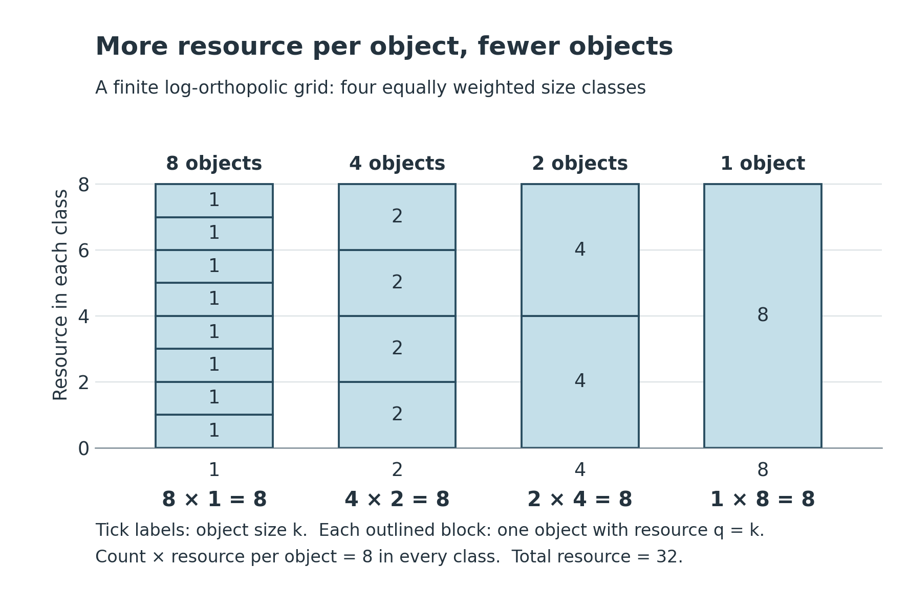
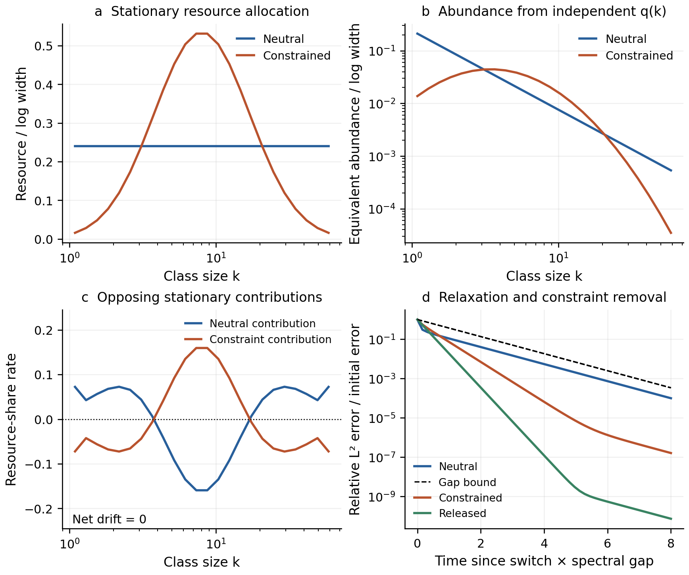

# Orthopolity: a general law of resource allocation

**A natural-law proposal, physical realizations and cosmic implications**

> Research manuscript, revised 11 November 2026. Detailed derivations, complete
> comparisons and analysis histories are retained in the [supporting material](supporting-material.md).
> Empirical studies include exploration, locally frozen forecasts and retrospective
> reanalyses; none is externally preregistered. Authorship and submission declarations
> require agreement before submission.

## Abstract

We propose orthopolity as a natural law of resource allocation: nature tends to
distribute resources equally among their concentrations, relative to a physically
specified comparison measure. The idea is simple: if each larger object contains
more resource, fewer such objects are needed to hold the same class total.
Abundance times mean resource per object is therefore constant in a neutral
allocation. We distinguish this physical proposal from exact accounting and show
how exchange dynamics, radiative transport and thermal modes realize specified
equalities. Logarithmic and linear size classes give different predictions;
independently specified constraints predict departures. Restricted combinations
of resources also allow predictions to transfer between environments. Retained
tests include accurate engineered allocation, chemical and language transfers,
biological budget closure, and failed forecasts that constrain the explanation.
These establish conditional results, not a common neutral regime across all
natural populations examined. A supporting cosmological conjecture asks when
cosmic assembly produces equal mass per logarithmic mass interval. Orthopolity
organizes these mechanisms and interpretations around one question: what
physically determines how much resource each class receives?

## 1. The law in one picture

**We propose orthopolity as a natural law: nature tends to distribute resources
equally among concentrations of those resources, relative to a physically
specified comparison measure.** This develops the proposal of Fabbri and
Oliveira Jr. (2017) and Fabbri (2024). Its general physical reach is proposed;
the exact results below hold under their stated conditions.

Consider objects of sizes $k=1,2,4,8$, with resource requirement $q=k$. Give each
of these four classes 8 units. The classes can then contain 8, 4, 2 and 1 objects,
respectively. The same total appears in four different arrangements:

$$8\times1=4\times2=2\times4=1\times8=8.$$

There are fewer expensive objects, but each class holds the same resource.
Figure 1 makes the distinction visible: the blocks differ; the stacks have
identical heights. Here the four equally weighted classes form a logarithmic
size grid, so the example is **log-orthopolic**. The total budget is 32.

*Figure 1. Count times resource per object gives resource per class. Each outlined
block is one object; its height is its resource requirement. The four geometric
classes have counts 8, 4, 2 and 1 and costs 1, 2, 4 and 8, respectively. Each
class holds 8 units. This prescribed finite log-orthopolic allocation illustrates
the relation; it is not an observation or a continuous-bin approximation.*

## 2. From the picture to a prediction

### 2.1 The allocation relation

For any class, the starting equation is ordinary accounting:

$$\text{number of objects}\times\text{mean resource per object}
=\text{resource in the class}.$$

To compare a continuous range of sizes $k$, let $\mu$ specify the class measure,
$n_\mu=dN/d\mu$ the number density and $\bar q(k)>0$ the arithmetic mean resource
per object of size $k$. The resource density is

$$\mathcal O_\mu(k)=\frac{dR}{d\mu}=\bar q(k)n_\mu(k). \tag{1}$$

A **neutral orthopolic allocation** has equal resource per unit of that measure:

$$\mathcal O_\mu(k)=C>0,\qquad n_\mu(k)=\frac{C}{\bar q(k)}. \tag{2}$$

Thus doubling the mean cost halves abundance per equal measure. If a domain has
positive finite measure $\mu(D)$ and resource budget $B$, then $C=B/\mu(D)$.
Equation (1) accounts for resource; equation (2) adds the allocation claim.

One sufficient allocation condition is symmetry among equally weighted classes.
If their shares are exchangeable and total resource is fixed, each class has
the same expected share. Fixed positive costs then give inverse-cost expected
counts. Such a symmetry must be physically justified. Equal expected shares
also allow unequal snapshots, as when the entire budget occupies a randomly
chosen class. The observation must match the claimed average.

### 2.2 The measure changes the exponent

The measure answers a concrete question: what makes two classes equally wide?
The intervals 1--2, 2--4 and 4--8 have equal logarithmic width, whereas 1--2,
2--3 and 3--4 have equal linear width. They make different allocation comparisons.

Write $p_\mu=n_\mu/N$ for a normalized object density over a finite population.
If cost is $\bar q(k)=q_0(k/k_0)^\alpha$, with fixed positive reference values
$q_0,k_0$, equation (2) becomes

$$(k/k_0)^\alpha p_\mu(k)=c,\qquad c=\frac{C}{Nq_0}.$$

This is the familiar $k^\alpha p(k)=\text{constant}$ relation when size is
expressed in units of $k_0$: an increasing cost and a decreasing frequency
exactly compensate. Its meaning depends on what density $p$ denotes.
Let $p_{\rm lin}$ be density per $dk$ and $p_{\log}$ density per $d\ln k$.
They obey $p_{\log}=k p_{\rm lin}$, so

| Allocation hypothesis | Constant resource density divided by $N$ | Predicted density per linear size |
|---|---|---|
| Linear-orthopolic: equal resource per $dk$ | $\bar q p_{\rm lin}$ | $p_{\rm lin}\propto k^{-\alpha}$ |
| Log-orthopolic: equal resource per $d\ln k$ | $\bar q p_{\log}=\bar q k p_{\rm lin}$ | $p_{\rm lin}\propto k^{-(\alpha+1)}$ |

For example, if the resource per object is its mass, equal mass per logarithmic
mass interval predicts density proportional to mass to the power $-2$.
Equal mass per linear mass interval predicts power $-1$. Neither measure follows
from conservation alone. Choosing a measure after seeing the distribution can
manufacture equality; a physical prediction fixes it independently.

The inverse-cost relation also applies to costs that are not powers. We call
its normalized profile a *natural (orthopolic) distribution*. Power laws are
one member of this resource-based family, not its definition.

### 2.3 What accounting makes unavoidable

For a nonnegative additive resource, a budget $B$ can support at most $B/t$
disjoint objects each requiring at least
$t>0$ units. If a complete partition has $N$ objects with mean resource
$\bar q$, then $N\bar q=B$ exactly. This remains true at every complete level
of a nested hierarchy, even when the objects within a level differ in size.

These levels repeatedly describe the same whole. Coexisting disjoint classes
instead divide it: class $j$ holds $N_j\bar q_j=Bf_j$, with
$\sum_jf_j\le1$. Equal shares require an additional condition on the fractions
$f_j$. The finite-capacity bound and complete-partition identity are
mathematically unavoidable; equal allocation among competing classes is a
further physical statement. Supporting S1.1 and S1.4 derive coverage and overlap
corrections. This accounting result is neither a log-orthopolic nor a
linear-orthopolic size-allocation test by itself.

### 2.4 Resources, constraints and a second prediction

A resource can combine several requirements. A useful explanation must specify
how those requirements combine and how the environment affects allocation.
Write the constrained relation as

$$\bar q_{\mathrm{eff}}(k)n_\mu(k)=C a(k),\qquad a(k)>0. \tag{3}$$

Here $a$ represents independently determined opportunities or constraints.
For example, absorption predicts how radiative power decreases with distance.
An unrestricted $a$ fitted to the observed profile explains nothing further.
Likewise, choosing a cost proportional to $1/n_\mu$ always constructs neutrality.
An exploratory resource reading becomes evidence through independently fixed
inputs and a second prediction that passes.

Restricted resource families make such predictions possible. Suppose effective
cost is $Q=Q_0\prod_\ell X_\ell^{\theta_\ell}$, measured constituents scale as
$X_{s\ell}\propto k^{D_{s\ell}}$ in environment $s$, and an independently known
constraint is $a_s\propto k^{-v_s}$. For log-orthopolic allocation, a linear-size
count density $k^{-(1+\alpha_s)}$ then implies

$$b=D\theta,\qquad b_s=\alpha_s-v_s. \tag{4}$$

In words, independently measured changes in the requirements constrain how the
abundance exponent can change. Two calibration environments with constituent
rows $(1,1)$ and $(1,2)$ identify two shared exponents; a third row $(2,1)$
predicts $b_3=3b_1-b_2$. The third abundance slope is a separate target.

This assumes deterministic class requirements or suitable size-independent
residual moments. Nonlinear combinations also need a fixed physical partition;
they need not preserve resource under subdivision. Supporting S1.2--S1.5 retain
the feasibility, averaging, identification and uncertainty results, including
synthetic checks. The contribution follows established inverse-problem methods
(Keshavarz et al., 2011; Habeck, 2014) and depends on the physical inputs and
their successful transfer.

## 3. Ideal mechanisms and physical realizations

The orthopolic umbrella connects several kinds of explanation. Complete
accounting establishes how counts and mean resource relate across descriptions.
An allocation mechanism explains how class shares are selected. A constrained
realization predicts how a specified process changes those shares. An exploratory
interpretation proposes a resource reading that still needs an independent test.
Their mathematical compatibility gives a common language; their evidential
roles remain different.

The following realizations show what each explanation actually equalizes.
Ecological size-spectrum studies provide a direct precedent for comparing
biomass across size classes (Sheldon et al., 1972; Gaedke, 1993; Hatton et al.,
2021). Detailed proofs and complete comparisons remain in supporting material.

### 3.1 Equalization, a constraint and its removal

Resource flows from classes with higher resource per unit reference width to
classes with lower resource per width. When every class is connected, this
exchange selects the neutral allocation.

Consider fixed classes with positive reference widths $w_i$, fixed costs $q_i$,
and resource stocks $R_i$ totaling $B$. Symmetric conductances
$g_{ij}=g_{ji}\ge0$ on a connected graph give the exchange current

$$J^0_{ij}=g_{ij}\left(\frac{R_i}{w_i}-\frac{R_j}{w_j}\right).$$

The resulting dynamics conserve resource and relax to
$R_i^0=Bw_i/\sum_jw_j$, hence $N_i^0=R_i^0/q_i$. This mechanism selects
equal resource per the declared measure. It establishes the neutral relation
within its specified model class.

A fixed class preference $V_i$ changes the transition rate from $i$ to $j$ to
$(g_{ij}/w_i)\exp[\max(V_i-V_j,0)]$. Detailed balance then gives

$$R_i^V=\frac{Bw_i e^{-V_i}}{\sum_jw_j e^{-V_j}}.$$

The added rates balance the neutral current at constrained equilibrium. Removing
the preference preserves the current state and predicts relaxation toward the
neutral allocation. The generator's spectral gap supplies a convergence bound;
disconnected components equalize only within their separately conserved budgets.
These are established reversible-chain tools applied to resource classes (Levin
and Peres, 2017).

Whole-object assembly gives asymptotic inverse-cost mean counts under symmetric saturated
channels, with finite-budget corrections; mass-action kinetics on the same
conserved budget instead favor larger objects in the worked case (supporting S3.10).
Hidden link storage and nonproportional storage curves can also alter relaxation
or intervention outcomes despite matched baseline measurements
(supporting S5.19 and S3.7).

Passive RC networks cannot have positive imaginary impedance at their driven
port. An independent forecast including magnetic storage gives 12.2% curve
error, below a 39.4% lower bound for any passive RC network. Physical capacitance
weights define this one-circuit test; the extension preserves energy accounting
(supporting S5.20), without uniquely establishing the general law.

*Figure 2. Resource exchange on fixed logarithmic size classes. The model predicts
neutral allocation, a nonuniform constrained equilibrium and recovery after release.
The detailed model, spectral bounds and finite-packet simulations are in the
[supporting material](supporting-material.md) and [model report](class-exchange.md).*

### 3.2 Gravity and radiating waves: what geometry preserves

A larger enclosing surface can receive the same total flux while the flux per
unit area falls. This is another inverse relation, but its objects and measure
are surfaces and geometry rather than a size distribution of material objects.

For a Newtonian gravitational field $\mathbf g$, the Poisson equation
(Chao, 2014) gives the integral relation
$\oint_S\mathbf g\cdot\mathbf n\,dA=-4\pi GM_{\mathrm{enc}}$.
Every enclosing surface outside a fixed isolated source has the same inward
field flux. Spherical symmetry additionally gives $|\mathbf g|=GM/r^2$:
the conserved enclosed-source quantity is distributed over an area growing
as $r^2$. Inward flux per solid angle is $d\Psi/d\Omega=GM$, an explicit
angular equality. This is a geometric realization with specified symmetry. The field
flux is not an energy throughput, and nested surfaces are not independent
mass or energy shares. Distributed sources change $M_{\mathrm{enc}}(r)$;
nonspherical sources need not give uniform local fields. The
[gravity derivation](gravity-realization.md) states the resource interpretation,
energy-accounting limits and departures.

For radiation, Poynting's balance gives a physical energy throughput. In steady
transparent transport outside a source, the enclosing-surface power is
$P(r)=L$; isotropic emission gives flux density $L/(4\pi r^2)$. With outgoing
radial propagation at speed $c$, disjoint shell stocks instead satisfy
$dU=(L/c)dr$. Equal radial thicknesses hold equal energy. Equal logarithmic
radial intervals have $dU/d\ln r=Lr/c$, so they do not have equal stocks.
The geometry identifies which comparison realizes equality.

An independently specified absorbing medium gives

$$P(r)=L\exp\left[-\int_{r_0}^{r}\kappa(s)\,ds\right].$$

It predicts the departure from constant radiative throughput and accounts for
energy deposited in matter. If absorption is removed while the source continues,
the response travels outward and the transparent profile returns by
$(r-r_0)/c$. The [transport derivation](physical-realizations.md) gives the full
space-time response and its assumptions (Poynting, 1884; Haus and Melcher, 1989;
Condon and Ransom, 2016). Neither the gravitational nor radiative inverse-square
law alone determines the abundance of objects at different sizes.

### 3.3 Thermal modes: a derived limitation of neutral allocation

In classical equilibrium, each harmonic mode has the same mean energy.
Quantum physics predicts where that equality breaks down.

A finite set of classical harmonic modes in canonical equilibrium has mean
energy $k_BT$ per mode. Counting modes is the independently defined measure, neither log-orthopolic nor
linear-orthopolic size allocation;
instantaneous mode energies can fluctuate. For electromagnetic excitation energy
above the ground state, quantization gives instead

$$\bar\epsilon_\nu=\frac{h\nu}{e^{h\nu/(k_BT)}-1}
=k_BT\frac{x}{e^x-1},\qquad x=\frac{h\nu}{k_BT}.$$

The classical plateau is approached for $x\ll1$ and suppressed for $x\gg1$.
The departure follows from the allowed states before a spectrum is observed.
Mode density $8\pi\nu^2/c^3$ then gives Planck's spectrum. Equal energy per
mode is therefore different from equal energy per frequency interval (Planck,
1901; Tong, n.d.).

Our [FIRAS calculation](thermal-radiation.md) converts 43 microwave-background
channels to excitation energy per mode. Their $x=1.199$--$11.262$ range illustrates
quantum suppression. The source already incorporates a fitted blackbody template
and correlated errors (Fixsen et al., 1996); this is established observational
evidence, not new independent confirmation. Supporting material retains the
derivation and spectrum.

For nonequilibrium cantilevers (Fontana and Bellon, 2023), colder-condition
damping calibrates a quadratic local-loss model before hotter fluctuations are
evaluated. Ten of eleven mode fits are physically admissible. On their 26
targets, mean absolute error is 74.0 K versus 78.9 K for uniform local loss.
Large mode errors and one negative-dissipation fit show that global damping
does not identify adequate spatial energy weights. Supporting S5.13 retains
the retrospective design, calibration conventions, plotting omission and all
failures. Inherited equilibrium normalization precludes a new equipartition test.

### 3.4 Cell growth and division: a measurable constraint envelope

Cells spend different amounts of time at different sizes. Birth and division
therefore determine which sizes are available and how they are represented.

Let cell mass grow as $\dot x=gx$, with common deterministic $g$, conservative
symmetric binary division and no death. For a balanced asynchronous population
and stationary lineage of physiologically equivalent daughters, growth-fragmentation
theory gives $p_L(x)=xp_P(x)/E_P[x]$ (Genthon, 2022). Birth mass $B$ and division
mass $D$ satisfy $D\overset d=2B$. The cycle-crossing fraction is

$$H(x)=P(B\le x<D)=F_B(x)-F_B(x/2),$$

and the population law becomes

$$p_P(x)=\frac{2H(x)}{E[B^{-1}]x^2},\qquad
\frac{x^2p_P(x)}{E_P[x]}=\frac{H(x)}{\ln2}.$$

The right-hand side is normalized mass allocation per logarithmic size.
Where every cycle crosses an interval, $H=1$ and allocation is log-orthopolic.
Fixed birth mass $b$ gives $2b/x^2$ on $[b,2b)$; variable births can remove
the plateau. Independent birth observations predict the envelope. Growth noise,
asymmetric division or lineage selection require a different observation model
([derivation](cell-division.md)).

## 4. What the empirical comparisons establish

### 4.1 Predictions and comparisons

Forecasts fix objects, measure, costs, constraints and observation models.
The [registry](run-registry.md) and supporting material retain inputs, comparisons
and prior access. Identities on the same data provide no independent
confirmation; later freezing does not erase exposure.

| Evidence | Established outcome | Scope or unresolved limitation |
|---|---|---|
| Runtime resource competition | Calibrated costs predict allocation and a thread-count intervention | One engineered mechanism |
| Size-selected algal cultures | Equal-biovolume forecasts transfer across selection treatments | Separate populations; binding resource unmeasured |
| Language transfers | Entropy predicts speech; symbolic costs transfer across genres | Known capacity account; physical cost and neutrality unidentified |
| Bacterial transfers | Population means and independent burden assays inform forecasts | Variability and fitted workload correction fail |
| Cantilever energy transfer | Some damping-to-energy forecasts transfer | Small average gain; spatial-loss and observation failures remain |
| Chemical / sediment constraints | Independent inputs improve transfer forecasts | Established rivals perform similarly or better; finite-accuracy limits |
| Chemostat nutrient pulse | Frozen two-budget reweighting fails | Constraint response needs explanation |
| Flare and lake geometry | Predicted exponents excluded or equivalence unresolved | Measurement and dependence affect interpretation |
| Seismicity | Qualification or estimator prerequisites fail | No real b--dimension comparison established |

*Table 1. Different studies answer different questions. Detailed results, all rival
forecasts and observation limitations are retained in supporting material.*

### 4.2 An allocation mechanism with an intervention

In a Python runtime that serializes execution, matrix-kernel workers compete
for CPU time. Independently calibrated job costs predict both resource shares
and inverse-cost job shares. Across 16 allocation trials, maximum CPU-share
errors are 0.0035--0.0063 and job-share total-variation errors are 0.0021--0.0124.
Replacing the largest-class worker with a second smallest-class worker predicts
the allocation change within 0.0078. A linear-cost alternative
($q_j\propto k_j$) has job-share errors of 0.126--0.273
([intervention report](dimensionality-intervention.md); supporting S5.1).

The baseline uses logarithmic matrix-size classes; the intervention changes
independently counted worker opportunities. This demonstrates a physical
implementation of a conditional resource law in one engineered system.

### 4.3 Biological closure, predicted means and failed responses

Separately regrown *Dunaliella* cultures provide an intuitive inverse relation:
a 10.4-fold difference in mean cell volume accompanies only a 2.5% difference
in geometric mean total biovolume between large- and small-selected treatments.
Frozen equal-biovolume forecasts beat fitted-size and equal-count alternatives
in both held-out folds. Control capacity is 18--21% higher, and the limiting
resource is unmeasured (Malerba et al., 2018; supporting S5.3). This is budget
closure across separate populations, not log-orthopolic or linear-orthopolic
allocation among coexisting sizes.

The cell-cycle mechanism predicts separate *E. coli* population means within
2.72% and 0.447%, but overpredicts variability and fails its joint criterion
(Gangan and Athale, 2017; supporting S5.6). A close mean alone is insufficient.

A nutrient-pulse forecast fails in twelve held-out chemostat polycultures:
none of the forecasts appreciably improves on persistence. A retrospective
bound then shows that arbitrary C:N price changes still cannot explain 17/36
redistributions in eight vessels under transferred quotas and fixed opportunities
(Wojcik et al., 2025; supporting S5.3/S5.10). That result rules out one proposed
repair. Independent phosphorus assays also fail their count transfer; field
partial-stock compatibility lacks allocation eligibility; and a fitted protein
workload correction loses to direct transfer (supporting S5.11/S5.12/S5.16).
These are species, cell or family comparisons, neither size-allocation measure.

### 4.4 Information costs and language transfer

Information per syllable supplies a cost in an established speech-capacity
account. Seven Indo-European languages calibrate its information rate; written
corpus estimates then predict speech duration in ten languages from eight other
families. Language log MAE is 0.0741, lower than all four declared rivals, and
all frozen criteria pass (Coupé et al., 2019; supporting S5.17). Individual
errors can cancel within a language, and the comparison does not identify a
metabolic resource or neutral word allocation.

For written word types, a letter/phoneme composite improves held-out genres
over a letter-only power, but lexical frequencies perform better and cost
shares remain uneven (supporting S5.5; Piantadosi et al., 2011). Both studies
use specified counting measures, neither log-orthopolic nor linear-orthopolic
size allocation. They assess the transfer of resource interpretations.

### 4.5 Geometric predictions and observation limits

Geometric resources give predictions that can fail. The primary aftershock
productivity exponent, 0.63 with 95% interval $[0.51,0.71]$, excludes the
rupture-area and moment predictions; changing counting windows substantially
changes the result. Flare ribbon density exponent 3.163, $[2.962,3.457]$,
excludes both proposed exponents, 2 and $7/3$. Their registered rules retain
inconclusive model-choice verdicts alongside these exclusions.

For lake radii, correcting physical geometry and spatial dependence removes
the initial positive equivalence conclusion. The corrected survival exponent
is 1.859, with basin-bootstrap interval $[1.785,1.924]$: exact 2 is excluded,
while the frozen equivalence band $[1.9,2.1]$ remains overlapped. These are
log-orthopolic resource hypotheses with declared coordinate transformations;
complete comparisons are in supporting S5.7.

The seismic b--dimension test stops before a real hypothesis comparison:
only six Southern California sequences qualify, against a required ten, and
the Italian estimator prerequisite fails 45 of 56 required synthetic scenarios.
These are observation boundaries, not evidence deciding between resource models.

### 4.6 Independent constraints and transport kinetics

Other transfers test independently specified constraints. Pure-gas calibration
predicts chemical competition in 45 mixture conditions: shared-capacity Langmuir
MAE is 0.247 mmol/g, versus 0.620 without competition and 0.243 for established
IAST. The practical tolerance passes, but only 39/90 component predictions lie
within reported uncertainties (Wedler et al., 2024; supporting S5.14).

Independent grain shape and wall corrections reduce error when transferring
from narrow to wider channels, but separate old-material fits perform better
and low-flux errors exceed fourfold (Deal et al., 2026; supporting S5.15).
Earlier membrane pairs predict later chamber contrasts with error of 4.23%
of each pair's initial total, close to empirical interpolation at 4.14% on
the same scale; broad stock uncertainty prevents
interpreting non-rejection as proof of conservation (Benstead et al., 2026;
supporting S5.18). Species/vacancy counting, material-balanced counting and
compartment volume define these respective measures, neither log-orthopolic
nor linear-orthopolic size allocation. The transfers support specific physical
accounts without uniquely favoring the general law over established theories.

## 5. Learning from validity, departures and failure

Normal aggregation and natural allocation offer complementary explanations.
Gaussian normality can emerge from additive aggregation under central-limit
conditions; we call the
normalized neutral inverse-resource profile (2) a *natural (orthopolic)
distribution*. Homogeneous geometric requirements yield power-law abundance under the
declared log-orthopolic or linear-orthopolic measure. Both mechanisms can coexist:
canonical harmonic modes have Gaussian coordinates and equal mean energies
under mode-counting measure, neither log-orthopolic nor linear-orthopolic size allocation.
Supporting S3.9 gives the conditions and distinguishes physical scaling relations
from sampled distributions.

Uniform spatial cuts of a homogeneous rod conserve every realization's mass
and give labeled fragments equal expected mass. Yet expected resource per
logarithmic fragment mass is nonconstant. This analytic failure of log-orthopolic
size-class equality follows before outcomes, without fitting a correction.
Supporting S3.8 gives the finite-bin prediction and distinguishes this partition
mechanism from exchange under class symmetry.

Departures have distinct explanations. Changing the measure or sampling alters
the reported distribution; independently specified absorption, quantum levels
or adsorption affinities predict physical constraints. Chemostat reweighting,
bacterial variability and cantilever spatial-loss errors instead remain failed
forecasts until a revised explanation succeeds on additional evidence.

Unavailable tests cannot decide between resource models, and unrestricted
resource fitting supplies an identity (section 2.4). Further comparisons should
change independently specified constraints so that rivals predict different
allocation profiles, relaxation rates or cross-environment contrasts such as (4).

## 6. Cosmic implications and the proposed law

Stars in galaxies give a direct extension of the opening picture. Let $k$ be
stars per galaxy and $\phi(k)=dN_{\rm galaxies}/dk$. Log-orthopolic allocation
of stellar number predicts $k^2\phi(k)=C$: each decade of galaxy richness holds
the same total number of stars. A fixed inventory also obeys
$N_{\rm galaxies}\bar k=N_{\rm stars}$ exactly, but that accounting identity
does not select the richness distribution.

Supporting S6 develops a **cosmological conjecture**: gravitational assembly can
produce finite regimes of approximately equal mass per logarithmic host-mass
interval. The conditional mechanism combines steady material current with equal
residence time per logarithmic interval. Independently known current and drift
would predict the mass-function normalization as well as its slope. Published
galaxy, stellar and simulated subhalo distributions provide exploratory signs
and departures. Stellar mass remains distinct from star number, and this
allocation constant is not the cosmological constant $\Lambda$.

The natural-law proposal unifies a simple relation with several physical routes
to it. Exact accounting establishes its mathematical core; specified symmetries
and dynamics establish allocation realizations. Independently known constraints
and restricted resource combinations produce further predictions. The retained
empirical comparisons establish conditional successes, failures and observation
boundaries. The next scientific task is to predict both where neutral allocation
occurs and how it changes, using information beyond the distribution it explains.

## Data and code availability

The repository and [run registry](run-registry.md) retain sources, configurations,
forecasts, algorithms and outcomes, including failures. The
[supporting material](supporting-material.md) contains detailed derivations,
complete comparisons and study reports. Source licences are in
[data/NOTICE.md](../data/NOTICE.md). Published FIRAS reconstruction and bacterial
figure summaries remain identified as such.

The make all target verifies inputs, runs tests and regenerates the original
analyses; later studies have separate offline targets in their reports.
The make paper target builds both manuscripts; registry-verify checks retained
study references. The supplied 2017 manuscript was inspected privately and is
not redistributed.

## References

Benstead, C., Politi, M., Bergsman, D., and Pozzo, L. (2026). An automated sampling workflow for
parallel long-term membrane diffusion cell testing. *Digital Discovery*.
<https://doi.org/10.1039/D5DD00523J>.

Chao, B. F. (2014). On the gravitational energy associated with Earth's changing
oblateness. *Geophysical Journal International*, 199(2), 800–804.
<https://doi.org/10.1093/gji/ggu301>.

Condon, J. J., and Ransom, S. M. (2016). *Essential Radio Astronomy*.
Princeton University Press. Chapter 2, radiation and absorption.
<https://www.cv.nrao.edu/~sransom/web/Ch2.html>.

Coupé, C., Oh, Y. M., Dediu, D., and Pellegrino, F. (2019). Different languages,
similar encoding efficiency: Comparable information rates across the human
communicative niche. *Science Advances*, 5, eaaw2594.
<https://doi.org/10.1126/sciadv.aaw2594>.

Deal, E., et al. (2026). Generalizing sediment transport experiments from narrow
flumes to wider channels. *Journal of Geophysical Research: Earth Surface*, 131.
<https://doi.org/10.1029/2025JF008712>. Data: <https://doi.org/10.20383/103.01325>.

Fabbri, R., and Oliveira Jr., O. N. (2017). *A simple model that explains why inequality
is ubiquitous*. Supplied manuscript dated 17 March 2017, 13 pp.; publication status unverified.

Fabbri, R. (2024). The Orthopolity cosmological principle and the Natural distribution law.
Author's essay, 14 August. <https://ttm.github.io/2024/08/14/power.html>.

Fixsen, D. J., Cheng, E. S., Gales, J. M., Mather, J. C., Shafer, R. A., and Wright,
E. L. (1996). The cosmic microwave background spectrum from the full COBE FIRAS data set.
*The Astrophysical Journal*, 473, 576. <https://doi.org/10.1086/178173>.
Source article: <https://arxiv.org/abs/astro-ph/9605054>.

Gaedke, U. (1993). Ecosystem analysis based on biomass size distributions: A case study
of a plankton community in a large lake. *Limnology and Oceanography*, 38, 112–127.
<https://doi.org/10.4319/lo.1993.38.1.0112>.

Gangan, M. S., and Athale, C. A. (2017). Threshold effect of growth rate on
population variability of *Escherichia coli* cell lengths.
*Royal Society Open Science*, 4, 160417. <https://doi.org/10.1098/rsos.160417>.

Fontana, A., and Bellon, L. (2023). Linking fluctuation and dissipation in spatially
extended out-of-equilibrium systems. *Physical Review E*, **107**, 034118.
<https://doi.org/10.1103/PhysRevE.107.034118>. Data:
<https://doi.org/10.5281/zenodo.7640708>.

Genthon, A. (2022). Analytical cell size distribution: lineage-population bias
and parameter inference. *Journal of the Royal Society Interface*, 19, 20220405.
<https://doi.org/10.1098/rsif.2022.0405>. Revised exposition:
<https://arxiv.org/abs/2206.06146v2>.

Hatton, I. A., Heneghan, R. F., Bar-On, Y. M., and Galbraith, E. D. (2021). The global
ocean size spectrum from bacteria to whales. *Science Advances*, 7, eabh3732.
<https://doi.org/10.1126/sciadv.abh3732>.

Habeck, M. (2014). Bayesian approach to inverse statistical mechanics.
*Physical Review E*, 89, 052113. <https://doi.org/10.1103/PhysRevE.89.052113>.

Haus, H. A., and Melcher, J. R. (1989). *Electromagnetic Fields and Energy*.
Prentice-Hall. Section 11.2, Poynting's theorem.
<https://web.mit.edu/6.013_book/www/chapter11/11.2.html>.

Keshavarz, A., Wang, Y., and Boyd, S. (2011). Imputing a Convex Objective Function.
*Proceedings IEEE Multi-Conference on Systems and Control*, 613–619.
<https://stanford.edu/~boyd/papers/imputed_objective.html>.

Levin, D. A., and Peres, Y. (2017). *Markov Chains and Mixing Times*, second edition,
with contributions by E. L. Wilmer. American Mathematical Society.
<https://pages.uoregon.edu/dlevin/MARKOV/mcmt2e.pdf>.

Malerba, M. E., Palacios, M. M., and Marshall, D. J. (2018). Do larger individuals cope with
resource fluctuations better? An artificial selection approach. *Proceedings of the Royal
Society B*, 285, 20181347. <https://doi.org/10.1098/rspb.2018.1347>. Data:
<https://doi.org/10.5061/dryad.4mh47r7>.

Piantadosi, S. T., Tily, H., and Gibson, E. (2011). Word lengths are optimized for
efficient communication. *Proceedings of the National Academy of Sciences*,
108(9), 3526–3529. <https://doi.org/10.1073/pnas.1012551108>.

Planck, M. (1901). Ueber das Gesetz der Energieverteilung im Normalspectrum.
*Annalen der Physik*, 309, 553--563. <https://doi.org/10.1002/andp.19013090310>.

Poynting, J. H. (1884). On the transfer of energy in the electromagnetic field.
*Philosophical Transactions of the Royal Society of London*, 175, 343–361.
<https://doi.org/10.1098/rstl.1884.0016>.

Sheldon, R. W., Prakash, A., and Sutcliffe, W. H., Jr. (1972). The size distribution of
particles in the ocean. *Limnology and Oceanography*, 17, 327–340.
<https://doi.org/10.4319/lo.1972.17.3.0327>.

Tong, D. (n.d.). *Statistical Physics*. University of Cambridge Part II Mathematical
Tripos lecture notes, Sections 1.3, 2.2.1 and 3.2. Accessed 6 October 2026.
<https://davidtong.org/pdfs/teaching/statistical-physics/statphys.pdf>.

Wedler, C., Ferre, A., Azzan, H., Danaci, D., Petit, C., and Pini, R. (2024).
Binary adsorption equilibria of three CO2+CH4 mixtures on NIST reference zeolite Y
(RM 8850) at temperatures from 298 to 353 K and pressures up to 3 MPa.
*Journal of Chemical & Engineering Data*, 69, 4216--4229.
<https://doi.org/10.1021/acs.jced.4c00358>.

Wojcik, L. A. M., Pfennig, A., Flamm, S., Klauschies, T., Rosenbaum, B., Weithoff, G., and
Gaedke, U. (2025). Top-down control and species composition influence nonlinearly the
short-term response of experimental food webs to a nutrient pulse perturbation. *Proceedings
of the Royal Society B*. <https://doi.org/10.1098/rspb.2025.1969>. Data:
<https://doi.org/10.5061/dryad.51c59zwj5>.
