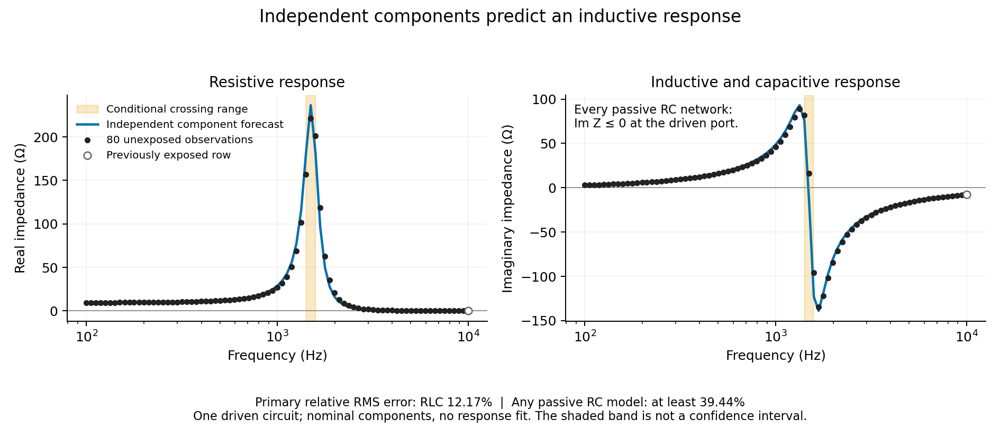

# Independent circuit forecast: a measured boundary of first-order exchange

25 October 2026. The fixed component forecast predicts the response regime and
outperforms a mathematical lower bound for every passive resistor–capacitor
network at the driven port. **This establishes a useful boundary of the
restricted exchange mechanism, not the general law uniquely.** Magnetic storage
requires an additional state. Complete energy accounting remains valid.

Capacitance weights charge increments; the energy metric includes both
capacitance and inductance. These are different physical quantities. This is
neither log-orthopolic nor linear-orthopolic size allocation. Log-frequency
quadrature weights the error score, not a size-class resource claim.

## Forecast and results

The actual fabricated circuit in [Danzer, Plank and Rüther (2024)](https://doi.org/10.1016/j.xcrp.2024.102091)
is a series resistor/inductor branch in parallel with a capacitor. The
[original data](https://doi.org/10.5281/zenodo.10794584) supply 81 frequencies.
Supplementary Table S3 independently specifies `R≈9.7 Ω` by multimeter,
`L=5 mH±1%` and `C=2.2 µF±10%`. No target parameter is fitted.

| Fixed comparison | Primary result, 80 unexposed rows |
| --- | --- |
| Sign predictions outside the Table S3 component envelope | **78/78 agree**; 2 frequencies unclassified |
| Signs robust to both printed resistance-unit scenarios | **77/77 agree**; 3 frequencies unclassified |
| Observed positive-to-negative sign-change bracket | **1496.4342–1584.4927 Hz**, unique; no exact zeros |
| Predicted crossing, conditional on `R=9.7 Ω` | Nominal **1485.739 Hz**; component range **1406.852–1577.083 Hz** |
| Full-curve normalized complex RMS error | **0.121650** |
| Minimum possible error for any passive RC network | **at least 0.394413** |
| Fixed alternative `R=0.0097 Ω` curve error | **3.372860** |

The observed crossing bracket overlaps the component range, so the frozen
sampled-resolution rule passes. **The nominal crossing itself lies below the
observed bracket**; the result is not exact point agreement. All 80 responses,
including the two unclassified by the primary sign envelope, enter the curve
score. No window or near-resonance point was removed after access.

Forty-eight of the 80 primary observations have positive imaginary impedance,
ranging from **2.9198 to 88.9713 Ω**. The fixed nominal curve has less error than
even the optimistic RC-class lower bound, a reduction of at least **69.16%**.
This comparison does not depend on selecting or fitting a particular RC circuit.
The all-81-row descriptive result is nearly identical: error 0.121638 versus
RC lower bound 0.394371, with 79/79 classified signs agreeing. The additionally
included row was exposed before the forecast and is never counted as withheld.

## Why the comparison discriminates

For any passive resistor-capacitor network, collocated current injection and
voltage measurement give `Z=bᵀ(G+iωC)⁻¹b`. With `G,C` symmetric positive
semidefinite and an admissible port, `Im Z=−ωv*Cv≤0`. Additional passive RC
states cannot produce a positive imaginary part at this port. Noncollocated
transfer measurements do not satisfy the same theorem.

The independently specified circuit instead predicts

$$Z(\omega)=\frac{R+i\omega L}{1-\omega^2LC+i\omega CR}.$$

This standard circuit law gives the crossover above. The complex-error lower
bound follows because every candidate constrained to `Im Z≤0` has pointwise
error at least `max(Im Zobs,0)`. Integrate squared errors by the same trapezoid
rule in log frequency, then normalize by the observed squared complex norm
and take the square root.
This half-plane bound is deliberately optimistic: not every pointwise
projection onto that half-plane can be realized by one physical RC network.

The added state obeys `C Vdot=Iin−IL`, `L ILdot=V−R IL` and
`Edot=V Iin−R IL²` for `E=(C V²+L IL²)/2`. The source injects power and the
resistor dissipates it. The data support this established constitutive
extension over the restricted passive RC class; they do not show failed energy
conservation, a closed equal-allocation experiment, or uniquely new physics.

## Exposure, uncertainty and provenance

The [protocol](rlc-boundary-protocol-2026-10-24.md), config, implementation and
independent verifier were committed/pushed at **62d1313**. Frequency-specific
forecasts and their verification were committed/pushed at **e9e7845** before
the other 80 numerical impedances were decoded. All three columns of published
component fits and the qualitative resonant response were known. A schema reader
inadvertently printed the first string-encoded impedance; primary exclusion of
row 0 was fixed before all remaining access. A synthetic sentinel test now checks
that inventory output never emits string content. This is a local retrospective
forecast sequence, not global blindness or external preregistration.

Table S2 and the archive print milliohms whereas the component-specific Table
S3 says ohms, measured with a multimeter. The primary choice and alternative
were fixed before response access. The alternative's poor quantitative result
does not retroactively supply the missing measurement uncertainty. Resistance
uncertainty is unspecified, and printed component tolerances are not probability
distributions. The crossover envelopes are conditional scenario ranges, not
confidence intervals. No instrument-error model, repeat circuit or independent
replication is available; no statistical rejection or population claim is made.

Eleven synthetic checks cover state equations, energy accounting, the RC sign
identity, shared nullspaces, noncollocated outputs, tolerance extrema, changed
signs, multiple crossings, encoding inconsistency and independent computation.
The verifier uses a separate two-state linear solve, admittance roots and
explicit quadrature loops: **254 numerical comparisons**, maximum absolute
difference **2.27e−13**, with independent exact sign/count/bracket checks.
Source redundant encodings agree at the fixed tolerance; complex strings are
rounded relative to numeric fields, with maximum discrepancy **5.66e−5 Ω**.
Source phase is radians. Original files and their hashes remain unchanged.
Independent Decimal parsing and MATLAB binary decoding match **486 numeric
JSON/MAT values**, **81 complex MAT values** and **243 released values** exactly.
The original MAT's opaque object prevented the earlier header-only inventory,
but ordinary numeric arrays are readable after release. No sign was changed.

## Reproduction and next discriminating step

`make rlc-boundary PY=build/main-venv-2026-10-09/bin/python` verifies the original
bytes, replays inventory, sealed forecasts, results, independent verification
and figure. `make all` includes this replay. Registry records distinguish the
one-circuit result from a new experimental collection.

The contribution is a physically specified applicability test: additional
diffusive storage can remain in the same RC class, while reversible inductive
storage requires a different state equation. The next useful empirical step
is a separate component or topology intervention with independently measured
storage and instrument uncertainty. The
[thermal candidate](physics-source-followup-2026-10-24.md) remains stopped at
missing sensor coordinates and boundary records. Further fitting these exposed
circuit responses would be exploratory, not a new independent prediction.
