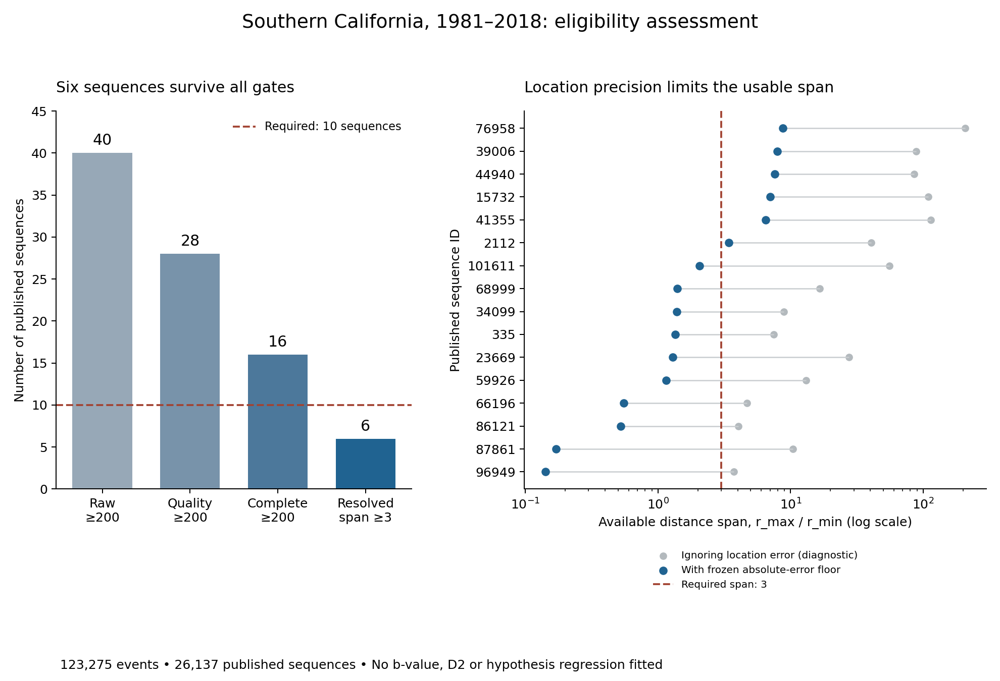

# Earthquake qualification: six sequences pass; ten required

The Southern California catalogues are available and the frozen qualification
has run. **Six sequences pass all eligibility gates, below the registered
minimum of ten.** The comparison of b=D2/2 with b=1 therefore stops before
estimating either response. This is inconclusive because the observational
design is insufficient; it provides no preference between the two hypotheses.
The territory reading refers to resource per **d ln rupture length**.

| Necessary condition, in order | Sequences remaining |
|---|---:|
| At least 200 published events | 40 |
| At least 200 after location/event-quality filtering | 28 |
| At least 200 above the frozen completeness rule | 16 |
| Distance interval spans a factor of at least 3 after the location-error floor | **6** |
| Required before any b/D2 comparison | **10** |



## Sources and prospective choices

The [published 1981–2018 catalogue](https://zaliapin.github.io/pubs/ZBZ_JGR2020_data.txt)
contains 123,275 events in 26,137 sequences. Membership follows the published
largest-event index without reclustering, merging or splitting. The source is
[Zaliapin and Ben-Zion (2020)](https://doi.org/10.1029/2018JB017120).
All event IDs join uniquely to the matching 634,252-event relocated catalogue
from [SCEDC](https://service.scedc.caltech.edu/ftp/catalogs/hauksson/Socal_DD/),
`hs_1981_all_comb_K4_A.cat_so_SCSN_v01`, associated with
[Hauksson, Yang and Shearer (2012)](https://doi.org/10.1785/0120120010).
Published latitude, longitude, depth and magnitude agree exactly with that source.

Three full downloads are pinned in the
[acquisition manifest](../data/seismic-regional/2026-10-09/acquisition.json):
the published labels (13.31 MB), their matching source (98.94 MB), and the newer
1981–2025 regional catalogue (152.81 MB). The last is retained for future work
and contributes no observations to this calculation. All byte counts and SHA256
digests pass. The raw files remain local and can be restored from publisher URLs.

The [execution supplement](seismic-qualification-protocol-2026-10-10.md),
[config](../configs/seismic_qualification_2026-10-10.json), parsers, qualification
code and 22 checks were committed as **`6ae7a8c` before real completeness or
distance-range calculations**. Structural source counts and the original
synthetic validation were already known and disclosed. This is a local Git
freeze, not an externally timestamped registration. The original hypotheses,
200-complete-event threshold, factor-three distance span and ten-sequence
minimum remain unchanged. The approximately 1,000/3,000 events needed in the
earlier planar/volumetric simulations were not imposed as extra hard thresholds.

## What limits the calculation

Quality filtering retains 96,441 events. It requires cross-correlation locations,
earthquake types `le` or `eq`, and finite positive absolute horizontal and vertical
errors below the declared placeholder cutoff. The ledger retains every event,
including exclusions and overlapping reasons. One published clock record has
minute=60; it remains flagged and retained because this calculation uses the
published memberships and does not use event times.

For each candidate sequence, completeness is rounded MAXC+0.2, bounded by the
source's magnitude floor. Sixteen have enough complete events. Their median
quadrature absolute-error proxies range from **0.447 to 4.757 km**. With the
registered three-error lower radius and upper radius of one tenth of the
90th-percentile pair distance, only six have a factor-three span:

| Published sequence ID | Complete events | Mc | Available span |
|---|---:|---:|---:|
| 2112 | 365 | 2.4 | 3.415 |
| 15732 | 1,154 | 2.3 | 7.032 |
| 39006 | 1,095 | 2.4 | 7.943 |
| 41355 | 6,048 | 2.4 | 6.498 |
| 44940 | 1,147 | 2.4 | 7.603 |
| 76958 | 2,537 | 2.4 | 8.754 |

The hypocentre cap is 3,000; the location-error median uses all complete events.
Every sampled ID is retained. The ten failed ranges remain in the ledger.
Ignoring errors would admit all sixteen, but this was frozen as a diagnostic
only and cannot justify a response fit.

This error convention is conservative rather than a complete uncertainty model.
Absolute standard-error estimates lack covariance information; shared translation
errors can cancel within a relocation component. All sixteen complete sequences
span multiple waveform/processing components, so the within-component relative
errors cannot simply replace their absolute errors. The finding is about this
specified observation model, not proof that these earthquakes can never support
a dimension estimate.

Two other limits would remain even if more sequences qualified. Published
membership depends on magnitude as well as time and distance, so fixed external
labels do not provide magnitude-independent geometry. Also, preferred catalogue
magnitudes are not homogeneous Mw, and this source has no magnitude-type column.
The [SCSN catalogue history](https://scedc.caltech.edu/about/BSSA_2010_Hutton_SCSN_cat.pdf)
describes these magnitude distinctions. A physical test of the moment-based
conversion would need independently justified calibration. No D2 contrast,
regression slope, or hypothesis interval is claimed here.

## Verification and reproduction

The [result](../results/seismic-qualification-2026-10-10/result.json),
[event table](../results/seismic-qualification-2026-10-10/event-selection.csv),
[all-sequence ledger](../results/seismic-qualification-2026-10-10/cluster-ledger.csv)
and [range details](../results/seismic-qualification-2026-10-10/range-details.json)
preserve the complete selection trail. The
[independent verification](../results/seismic-qualification-2026-10-10/verification.json)
recomputes every quality flag, all 28 completeness thresholds, all 16 distance
ranges, and both capped samples using the original coordinate/range functions.
Retained bounds match exactly under round-trip CSV decoding. A separate review
reproduced the same six IDs, with discrepancies below 9×10⁻¹⁶ km under ordinary
CSV decoding. Neither verification calls response estimators.

All **464 repository tests pass**; the pre-execution and full-suite logs are
retained with the result. Runtime and package versions are in `execution.json`.
The calculation finished on 10 October in Europe/Rome (9 October 23:00 UTC).

```bash
make install PY=python3.11
make restore-seismic-sources PY=python3.11  # only needed if raw files are absent
make seismic-qualification PY=python3.11
make seismic-qualification-registry registry-verify PY=python3.11
```

Reproduction writes to `build/reproductions/seismic-qualification`, preserving
the retained result. Source restoration is the only network stage. The registry
stores source/config snapshots, derived tables, diagnostics and hashes; its raw
catalogue verification is separate because those large files are ignored by Git.

The next useful seismic step is an independently justified catalogue or covariance
model with enough qualifying sequences and a defensible magnitude scale. At
least four additional qualifying sequences would be necessary with this cohort,
but still would not establish the required D2 contrast. Loosening the observed
error or cluster rules to force a fit would require a disclosed new study and
would not complete this registered comparison.
