# Supporting material for Orthopolity: a general law of resource allocation

**Accounting proofs, physical derivations, observation models and complete comparisons**

Prepared 10 October 2026; revised 12 October 2026 as a companion to
[the main article](paper.md).
This document preserves the substantive technical material of the article at
source commit **`f137d4efb050ccfcb5c5f814d32da651c645421c`**, supplemented by
its existing study reports. This is an editorial reorganization, with the
Dunaliella treatment/control and log-change interpretations corrected explicitly.
No frozen input, protocol, forecast, registry entry or numerical output is changed.
The general-law claim and the ambition to establish it are retained; each theorem,
physical realization, simulation and empirical comparison keeps its stated scope.

The comparison measure is part of every allocation statement. Except where a
linear, mode-counting or word-type measure is explicitly specified, the size
applications concern resource per logarithmic size, **log-orthopolic allocation**.
Natural-system observations, engineered measurements and simulations are
identified separately. A local Git freeze records execution order; it does not
establish external preregistration or erase prior exposure.

Contents:

- [S1. Accounting, composites and identification proofs](#s1-accounting-composites-and-identification-proofs)
- [S2. Measures, ensembles and counterexamples](#s2-measures-ensembles-and-counterexamples)
- [S3. Exchange dynamics and physical derivations](#s3-exchange-dynamics-and-physical-derivations)
- [S4. Exploratory sources, methods and results](#s4-exploratory-sources-methods-and-results)
- [S5. Frozen forecasts, full comparisons and eligibility](#s5-frozen-forecasts-full-comparisons-and-eligibility)
- [References](#references)

Each study's linked report remains the route to its exact source files,
configuration, archived algorithms and retained results. Figures and tables
below use independent S labels; they reuse retained presentation artifacts.

## S1. Accounting, composites and identification proofs

The physical resource measure, the class comparison measure, and the object partition have distinct roles. The following definitions and proofs state those roles before inverse inference.

### S1.1. Objects, resources, finite capacity and complete hierarchies

Let $k$ be a positive size coordinate on a finite domain $D=[a,b]$, with $0<a<b<\infty$.
Choose a reference measure $\mu$, with $0<\mu(D)<\infty$, for the classes being compared.
Let $n_\mu(k)=dN/d\mu$ denote object abundance and $\bar q(k)=E[q\mid k]>0$ the conditional
arithmetic mean of an additive resource per object. Then

$$\mathcal O_\mu(k)=\frac{dR}{d\mu}=\bar q(k)n_\mu(k). \tag{S1}$$

For an observed class, the corresponding identity is simply
$\sum_i q_i=N_{\rm class}\bar q_{\rm class}$. Resources may be a standing stock, such as
biomass, or an accumulated event quantity over a declared observation period. The latter
is not a stock resident in a size class, and neither is a flux through size classes.
Additivity is needed for (S1); a dynamical conservation law is not.

Define the **neutral allocation form of orthopolity relative to $\mu$**, denoted $O_\mu$, by

$$\mathcal O_\mu(k)=C>0\quad\text{for }\mu\text{-almost every }k\in D. \tag{S2}$$

This is an assumption about the neutral allocation, rather than a claim that every
constrained system has this profile. It gives $n_\mu=C/\bar q$. Equivalently, if an object
is sampled uniformly from the population, its size density with respect to $\mu$ is

$$p_N(k)=\frac{1}{Z\bar q(k)},\qquad
Z=\int_D\frac{d\mu(k)}{\bar q(k)}<\infty. \tag{S3}$$

Sampling instead in proportion to the resource held gives
$p_R(k)=\bar q(k)p_N(k)/E_N[q]=1/\mu(D)$. Thus uniform resource-weighted size and inverse-cost
object abundance are equivalent statements, under the same reference measure. This is an
accounting equivalence, not a derivation of the allocation assumption. The count, resource
total, and constants also satisfy $N=CZ$ and $R=C\mu(D)$. For a finite observed population,
the identity is exact for class totals; a smooth density is a population model or approximation.

**Finite capacity and complete hierarchies.** The box intuition has an exact formulation
that precedes the neutral-allocation postulate. Let $\nu$ be a nonnegative additive
resource measure on a system $\Omega$, with $B=\nu(\Omega)\in(0,\infty)$.
This physical resource measure differs from the class comparison measure $\mu$.
For disjoint units $A_i\subseteq\Omega$ with requirements $q_i=\nu(A_i)$,
finite additivity gives the capacity bound

$$N_{\ge t}=\#\{i:q_i\ge t\}\le B/t,\qquad t>0.$$

Indeed, $tN_{\ge t}\le\sum_{q_i\ge t}q_i\le B$. Equal units of resource
$q$ therefore obey $Nq\le B$, with equality when they exhaust the budget.
In a cube of side $L$, cubes of side $\ell=L/m$, for integer $m\ge1$,
tile it with $N=m^3$ and $N\ell^3=L^3$. For other side lengths an aligned
grid accommodates $\lfloor L/\ell\rfloor^3$ cubes; the volume bound remains
$N\ell^3\le L^3$. The grid construction is not a claim about optimal packing
under arbitrary shape or orientation constraints.

**Hierarchy theorem.** Suppose each level $j$ consists of a nonempty finite collection of
positive-resource sets $A_{ji}$, and define the multiplicity
$m_j(x)=\sum_i\mathbf 1_{A_{ji}}(x)$. If $N_j$ is their number and
$\bar q_j=N_j^{-1}\sum_i\nu(A_{ji})$, then

$$N_j\bar q_j=\int_\Omega m_j(x)\,d\nu(x)=B\gamma_j,
\qquad \gamma_j=B^{-1}\int_\Omega m_j\,d\nu.$$

This follows by integrating the finite sum of indicator functions. In particular,
if every level completely partitions the same resource, $m_j=1$ almost
everywhere and

$$N_j\bar q_j=B,\qquad
\frac{N_j}{N_h}=\frac{\bar q_h}{\bar q_j}.$$

No equal-size assumption is needed for the mean-resource relation. Nesting between
levels is allowed: a unit cube, its eight half-side subcubes, and its sixty-four
quarter-side subcubes each account for one unit of volume at their respective levels.
Within-level disjointness permits the same matter to be represented at several
resolutions. Summing $J$ complete levels counts that underlying resource $J$ times;
it does not create $J$ independent physical budgets. Hollow containers likewise
require a choice between enclosed volume and wall material.

For incomplete disjoint levels, $\gamma_j$ is the occupied resource fraction;
for overlapping descriptions it is the mean multiplicity and may exceed one.
The exact ratio becomes $N_j/N_h=(\gamma_j/\gamma_h)(\bar q_h/\bar q_j)$.
Thus independently measured coverage supplies a quantitative correction to the
inverse relation. A bound $m_j\le M$ also gives $N_{j,\ge t}\le MB/t$.
Arbitrary overlap with no multiplicity bound has no finite capacity bound based
on $B$ alone. Complete partitions fix the comparison structurally: one full
accounting per level. Equal steps in logarithmic size arise when each refinement
uses the same scale factor.

This theorem establishes an exact inverse count--mean-resource relation across
complete descriptions. A mixed population's size classes usually account for
different parts of one budget. Writing their fractions as $f_j$ gives
$N_j\bar q_j=Bf_j$, with $\sum_jf_j\le1$ for disjoint classes. Equal
allocation across equally weighted classes then means equal $f_j$; finite
capacity alone leaves those fractions undetermined. Sections S2.2 and S3.1 supply
additional symmetry and dynamical conditions for that allocation statement.
Additivity and multiplicity accounting are established mathematics (Tao, 2011);
inverse-scale covering counts also have a developed geometric theory (Bishop and
Peres, 2017). The [capacity and hierarchy derivation](resource-capacity.md)
gives proofs, examples, and the implications for composite resources.

### S1.2. Effective resources with coupled requirements

An effective resource can combine several constituent requirements. For an object $i$,
let $q_{i\ell}$ be its requirement or assigned amount of constituent $\ell$, and let
$s_\ell>0$ be a fixed reference quantity in the same units. A general representation is

$$Q_i=Q_0 F\!\left(\frac{q_{i1}}{s_1},\ldots,
\frac{q_{im}}{s_m};z_i,\theta\right)>0,\qquad
\bar q_{\mathrm{eff}}(k)=E[Q_i\mid k].$$

Here $Q_0$ supplies effective-resource units, $z_i$ records relevant environmental or
historical conditions, and $\theta$ specifies the combination rule. The reference scales
are declared independently of the observed abundance. Nonlinearity can represent
complementarity, substitution, saturation, or a bottleneck. The arithmetic class mean is
taken after combining the constituent resources. In general,
$E[F(X,Y)\mid k]\ne F(E[X\mid k],E[Y\mid k])$; for $F(X,Y)=XY$, the difference
is the conditional covariance. Marginal resource means alone may therefore miss a
dependence that changes the effective resource.

The quantity $R_{\mathrm{eff}}=\sum_i Q_i$ is additive over the declared object
partition, so equation (S1) still holds with $\bar q=\bar q_{\mathrm{eff}}$.
Nonlinearity within an object does not prevent this additivity across objects. It does,
however, make the physical partition important: $\sum_iF(\mathbf q_i)$ need not equal
$F(\sum_i\mathbf q_i)$. Splitting or merging objects can change the effective total.
Nor is $R_{\mathrm{eff}}$ automatically conserved merely because some constituent
resources are conserved. The proposed combination must be interpreted as a physical
stock, an accumulated requirement, an opportunity cost, or another explicitly defined
quantity, with its appropriate balance law.
Collective interaction terms must be included or assigned to objects through a physical
accounting convention without double counting.

The hierarchy theorem yields a further restriction when an effective resource is
required to describe the same underlying constituents at different resolutions.
Let $F$ be homogeneous of degree $h$, and split a parent constituent vector into
$r$ identical proportional parts. Their effective total is

$$\sum_{i=1}^{r}Q_0F(\mathbf x/r)
=r^{1-h}Q_0F(\mathbf x).$$

Exact level invariance in this proportional subdivision therefore requires $h=1$
for a positive parent and $r>1$. For product resources this becomes
$\sum_\ell\theta_\ell=1$. Arbitrary heterogeneous subdivision is more
restrictive: invariance requires $F(\mathbf x+\mathbf y)=F(\mathbf x)+F(\mathbf y)$.
If all nonnegative constituent vectors are admissible, $F$ is finite and nonnegative,
and $F(0)=0$,
additivity implies $F(\mathbf x)=\sum_\ell c_\ell x_\ell$ with $c_\ell\ge0$.
Thus nonlinear composition remains admissible on a physically specified object
partition, or on a restricted family of constituent proportions, while invariance
under every regrouping imposes a linear form. The supporting derivation proves
these statements. They give a consistency test for applying a composite at several
resolutions, without imposing homogeneity on resources defined only at one level.

For algae, nutrient stocks per cell and available nutrient budgets differ; light can be
an absorbed photon flux or an exposure integrated over a specified interval. Space and
water can be capacities or environmental conditions. Time can enter through residence
time, growth history, or an additive occupancy such as cell-hours; elapsed time is not
automatically a divisible stock. For cities, land, buildings and people are stocks,
while food, water, energy and money can involve stocks, flows and exchanges over the
chosen observation horizon. The combination rule must respect those distinctions and
avoid counting a resource twice along a supply chain.

Multiple physical budgets remain explicit. For fixed class requirements, feasibility
can require $\sum_jN_jq_{\ell j}\le B_\ell$ for each constituent $\ell$.
A scalar $Q$ does not generally replace all these inequalities. A specified optimization
model can produce a local effective cost $Q_i=\sum_\ell\lambda_\ell q_{i\ell}$,
with dimensionally compatible scarcity prices $\lambda_\ell$, but those prices and
their range of validity belong to that model (Boyd and Vandenberghe, 2004). A bottleneck gives another illustration:
for a separately supported population of identical objects with fixed requirements,
$N_{\max}=\min_\ell B_\ell/q_\ell$ depends nonlinearly on the budgets. It does
not prescribe the allocation among competing types. These are ways to derive candidate
effective quantities; neither scalarization nor feasibility by itself proves neutrality.

A simple nonlinear candidate is a product of positive normalized inputs,
$Q=Q_0\prod_\ell(q_\ell/s_\ell)^{\theta_\ell}$. If constituent requirements
are deterministic functions $q_\ell(k)\propto k^{d_\ell}$, then
$Q(k)\propto k^{d_{\mathrm{eff}}}$ with
$d_{\mathrm{eff}}=\sum_\ell\theta_\ell d_\ell$. Under logarithmic neutrality
the abundance density exponent is $1+d_{\mathrm{eff}}$. For differentiable $F$,
the more general local elasticity is

$$\frac{d\ln Q}{d\ln k}
=\sum_\ell\frac{\partial\ln F}{\partial\ln(q_\ell/s_\ell)}
\frac{d\ln q_\ell}{d\ln k},$$

when the environment and parameters are fixed and $F$ has no further explicit size
dependence. Varying constituent elasticities or interactions can generate curvature.
This chain rule for specified functions is distinct from a claim that independent random
resource distributions have additive tail exponents. With heterogeneous objects, the
class mean $E[Q\mid k]$ remains the relevant quantity. The
[effective-resource derivation](effective-resources.md) develops the finite-bin and
heterogeneity implications.

### S1.3. Inverse identification and illustrative urban and linguistic targets

The law can be used in two directions. Given a resource model and a specified constraint,
it predicts abundance. Given an abundance profile, it supplies information about the
effective resource required by that allocation. Write a positive constrained profile as

$$\bar q_{\mathrm{eff}}(k)n_\mu(k)=C a(k),\qquad a(k)>0,$$

where neutrality has $a=1$. The class-exchange example below derives $a=e^{-V}$ from
prescribed kinetics. In other systems $a$ needs its own mechanism or conditional
assumption; an arbitrary fitted factor is not an explanation. On a domain with positive
population density, inversion gives

$$\frac{\bar q_{\mathrm{eff}}(k)}{a(k)}=\frac{C}{n_\mu(k)},\qquad
\frac{\bar q_{\mathrm{eff}}(k)/a(k)}{\bar q_{\mathrm{eff}}(k_0)/a(k_0)}
=\frac{n_\mu(k_0)}{n_\mu(k)}.$$

Thus a distribution identifies the shape of effective resource divided by its constraint
factor, conditional on the comparison measure. With the constraint profile and its
normalization specified, an independently measured effective-resource total fixes
$C=R_{\mathrm{eff}}/\int_Da\,d\mu$. Without further information, the constituents and their combination are
not unique; multiplying both $\bar q_{\mathrm{eff}}$ and $a$ by the same positive
size-dependent function leaves the prediction unchanged. This is a precise statement of
the inverse information available, not a reason to discard inverse inference. Measured
constituents, restricted combination families, and responses in different environments
can resolve parts of that ambiguity. Finite observed counts require a sampling model and
bin integration; a zero-count bin does not establish infinite physical cost.

**A constructive inverse example.** Prespecify $Q=Q_0X^{\theta_1}Y^{\theta_2}$
for positive normalized resources. In environment $s$, suppose independently measured
class requirements scale as $X_s\propto k^{d_{1s}}$ and $Y_s\propto k^{d_{2s}}$,
with no within-class variation, and a known constraint has
$V_s=v_s\ln(k/k_0)$. A Pareto count density $dN/dk\propto k^{-(1+\alpha_s)}$
then implies

$$\alpha_s-v_s=\theta_1d_{1s}+\theta_2d_{2s}.$$

Two environments with scaling vectors $(1,1)$ and $(1,2)$ and corrected exponents
$\alpha_s-v_s$ equal to $1.5$ and $2$ identify $\theta_1=1$ and
$\theta_2=1/2$. The inferred nonlinear resource is $Q=Q_0X\sqrt Y$.
A third environment with scaling vector $(2,1)$ predicts
$\alpha_3=2.5+v_3$ without refitting. The two independent scaling directions identify
the composition within this family; the third supplies a test. The remaining scale
$Q_0$ requires an independent anchor. These are algebraic illustrative values, not
measurements. They show how allocation distributions can reveal a composite resource
and generate further predictions.

**Identification and transfer.** More generally, assume a common product composition
$Q=Q_0\prod_{\ell=1}^m X_\ell^{\theta_\ell}$, a fixed logarithmic comparison
measure, independently characterized constituent exponents $D_{s\ell}$, and known
constraint slopes $v_s$. Assume deterministic class requirements or write
$X_{s\ell}=A_{s\ell}(k/k_0)^{D_{s\ell}}U_{s\ell}$ with a finite positive
residual moment $E[\prod_\ell U_{s\ell}^{\theta_\ell}\mid k,s]$ independent
of size. Then the corrected abundance slopes satisfy

$$b=D\theta,\qquad b_s=\alpha_s-v_s.$$

For a compatible $b$ and unrestricted real exponents, $\theta$ is unique
precisely when $D$ has full column rank. With deficient rank, the compatible parameters are
$D^+b+\ker D$, provided $b$ lies in the column space. A new environment with
constituent row $d_*$ still has an identified prediction if and only if
$d_*$ lies in the row space of $D$, for unrestricted real exponents.
Restrictions such as nonnegative exponents can reduce this ambiguity further;
they must be included in the identification problem.

Every vector $\ell$ satisfying $\ell^\top D=0$ supplies a parameter-free
cross-environment consequence,

$$\ell^\top b=0.$$

For the three environments above, this gives $b_3=3b_1-b_2$. The third slope
is predicted before its abundance data are used. Thus additional environments
can test a shared effective resource even when an individual profile supplies
only a conditional reconstruction.

**Proof and precision.** Two parameter vectors give the same calibration slopes
exactly when their difference lies in $\ker D$. A target row gives the same
prediction for all such vectors exactly when it annihilates that kernel.
Multiplication by a left-null vector gives the stated contrast. For full column
rank and fixed $D$, least-squares recovery obeys

$$\|\widehat\theta-\theta\|_2
\le \frac{\|\delta b\|_2}{\sigma_{\min}(D)}.$$

Near-proportional constituent scalings can therefore make a formally unique
composition practically unstable. A contrast with slope-error covariance
$\Sigma_b$ has variance $\ell^\top\Sigma_b\ell$, including correlations
between environments. Uncertain constituent scalings, constraint corrections,
and size-dependent heterogeneity require their own error model; this fixed-design
bound does not cover them. These statements apply standard linear inverse-problem
results to the allocation model. The supporting
[identification analysis](inverse-resources.md) supplies generalized least squares,
partial identification, and reproducible synthetic recovery and transfer checks.

**City sizes.** Upper city-size tails often admit Pareto descriptions, with Zipf scaling
as a prominent special case. The result depends on how cities and the fitted size range
are defined. Eeckhout (2004) found a lognormal description across the full US Census
Places distribution; Ioannides and Skouras (2013) found a lognormal body and Pareto tail,
with an estimated tail exponent of 1.25 for their preferred Census Places model. These
findings concern different parts and definitions of an urban system, not a requirement
that every city-size observation follow exact Zipf scaling.

Let $S$ denote population per city and $n(S)$ the positive number density of cities per
unit population interval. For a Pareto survival exponent $\alpha$,
$N(\ge S)\propto S^{-\alpha}$ and $n(S)\propto S^{-(1+\alpha)}$;
ranked size scales as $S(r)\propto r^{-1/\alpha}$. Finite upper cutoffs modify
the survival and rank relations near the largest city. Under logarithmic allocation,

$$\frac{dN}{d\ln S}=S n(S),\qquad
\frac{\bar q_{\mathrm{eff}}(S)}{a(S)}\propto S^\alpha.$$

Exact Zipf scaling has $\alpha=1$. If $a=1$ and population is the resource,
$q(S)=S$, the relation expresses equal population in equal logarithmic city-size
intervals. If the operative resource is a nonlinear combination of urban requirements,
the same observation instead constrains that combination to have approximately linear
net scaling, after accounting for $a$. This is the proposed orthopolity interpretation
and an inverse target for measurements of land, infrastructure, energy, water and other
inputs. The exponent alone does not identify the combination or assign a probability to
its causal explanation. Existing proportional-growth mechanisms, including Gabaix's
(1999) model with lower-size regularization, provide comparisons that the resource
account should explain, connect to, or distinguish. No new city dataset is analyzed here.

**Language.** A word type is a distinct lexical form and a token is one occurrence.
For type $w$, let $f_w$ be its token frequency and $L_w$ its letter count.
The corpus expenditure of letters on that type is $f_wL_w$. Equality on a
counting measure over word types would therefore imply $f_w\propto L_w^{-1}$.
Zipf's rank-frequency relation $f(r)\propto r^{-\zeta}$ concerns a different
coordinate. In a smooth rank approximation, letter expenditure per logarithmic
rank is $r f(r)L(r)\propto r^{1-\zeta}L(r)$. For $\zeta=1$, tokens per log
rank are constant, while letters per log rank vary with word length. Finite
rank groups require the actual sums, including tied frequencies.
Length classes introduce another distinction: if $M_L$ vocabulary types have
length $L$, equal letter expenditure per type gives total token count at that
length proportional to $M_L/L$. The number of available types is part of the
comparison measure; a peaked word-length distribution alone does not negate
this conditional allocation.

The abbreviation tendency, in which frequent words are shorter, motivates
resource candidates without fixing either exponent or comparison measure.
Contextual information is also relevant to word length (Piantadosi, Tily and
Gibson, 2011). A declared candidate is
$Q_w=Q_0L_w^{\theta_L}P_w^{\theta_P}$, where $P_w$ is a dictionary phoneme
count. Under neutral type allocation it predicts
$p_\theta(w)\propto L_w^{-\theta_L}P_w^{-\theta_P}$ on a fixed vocabulary.
Section S5.5 applies this inverse model across text genres. Letter and phoneme
counts are symbolic resource candidates; sonority, duration and acoustic
energy need separate measurements and constitutive definitions.

### S1.4. Additional proofs and sharpness limits

**Layer-cake identity and the finite-domain restriction.** In a finite inventory,

$$\sum_iq_i=\int_0^\infty N_{>t}\,dt.$$

Integrate $q_i=\int_0^\infty\mathbf1_{\{t<q_i\}}\,dt$ and exchange the
finite sum and integral. A continuum approximation $N_{>t}=C/t$ on $[a,b]$
contributes $C\ln(b/a)$ to the budget on that interval alone; it cannot
extend over an unbounded logarithmic range with finite resource. The sharper
integer capacity bound is $N_{\ge t}\le\lfloor B/t\rfloor$. It is attainable
only when the budget and feasibility restrictions admit that many units.

**Boundary occupancy and a mixed-size counterexample.** An aligned grid of
side-$\ell$ cubes in a side-$L$ box in $d$ dimensions has occupied fraction

$$\phi(\ell)=\left(\frac{\ell\lfloor L/\ell\rfloor}{L}\right)^d,
\qquad N=\phi(\ell)L^d/\ell^d.$$

Complete use of the total volume does not imply equal class budgets. Tile a
unit cube with 64 quarter-side cubes and subdivide one into eight eighth-side
cubes. The final inventory has 63 units holding $63/64$ of the volume and
eight units holding $1/64$. Both classes coexist, fill the volume without
overlap, and have unequal resource totals. The construction specifies the
missing allocation premise; it does not contradict the capacity bound.

Define uncovered fraction and excess multiplicity by

$$g_j=\frac{\nu(\{x:m_j(x)=0\})}{B},\qquad
o_j=\frac1B\int_\Omega(m_j(x)-1)_+\,d\nu(x).$$

Because integer-valued $m_j=\mathbf1_{\{m_j>0\}}+(m_j-1)_+$,

$$\gamma_j=1-g_j+o_j,\qquad
N_j\bar q_j=B(1-g_j+o_j).$$

For two nonempty levels the resulting prediction is

$$\frac{N_j}{N_h}
=\frac{\bar q_h}{\bar q_j}
\frac{1-g_j+o_j}{1-g_h+o_h}.$$

Incomplete disjoint coverage has $o_j=0$. Complete overlapping coverage
has $g_j=0$. A pointwise bound $m_j\le M$ gives the threshold bound
$N_{j,\ge t}\le\lfloor MB/t\rfloor$ by the capacity argument in S1.1.
Arbitrary repeated copies with no overlap bound can have arbitrarily
large counts while enclosing the same physical volume.

Coverage and overlap can be determined from independently specified geometry.
In that setting they supply a quantitative correction rather than a residual
named after observing an abundance curve. If they are computed solely from
the same count/resource accounting being compared, the relation is a
consistency identity; it provides no independent forecast.

**Proof of the arbitrary-subdivision restriction.** Assume every vector in $\mathbb R_+^m$
and every split into two such vectors are admissible, $F$ is finite and
nonnegative there, and $F(0)=0$. Invariance under every split or merge is
equivalent to

$$F(\mathbf x+\mathbf y)=F(\mathbf x)+F(\mathbf y).$$

It forces

$$F(\mathbf x)=\sum_{\ell=1}^m c_\ell x_\ell,\qquad c_\ell\ge0.$$

**Proof.** Additivity gives $F(\mathbf x)=\sum_\ell F(x_\ell\mathbf e_\ell)$.
For each axis $g_\ell(t)=F(t\mathbf e_\ell)$ is additive and nonnegative.
It is monotone since $g_\ell(t+s)-g_\ell(t)=g_\ell(s)\ge0$.
Rational arguments give $g_\ell(r)=r g_\ell(1)$; bounding a real argument
above and below by rationals gives $g_\ell(t)=t g_\ell(1)$.
Set $c_\ell=g_\ell(1)$.

Degree one is necessary but insufficient for arbitrary heterogeneous splits.
For $F(x,y)=\sqrt{xy}$, parents with vectors $(9,1)$ and $(1,9)$ each
contribute 3, while their merged vector $(10,10)$ contributes 10.
If attainable vectors are restricted to common constituent proportions,
a nonlinear homogeneous degree-one form can remain invariant on that
restricted family. The full-cone assumption must not be omitted.

This result preserves the programme's nonlinear resources while identifying
their physical domain. They can describe assembly-dependent requirements at
a specified object partition. Applying them across arbitrary partitions needs
additional interaction accounting or the additivity property above.
The restriction does not apply to the linguistic study merely because its
fitted product has a degree different from one: that study fixes word types
and makes no claim of invariance under arbitrary splitting and merging.

### S1.5. Constructed identification, transfer and uncertainty checks

Prespecify a dimensionless product resource
$Q=Q_0X^{\theta_1}Y^{\theta_2}$ and the logarithmic size measure. Deterministic
constituents scale as $X_s\propto k^{D_{s1}}$ and $Y_s\propto k^{D_{s2}}$.
The known allocation factor is $a_s(k)\propto k^{-v_s}$. A count density
$dN_s/dk\propto k^{-(1+\alpha_s)}$ therefore has corrected slope
$b_s=\alpha_s-v_s=D_{s1}\theta_1+D_{s2}\theta_2$.

| Environment | Constituent exponents | Known offset $v_s$ | Corrected slope $b_s$ | Abundance slope $\alpha_s$ | Role |
| --- | --- | --- | --- | --- | --- |
| 1 | $(1,1)$ | $0.15$ | $1.5$ | $1.65$ | Calibration |
| 2 | $(1,2)$ | $-0.10$ | $2.0$ | $1.90$ | Calibration |
| 3 | $(2,1)$ | $0.20$ | $2.5$ | $2.70$ | Held-out prediction |

*Table S1. Fixed environments in the constructed product-resource identification example.*

The first two rows recover $\theta=(1,1/2)$, or $Q=Q_0X\sqrt Y$.
Since $D_3=3D_1-D_2$, the prediction fixed without the third abundance slope is

$$b_3=3b_1-b_2,\qquad
\alpha_3=3(\alpha_1-v_1)-(\alpha_2-v_2)+v_3.$$

The scalar $Q_0$ is not identified by slopes. No resource amplitude or
conservation principle is inferred from its omission. The composition
is assumed shared across environments, while the known constituent scalings
and known constraint offsets change.

#### Correlated uncertainty and deliberate misspecification

Every estimated slope has Gaussian marginal standard error $0.02$. The
joint correlation is

$$\mathcal C=\begin{pmatrix}
1&0.35&0.20\\
0.35&1&0.40\\
0.20&0.40&1
\end{pmatrix},\qquad \Sigma_b=0.02^2\mathcal C.$$

The design and offsets are exact in this experiment. The calibration estimate
uses generalized least squares. Its analytic covariance is

$$\operatorname{Cov}(\widehat\theta)=
\begin{pmatrix}0.00144&-0.00078\\-0.00078&0.00052\end{pmatrix}.$$

For the held-out residual, $c=(-3,1,1)^\top$ gives
$\operatorname{Var}(r)=c^\top\Sigma_bc=0.0034$ and
$\operatorname{SE}(r)=0.0583095$. Retaining the correlations is essential:
the prediction uncertainty and held-out observation uncertainty cannot simply
be added as if independent. The reported intervals are centered on the
calibration prediction and assessed against the noisy held-out slope; they
include both sources of uncertainty. Coverage is unconditional across the
specified joint repetitions.

The run generates 20,000 independent joint error vectors with seed 20261006.
Each error vector is reused in a paired alternative where only the held-out
composition changes to $(1,0.8)$; its true $\alpha_3$ is then $3.0$ instead
of $2.7$. The same frozen calibration forecast is used for both scenarios.
No parameter is refitted to the third slope.

| Quantity | Analytic prediction | Seeded outcome |
| --- | ---: | ---: |
| Mean recovered $\theta_1$ | 1 | 0.999741 |
| Mean recovered $\theta_2$ | 0.5 | 0.500149 |
| Shared-model standardized residual mean | 0 | 0.009145 |
| Shared-model standardized residual variance | 1 | 1.011435 |
| Shared-model 95% interval coverage | 95% | 94.815% |
| Changed-composition standardized residual mean | 5.144958 | 5.154103 |
| Changed-composition two-sided rejection fraction | 99.9276% | 99.915% |

*Table S2. Analytic expectations and all 20,000 seeded repetitions under shared and changed composition.*

The Monte Carlo standard error of nominal 95% coverage is 0.1541 percentage
points. These results check the inference calculation under its declared
Gaussian model. The high rejection fraction is the power for one specified
alternative and one selected noise level; it does not establish general
sensitivity to changes in effective resources. In empirical work a failed
forecast could also arise from an incorrect offset, constituent measurement,
sampling model, or heterogeneity correction.

#### Partial identification and conditioning

With calibration rows $(1,1)$ and $(2,2)$, the data identify only
$\theta_1+\theta_2=1.5$. For example, $(1,0.5)$ and $(0.25,1.25)$ give
exactly the same two corrected slopes. The target row $(3,3)$ nevertheless
predicts $4.5$. A target row $(1,0)$ cannot be determined. The implementation
rejects unidentified components and targets instead of interpreting a
minimum-norm coefficient vector as a discovered physical composition.

Formal uniqueness also need not imply useful precision. Compare the original
calibration design to rows $(1,1)$ and $(1,1.0001)$, and perturb the second
corrected slope by $0.001$ in both cases:

| Design | Condition number | Coefficient change | Error norm | Fixed-design bound |
| --- | ---: | --- | ---: | ---: |
| Original distinct scalings | 6.8541 | $(-0.001,0.001)$ | 0.0014142 | 0.0026180 |
| Nearly proportional scalings | 40002.0 | $(-10,10)$ | 14.1421 | 20.0005 |

*Table S3. Precision loss when constituent scaling directions become nearly proportional.*

Both matrices have full column rank at the declared relative SVD threshold
$10^{-12}$. This separates rank from precision. The error bound is
$\|\delta b\|_2/\sigma_{\min}(D)$; the tests also verify attainment along
the weakest singular direction. The [derivation](effective-resources.md)
states a separate deterministic bound for perturbed constituent exponents,
but this run does not simulate or estimate error in $D$.

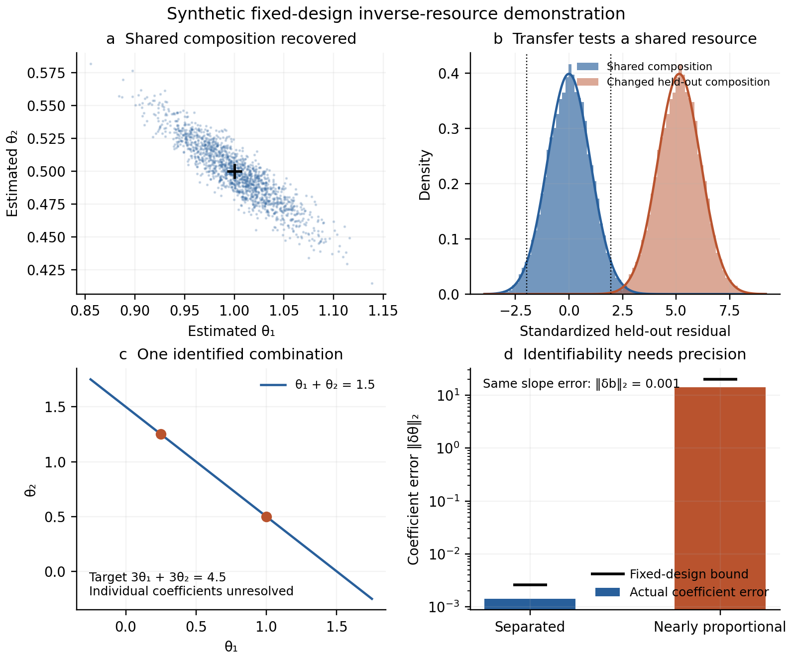

*Figure S1. Constructed inverse-resource recovery and transfer. The first panel displays 1,500 of 20,000 replicates; all replicates enter the tabulated checks. These are simulations, with no new natural-system observations.*

The [configuration](../configs/inverse_resources_2026-10-06.json), [retained summary](../results/inverse-resources/summary.json) and [source report](inverse-resources.md) preserve the design and all 20,000 repetitions. Analytic predictions were known during construction; their execution before random sampling is not an empirical holdout.

## S2. Measures, ensembles and counterexamples

These distinctions delimit what a distribution can establish without replacing the general-law claim with a single fitted exponent.

### S2.1. The comparison measure changes the exponent

Write $u=\ln(k/k_0)$ for a fixed reference size $k_0$. For
$\bar q(k)=q_0(k/k_0)^d$, with $d>0$, two different hypotheses give:

| Equal resource with respect to | Resource spectrum | Count density with respect to $dk$ |
|---|---|---|
| Linear size, $d\mu=dk$ | $\bar q(k)dN/dk=C$ | $dN/dk\propto k^{-d}$ |
| Logarithmic size, $d\mu=du=dk/k$ | $\bar q(k)dN/du=C$ | $dN/dk\propto k^{-(d+1)}$ |

*Table S4. Different hypotheses induced by linear and logarithmic size comparison measures.*

The second row follows because $dN/du=k\,dN/dk$. For biomass with $q=k=m$, the
predictions are consequently density exponents 1 and 2, respectively. The 2017 manuscript's
explicit uniform density over a linear wealth interval is not interchangeable with the
logarithmic convention used in the empirical analyses below. Adopting logarithmic classes
is a substantive specification, motivated by size-spectrum practice.

Logarithmic allocation is unchanged by changing size units or logarithm base, apart from a
constant density multiplier. It also survives $z=(k/k_0)^c$ for constant $c>0$, since
$d\ln z=c\,d\ln k$. It is not invariant under arbitrary nonlinear coordinates. In general,
$dR/dv=(dR/du)|du/dv|$. Choosing a transformation after observing $R$ can therefore manufacture
flatness; the coordinate and measure must be fixed independently.
More precisely, changing coordinates while carrying the same measure along
preserves the allocation statement. Replacing that measure by a uniform
measure in the new coordinate changes the hypothesis. The complete hierarchy
in Section S1.1 chooses its levels through the construction of the system;
that structural choice is separate from relabeling those levels.

Under $O_{\log}$ and the power-cost assumption, the slope of abundance per log interval is
$-d$, the ordinary density exponent is $d+1$, and the survival function on $[a,b]$ is

$$P(K\ge k)=\frac{k^{-d}-b^{-d}}{a^{-d}-b^{-d}}. \tag{S4}$$

The familiar survival exponent $d$ and rank-size exponent $1/d$ are approximations away
from the upper boundary, not exact finite-domain identities. For an unbounded domain with
$d>0$, count can be finite while logarithmically uniform resource has infinite total.
Finite boundaries are essential to a finite-budget interpretation.

### S2.2. Allocation postulates and accounting counterexamples

**Resource symmetry as a candidate law.** The proposed rationale is that, absent restrictions
favouring particular resource costs, allocation should not distinguish those costs. A natural
law can adopt this as a physical postulate without a deeper mechanistic derivation. One
precise sufficient formulation uses $K$ declared classes with fixed positive per-object
costs $q_i$, allocations $R_i=q_iN_i$, and fixed total $\sum_iR_i=R>0$. If the probability
law of $(R_1,\ldots,R_K)$ is invariant under exchanging allocations across the fixed classes,
then symmetry and the sum give

$$E[R_i]=R/K,\qquad E[N_i]=R/(Kq_i).$$

This postulate selects resource allocations as the symmetric quantities; symmetry of counts
would give a different prediction. It is stronger than conservation and is not implied by
an unspecified absence of constraints. Indivisible objects may require an approximation
where exact exchangeability is infeasible. The class measure also matters: with cost itself
as coordinate, equal resource per $dq$ predicts $dE[N]/dq\propto q^{-1}$, whereas equal
resource per $d\ln q$ predicts $dE[N]/dq\propto q^{-2}$. Transformation-based treatments
of indifference likewise require a specified symmetry (Jaynes, 1968); an inferential rule
does not itself establish a physical law.

Equal expectation does not establish equal snapshots or relaxation toward equality. In a
divisible-resource idealization, assigning all resource to one uniformly chosen class has
the required symmetry and unequal allocation in every realization. Time-average equality
needs an additional condition connecting time averages to expectations or its own empirical
postulate. A test must therefore specify what "tends to allocate" means and identify
eligible systems through conditions independent of their observed allocation. A deeper
mechanism is optional for an empirical law; the scope and predictive evidence are not.

**Conservation does not imply equal allocation.** On any bounded logarithmic domain,
$\mathcal O(u)=A\exp(\beta u)$ can be normalized to the same resource total for every
$\beta$. Conservation fixes the integral and leaves its shape undetermined. Likewise,
maximum entropy over finitely many equally weighted object classes, constrained by a mean
cost, yields $p_j\propto\exp(-\lambda q_j)$. Different reference measures or constraints
give different distributions (Jaynes, 1957; Visser, 2013).

**Equipartition does not imply a power law without a cost law.** If
$\bar q(k)=q_0\exp(k/k_0)$, then $O_{\log}$ gives
$dN/du\propto\exp(-k/k_0)$ and $dN/dk\propto\exp(-k/k_0)/k$. Neither is a power law.
Geometric dimension supplies $d$ only in a specified geometric model such as similar objects
with volume proportional to length cubed. It does not establish the number of independent
resource inputs in an arbitrary system.

**Independent inputs do not generally add tail exponents.** For example, two independent
unit-scale Pareto variables with densities $h x^{-h-1}$, $x\ge1$, $h>0$, have product
density $h^2 z^{-h-1}\ln z$, $z\ge1$. Integration over the possible factorizations introduces
a logarithmic factor. This limits the independent-input argument in the 2017 essay.

**Forward tests and inverse inference have different roles.** For any positive abundance,
defining $\bar q=C/n_\mu$ makes (S2) hold identically. In Section S1.3 this is the starting
inverse relation: it identifies a conditional effective-resource profile and motivates
resource hypotheses. Agreement on the same fitted profile is not independent evidence
for the law or for the inferred physical composition. A forward test fixes the resource
model through definitions, independent measurements, or a separate calibration, then
checks a prediction on additional observations. A constraint inferred from the original
profile likewise needs additional information or a transferred prediction to establish
its explanatory value.

### S2.3. Ensemble statements and averaging

Suppose a system has a power-shaped resource spectrum
$\mathcal O_i(u)=A_i\exp(\beta_i u)$. A proposed ensemble condition
$E[\beta_i]=0$ concerns mean slopes. It does not imply
$E[\mathcal O_i(u)]$ is constant. With equal $A_i=A$ and
$\beta_i\sim N(0,\tau^2)$,

$$E[\mathcal O_i(u)]=A\exp(\tau^2u^2/2), \tag{S5}$$

which is curved whenever $\tau>0$. Equal-total normalization changes this formula but does
not make mean-zero slopes sufficient: averaging normalized spectra proportional to
$\exp(cu)$ and $\exp(-cu)$ on a symmetric domain produces a nonconstant hyperbolic cosine.
A median slope is a different estimand again. A claim about average resource occupancy
requires spectra, a common domain, and an explicit weighting of systems; slopes alone do
not identify it.

More generally, let $H(u)=\sum_{i=1}^n w_iA_i e^{\beta_i u}$ on a common log-domain,
with fixed positive weights and amplitudes. Then

$$H''(u)=\sum_iw_iA_i\beta_i^2e^{\beta_i u}\ge0.$$

If any slope is nonzero, the derivative is strictly positive, so the arithmetic mixture
cannot be constant on an open interval. Exact flatness requires every contributing slope
to be zero. With $p_i(u)=w_iA_i e^{\beta_i u}/H(u)$, its log-curvature is
$d^2\ln H/du^2=\operatorname{Var}_{p(u)}(\beta)$. Per-system total normalization preserves
these conclusions. They are standard convexity consequences for exact power spectra;
arbitrary curved profiles can cancel to a flat mean. They therefore neither exclude a
general resource-symmetry law nor convert noisy fitted slopes into a profile test.
The [scientific assessment](scientific-assessment.md) gives a quantitative bound for
approximate flatness and its weighting restrictions.

Mean and variance also do not require a Gaussian distribution. Gaussianity is an additional
maximum-entropy modelling choice, and selecting it by AIC is not a goodness-of-fit test.
If $\beta_i\sim N(\mu_\beta,\tau^2)$ and reported slope error is independent
$N(0,\sigma_i^2)$, the predicted probability that the *reported slope* lies in
$[-c_i,c_i]$ is

$$\Phi_{\rm N}\!\left(\frac{c_i-\mu_\beta}{\sqrt{\tau^2+\sigma_i^2}}\right)
-\Phi_{\rm N}\!\left(\frac{-c_i-\mu_\beta}{\sqrt{\tau^2+\sigma_i^2}}\right). \tag{S6}$$

The expression $2\Phi_{\rm N}(c_i/\tau)-1$ applies to zero-centred *latent* slopes.
Comparing it to observed estimates without their errors is a different calculation.
Fitting $\tau$ on the same slopes makes either comparison an internal diagnostic, not
independent validation.

There is a valid simultaneous-resource restriction for an individual system:
$\mathcal O_1/\mathcal O_2=\bar q_1/\bar q_2$. Both spectra can be exactly flat only if
their mean resource ratio is size-independent. Across systems, however,
$\beta_{1i}-\beta_{2i}=d_{1i}-d_{2i}$ for power cost laws. Equal variances and correlation
one follow only if that difference is constant and slope variance is nonzero, whether or
not equipartition holds. They are not a general test of ensemble equipartition.

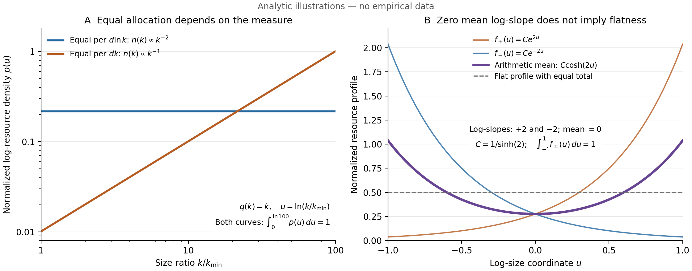

*Figure S2. Analytic illustrations, not empirical data. (A) With resource equal to size,
linear and logarithmic resource equipartition produce different count exponents. Both
curves show unit-total resource density in the logarithmic coordinate. (B) Two unit-total
resource profiles on a common domain have opposite log-slopes and therefore zero mean
log-slope, but their arithmetic mean is not flat. Generated by
[run_theory.py](../experiments/run_theory.py); a [vector version](../results/theory.svg)
is available.*

### S2.4. Constraints and observable distributions

Three levels of description must be kept distinct: an underlying resource-equalizing
tendency, the neutral signature (S2), and the outcome of the complete system. The latter
depends on the proposed tendency together with resource costs, other processes, forcing,
and initial and boundary conditions. A model containing an equalizing contribution can
therefore predict a non-neutral stationary state or a transient with no clear neutral
signature. Establishing such a contribution requires an explicit model or discriminating
observations; equation (S1) alone does not identify it.

Age and height distributions are motivating examples of constrained outcomes. A worked
age-distribution account must specify birth history, survival, and migration; a height
account must specify developmental processes, biological variation, and environmental
conditions, as well as the population sampled. An orthopolity application must additionally
identify the resource, its concentrations, and the comparison measure. No completed
orthopolity model of either example is supplied here. The relevant task is to derive the
combined outcome and explain how its form depends on the constraints.

A failure of the neutral prediction is a finding about that prediction in the stated
setting. It does not automatically establish the absence of the broader tendency, and
counting distributions without its visible signature does not establish a general absence
of evidence in Nature. A constrained model has its own predictions, which can succeed or
fail. Specify the constraint through physical reasoning or independent measurements,
derive its effect on the profile, and test the predicted response when it changes. Where
recovery of neutrality is predicted, specify its conditions and timescale. This permits
both neutral and non-neutral outcomes to inform the theory, while preserving the distinction
between an observed departure, a proposed cause, and a tested explanation.

## S3. Exchange dynamics and physical derivations

The following mechanisms establish allocation relations under their explicit physical and stochastic assumptions. They do not assert a shared microscopic dynamics for every application.

### S3.1. Exchange on concentration classes and recovery

Consider $K$ fixed size classes, with positive reference widths $w_i$, fixed per-object
resource costs $q_i$, nonnegative class stocks $R_i$, and conserved total $B=\sum_iR_i$.
The classes represent populations of resource-bearing objects; the state is their aggregate
resource. Equivalent counts $N_i=R_i/q_i$ may be continuous or expected counts, and their
total need not be conserved. This effective model does not specify individual-object
assembly or demographic kinetics. The [full derivation](class-exchange.md) states its
interpretation and assumptions.

Let $g_{ij}=g_{ji}\ge0$ be conductances on a connected undirected graph. Neutral exchange
has current $J^0_{ij}=g_{ij}(R_i/w_i-R_j/w_j)$ and dynamics
$\dot R_i=-\sum_jJ^0_{ij}$. Positivity follows from nonnegative jump rates $g_{ij}/w_i$;
antisymmetry of currents conserves total resource. Connectedness makes the stationary
resource density constant, giving

$$R_i^0=\frac{Bw_i}{\sum_jw_j},\qquad N_i^0=\frac{Bw_i}{q_i\sum_jw_j}.$$

This is a mechanism selecting equal resource per declared class measure. The local
exchange symmetry and the measure are assumptions of the model; they are not supplied
by conservation alone. To model a constraint, prescribe dimensionless class preferences
$V_i$ and add downhill transitions:

$$a_{ij}=\frac{g_{ij}}{w_i}\exp\!\left(\max\{V_i-V_j,0\}\right).$$

The rate $a_{ij}$ is from $i$ to $j$. Its neutral part $g_{ij}/w_i$ remains, and the
additional part is nonnegative. With column generator $A_{ji}=a_{ij}$ for $j\ne i$,
$A_{ii}=-\sum_{j\ne i}a_{ij}$, define

$$\pi_i=\frac{w_i e^{-V_i}}{Z},\qquad Z=\sum_jw_j e^{-V_j}.$$

Then $\pi_i a_{ij}=\pi_j a_{ji}$ on every edge. Detailed balance selects the unique
stationary resource $R_i^V=B\pi_i$. This uses standard reversible-chain mathematics
(Levin and Peres, 2017), specialized here to fixed concentration classes and an explicit
additive constraint mechanism. At that stationary state the neutral edge current is

$$J^0_{ij}=\frac{Bg_{ij}}{Z}(e^{-V_i}-e^{-V_j}),\qquad
J^{\mathrm c}_{ij}=-J^0_{ij}.$$

Thus a nonuniform stationary distribution can have an active equalizing contribution
balanced by the constraint. Setting $V$ to a constant removes the added rates and lets
the actual constrained allocation relax toward neutrality.

For $p=R/B$, set $E^2=\sum_i(p_i-\pi_i)^2/\pi_i$. Writing $z_i=p_i/\pi_i$ gives

$$\frac{dE^2}{dt}=-2\sum_{i<j}\pi_i a_{ij}(z_i-z_j)^2
\le-2\lambda E^2,$$

where $\lambda>0$ is the smallest nonzero eigenvalue of the symmetric matrix
$-D_\pi^{-1/2}AD_\pi^{1/2}$. Consequently $E(t)\le E(0)e^{-\lambda t}$ and
$\operatorname{TV}(p,\pi)\le E/2$. The same bound applies after release, using the neutral
generator and the state actually present at the switch. If connections are removed, each
component retains its own resource total and only component-wise equalization follows.

The simulation fixes 24 equal-log size classes on $[1,64]$, $q_i=k_i^{1.5}$, and adjacent
conductances $1/\Delta\ln k$. A prescribed quadratic preference in $\ln k$, centered at
$k=8$ with width $0.75$, produces a curved resource profile. The corresponding continuous
count form is $dN/dk\propto k^{-2.5}e^{-V(\ln k)}$, a truncated lognormal shape for this
quadratic choice. Each phase runs for eight relaxation times. The neutral and constrained
spectral gaps are 0.569805 and 1.991712 per model time unit. The final relative errors in
the neutral, constrained, and released phases are $4.73\times10^{-4}$,
$2.41\times10^{-7}$, and $5.51\times10^{-11}$, each below its predicted bound.
The opposing stationary drift vectors cancel to Euclidean residual $3.22\times10^{-15}$.

There are 4,096 equal-resource packets in each of 128 realizations, initially all in the
first class. Exact matrix-exponential checkpoint transitions preserve the state at both
switches. Packets remain independent, giving class-count law
$X(t)\sim\operatorname{Multinomial}(4096,p(t))$ and share covariance
$(\operatorname{diag}(p)-pp^T)/4096$. Uneven finite snapshots are therefore predicted even
at neutral mean allocation. Rates, costs, preferences, and predictions were fixed before
drawing the stochastic trajectories. The computational results and checks are retained
with the [model report](class-exchange.md); the simulation supplies a constructive example,
not new natural-system observations.

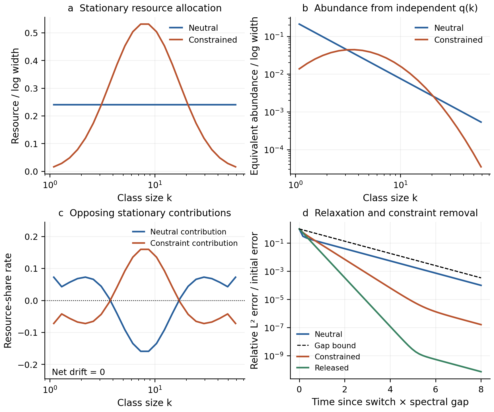

*Figure S3. Fixed class-exchange model. Equalizing kinetics select neutral resource shares;
an added class preference selects a curved profile and changes equivalent abundance.
At constrained equilibrium the neutral and added contributions cancel. Removing the
preference preserves the current state and predicts recovery under the neutral dynamics.
The displayed convergence curves are deterministic expectations; stochastic packet
realizations and their uncertainty are retained in the linked report.*

### S3.2. Electromagnetic transport, absorption and release

For electromagnetic energy density $u$ and Poynting vector $\mathbf S$, Maxwell's equations
give $\partial_tu+\nabla\cdot\mathbf S=-\mathbf J\cdot\mathbf E$ (Poynting, 1884;
Haus and Melcher, 1989). Define $P(r)=\int_{S_r}\mathbf S\cdot\mathbf n\,dA$ outside a
source enclosed by an inner sphere $r_0$ with steady power $P(r_0)=L$.
Integrating the balance over a transparent, source-free shell
with no net energy accumulation gives $P(r_2)=P(r_1)=L$. Isotropy is a separate condition:
it makes the local radial flux density $F=L/(4\pi r^2)$; otherwise this is its sphere average.

Under outgoing radial transport at constant speed $c$, without scattering or secondary
emission in the modeled component, a specified absorber with coefficient $\kappa(r)$ gives

$$\frac{dP}{dr}=-\kappa(r)P,\qquad
P(r)=L\exp\!\left[-\int_{r_0}^r\kappa(s)\,ds\right].$$

This is the absorption law specialized to spherical transport (Condon and Ransom, 2016).
An absorbing layer with optical depth $\ln2$ halves downstream power. The missing
radiative power is deposited in matter, so the modeled radiation component has an open
budget. Its departure follows from the prescribed medium and the same energy balance.

These nested surfaces receive the passage of the same energy; their powers cannot be
summed as disjoint resource shares. Disjoint shell stocks do give an additive comparison:
in transparent stationary radial transport, $dU=(L/c)dr$. Thus equal radial thicknesses
hold equal energy, whereas $dU/d\ln r=Lr/c$ increases with radius. The resource, units,
and comparison measure determine which equality is physically meaningful.

The response to removing an absorber is also determined. For sphere-averaged $u$,
with $e=4\pi r^2u=P/c$, the
transport equation is $\partial_te+c\partial_re=-c\kappa(r,t)e$. Suppose the source
remains constant, the initial field is stationary under $\kappa_{\mathrm{old}}(r)$,
and absorption is set to zero throughout the modeled domain at $t=0$. For $t\ge0$, characteristics give

$$P(r,t)=L\exp\!\left[-\int_{r_0}^{\max\{r_0,r-ct\}}
\kappa_{\mathrm{old}}(s)\,ds\right].$$

Every radius recovers by $(r-r_0)/c$. Downstream of a layer $[a,b]$, the response starts
at $(r-b)/c$ and completes at $(r-a)/c$. This is an idealized change of the absorption
coefficient, with no radiation injected by the removal process. The
[physical derivation](physical-realizations.md) states the boundary history and all
transport assumptions. It supplies an established physical realization of a declared
equality and its constrained departure; it does not equate radial shells with organism
size classes or derive abundance laws from an inverse-square flux.

### S3.3. Classical equipartition and quantized mode energies

Thermal electromagnetic radiation supplies a second physical realization with a different
reference measure: counting field modes, including polarization. For a finite set of
classical normal modes in canonical equilibrium at $T>0$, each has two quadratic terms,
$H_j=P_j^2/(2m_j)+m_j\omega_j^2Q_j^2/2$. Gaussian integration over both coordinates
gives $Z_j^{\mathrm{cl}}\propto(\beta\omega_j)^{-1}$, with
$\beta=(k_BT)^{-1}$, and therefore

$$\langle H_j\rangle=-\partial_\beta\ln Z_j^{\mathrm{cl}}=k_BT.$$

A class of $M_i$ modes consequently has mean energy $M_i k_BT$: the resource density
is equal per mode, with independently defined weight $w_i=M_i$. This is equality of
equilibrium means, not identical instantaneous energies. Equilibrium preparation or
thermal coupling must be justified; uncoupled harmonic modes do not thermalize each
other merely because their canonical distribution can be written down. This argument
uses standard equipartition and supplies no relaxation time (Tong, n.d.).

Quantization changes the allowed states. Define the resource as thermal excitation
energy above the ground state, excluding the temperature-independent zero-point term.
For photon absorption and emission in thermal equilibrium, photon chemical potential
is zero and a mode has excitation levels $\epsilon_n=nh\nu$. The geometric sum gives

$$Z_\nu=\frac{1}{1-e^{-x}},\qquad
\bar\epsilon_\nu=\frac{h\nu}{e^x-1}=k_BT f(x),\qquad
x=\frac{h\nu}{k_BT},\quad f(x)=\frac{x}{e^x-1}.$$

For $x>0$, $f$ decreases strictly from 1 toward 0. Its limits are
$f(x)=1-x/2+x^2/12+O(x^4)$ near zero and $f(x)\sim xe^{-x}$ at large $x$.
The quantum level spacing relative to thermal energy specifies the departure before
any spectrum is observed. Raising temperature or lowering frequency recovers classical
relative equality. This is a restriction of the available energy states; it does not
establish the additive decomposition into opposed classical currents proved in Section S3.1.

In a large three-dimensional vacuum cavity, counting two polarizations gives the mode
density $dM/(Vd\nu)=8\pi\nu^2/c^3$. Multiplication by $\bar\epsilon_\nu$ yields the
Planck energy density and, for isotropic radiation, the spectral radiance:

$$u_\nu(T)=\frac{8\pi h\nu^3}{c^3(e^{h\nu/(k_BT)}-1)},\qquad
B_\nu(T)=\frac{c}{4\pi}u_\nu(T).$$

Thus the classical equality per mode gives $u_\nu^{\mathrm{cl}}\propto\nu^2$ and
$dU/(Vd\ln\nu)\propto\nu^3$, neither a flat linear-frequency nor a flat
log-frequency spectrum. If photons are the counted objects, $q(\nu)=h\nu$ and their
mean number per mode approaches $k_BT/(h\nu)$ in the classical regime. Extending
classical equipartition to infinitely many modes gives divergent total energy;
quantization makes it finite, $U/V=8\pi^5 k_B^4T^4/(15h^3c^3)$. These are established
results (Planck, 1901; Tong, n.d.; Condon and Ransom, 2016), here specifying the resource,
comparison measure, and constraint in the allocation framework.

### S3.4. FIRAS data as a retrospective mode-energy reconstruction

FIRAS measured the cosmic microwave background against calibrated blackbody references
and separated monopole, dipole, and Galactic components (Fixsen et al., 1996).
NASA LAMBDA's distributed monopole table contains a 2.725 K blackbody plus the residuals
from that published analysis, with marginal uncertainties and a Galactic model column.
The residuals already follow temperature and foreground fitting. The table therefore
supports a transparent re-expression of the published result; agreement with its
embedded template cannot be counted as a new independent confirmation.

Our retrospective calculation retains all 43 rows and fixes $T_0=2.725$ K from the
product definition. With wavenumber $\tilde\nu$ in inverse centimetres,
$\nu=100c\tilde\nu$. Radiance remains per hertz, with
$1\,\mathrm{MJy/sr}=10^{-20}\,\mathrm{W\,m^{-2}\,Hz^{-1}\,sr^{-1}}$.
Dividing the inferred energy density by the independent mode density gives

$$\frac{\widehat\epsilon_\nu}{k_BT_0}
=\frac{c^2 I_\nu}{2\nu^2k_BT_0}
=\frac{I_\nu}{B_\nu^{\mathrm{RJ}}(T_0)},\qquad
B_\nu^{\mathrm{RJ}}=\frac{2\nu^2k_BT_0}{c^2}.$$

The channels span 68.05--639.46 GHz and $x=1.199$--$11.262$. Their transformed
mode energies range from $0.518$ to $1.32\times10^{-4}$ of $k_BT_0$ (Figure S4).
They illustrate the quantum departure, not the $x\ll1$ classical plateau.
The CMB can retain a Planck spectrum through collisionless cosmological redshifting;
this example does not require current thermal contact with surrounding matter
(Condon and Ransom, 2016, Section 2.6.2).

For residual diagnostics we use the source's original residual column, not the difference
between rounded monopole intensities and a newly calculated curve. The source's
approximate frequency covariance is $C_{ij}=\sigma_i\sigma_j Q_{|i-j|}$, using its
43 published lag coefficients (Fixsen et al., 1996, Section 3.3). The matrix is positive
definite. Applying the linear radiance-to-mode conversion to both axes propagates this
covariance to the mode-energy ratios. The residual quadratic form is
$r^TC^{-1}r=49.774$; it is a descriptive audit of the published approximation, with no
new fit or goodness-of-fit probability. It need not reproduce the original full-analysis
statistic, 46 for 40 degrees of freedom. Diagonal inverse-variance weighting gives residual
RMS 18.90 kJy/sr, or 49.28 parts per million of the tabulated peak radiance. This defined
amplitude summary does not assume that the channels are independent.

Using exact SI constants at the rounded source coordinates gives a discrepancy
$I_{\mathrm{posted}}-[B_\nu(T_0)+r_{\mathrm{published}}]$ of
$-0.127$ to $+7.598$ kJy/sr, with radiances in common units.
This discrepancy is retained without assigning a cause or replacing
the original residuals. Absolute calibration, foreground modeling, and the prior fits
remain inherited from the published analysis. The [thermal-radiation report](thermal-radiation.md)
retains the full derivation, source bytes, covariance transcription, and reproducible
calculation. This example connects a physical equality and an independently derived
quantum departure to established observational evidence under its documented conditions.

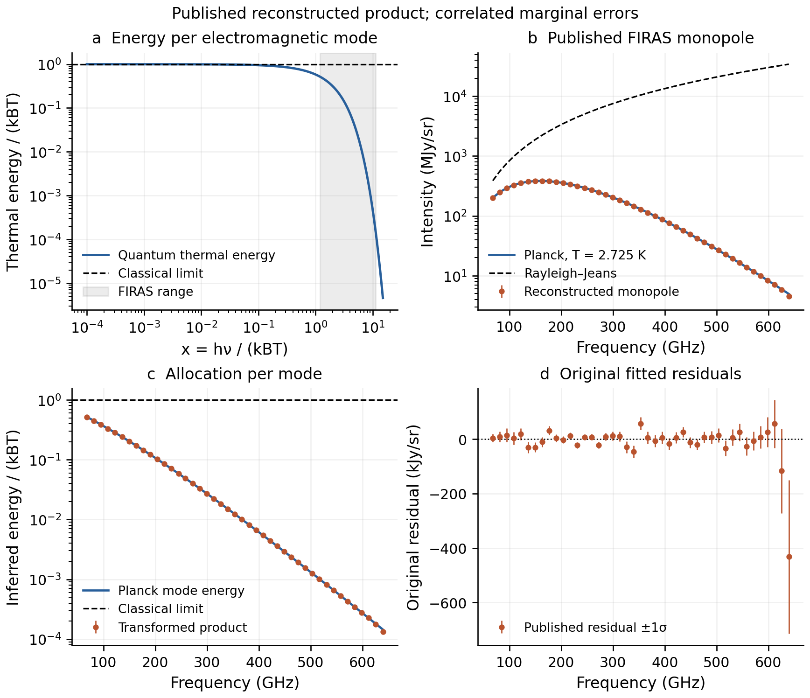

*Figure S4. Thermal energy per electromagnetic mode. (A) The theoretical quantum factor
$f(x)$ approaches classical equality as $x\to0$. (B) The NASA FIRAS reconstructed
monopole product and Planck and Rayleigh--Jeans radiances at the product's 2.725 K
reference temperature. (C) The same product expressed as energy per mode relative to
$k_BT_0$. (D) Original published residuals with marginal one-sigma uncertainties;
channels are correlated. The Planck template is part of the distributed product, so
panels B and C illustrate the published result rather than provide a new independent
model test. All 43 channels are retained.*

### S3.5. Growth, division and resource-weighted observation

Let $x$ be additive cell mass, growing deterministically as $\dot x=gx$ with
the same $g>0$ in every cell. Assume conservative symmetric binary division,
no death, and a balanced asynchronous population with finite mean mass. Total
mass and population number then grow at the same exponential rate $g$.
For division hazard $\beta(x)$, normalized population density $p_P$ satisfies

$$g p_P+(gx p_P)'=-\beta(x)p_P(x)+4\beta(2x)p_P(2x).$$

Multiplying by $x$ shows that $xp_P(x)$ solves the stationary chronological
lineage equation: division has one retained daughter, halved in size. After
normalization,

$$p_L(x)=\frac{xp_P(x)}{E_P[x]}.$$

Thus **the mass-weighted population size distribution equals the chronological
lineage size distribution**. This size tilt is established prior work, explicitly
derived and qualified by [Genthon (2022)](https://doi.org/10.1098/rsif.2022.0405),
Section 2.2 and its [revised exposition](https://arxiv.org/html/2206.06146v2).
It is not introduced here as a new theorem of cell biology.

Let $B,D$ be sizes at the beginning and end of completed lineage cycles.
Stationarity and symmetric division imply $D\overset d=2B$, not necessarily
$D=2B$ within each individual cycle. For monotone growth the fraction of cycles
crossing $x$ is

$$H(x)=P(B\le x<D)=F_B(x)-F_D(x)=F_B(x)-F_B(x/2).$$

Each crossing occupies time $dx/(gx)$, while mean cycle time is $\ln2/g$.
The renewal occupation identity and the size tilt therefore give

$$p_L(x)=\frac{H(x)}{x\ln2},\qquad
p_P(x)=\frac{2H(x)}{E[B^{-1}]x^2},\qquad
E_P[x]=\frac{2\ln2}{E[B^{-1}]}.$$

The normalized mass share per logarithmic size is

$$\frac{x^2p_P(x)}{E_P[x]}=\frac{H(x)}{\ln2}.$$

This identifies both the measure, $d\ln x$, and the constraint profile from
birth/division events. When every cycle crosses an interval, $H=1$ there and
mass is equal across equal logarithmic widths. For fixed birth mass $b$,
$p_P=2b/x^2$ on $[b,2b)$: the familiar inverse-square result. Variable birth
and division sizes alter the envelope; an exact plateau is not generally
present. A lognormal birth law has no strict plateau. The allocation claim
is therefore more informative as an envelope prediction than as a search for
an inverse-square slope over a selected interval.

For normalized probability densities $b_P,d_P$ of population-tree birth/division
event sizes (not event intensities per unit time), population balance also gives

$$\frac{d}{dx}[x^2p_P(x)]=x[2b_P(x)-d_P(x)].$$

Here the total division-event rate per cell equals $g$, which cancels the
common growth factor. Source-free intervals have a flat resource profile. These population event
densities must not be replaced by chronological event densities without the
sampling correction above. The resource profile is a stock across simultaneously
present cells; lineage duration is used to infer it, not counted as extra mass.

#### Conditions that matter in nature

The common-growth assumption is stronger than a shared mean rate. Growth noise,
division asymmetry, size-dependent loss, and lineage-specific physiology change
the relation. With asymmetric partition, the corresponding lineage follows a
mass-biased daughter; an ordinary old-pole mother-machine trajectory need not
be that lineage. Genthon derives these distinctions. A balanced phase distribution
is also an assumption: perfectly deterministic synchronized cycles can oscillate
without approaching it. The proof is a statement about a stationary profile,
not a general convergence result.

The empirical source measures length $L$, not mass. Even for constant diameter
$d$, a spherocylinder has volume proportional to $L-d/3$, rather than exactly
$L$. Width, density, polar geometry, and fixation are not independently calibrated
here. The numerical study therefore tests a **length-proxy transfer model**.
It cannot certify a biomass plateau or explain deviations by selecting an
unmeasured correction after seeing the outcomes.

### S3.6. Newtonian gravity and complete source accounting

The [gravity derivation](gravity-realization.md) adds a physical realization of
complete source accounting. In the Newtonian regime, the divergence theorem gives

$$\Psi(S)=-\int_S\mathbf g\cdot\mathbf n\,dA=4\pi G M_{\rm enc}.$$

Complete surfaces enclosing the same source have the same inward field flux.
For an isolated spherical source, $\mathbf g=-GM\widehat{\mathbf r}/r^2$ and
$d\Psi=GM\,d\Omega$: the field flux is equal per solid angle. Acceleration is
not an energy current, and nested source representations cannot be added as
independent mass stocks. This equality uses the angular measure $d\Omega$;
it is not a linear-orthopolic or log-orthopolic law over radius.

In the conventional field representation of gravitational binding energy,
$u_g=-|\mathbf g|^2/(8\pi G)$. Exterior spherical shells then have
$dU/dr=-GM^2/(2r^2)$ and $dU/d\ln r=-GM^2/(2r)$, both nonuniform.
That negative energy representation is distinct from an available positive
resource budget. The linked derivation retains the source geometry, boundary
conditions, attribution and interpretation limits. It also separates static
field accounting from the supported-body analogy and from relativistic propagation.

## S4. Exploratory sources, methods and results

These convenience sources were inspected before the analyses or governed by locally recorded plans with the exposure qualifications below. They do not constitute a representative sample of natural systems.

### S4.1. Sources and scope

| Data source | Analysed material | Resource and size coordinate |
|---|---|---|
| NOAA GOES XRS flare reports, 2022–2024 | 10,501 catalogue events; 1,168 paired events in the primary evaluation domain | End fluence in J/m²; peak irradiance in W/m² |
| USGS ComCat, 2010–2024 | 6,639 events after retaining moment-magnitude types and rounding to 0.1 at threshold 5.5 | Magnitude-derived energy proxy as both resource and coordinate |
| Hatton et al. (2021) | 23 one-decade biomass bins, upper 200 m and full water column | Body mass for both |
| GLOSSAQUA (Ersoy et al., 2025) | 1,300 normalized biomass-spectrum estimates from 16 study identifiers | Body mass for both |

*Table S5. Exploratory data sources, analysed material and resource definitions.*

These are four data sources; the two ocean domains are related reconstructions. GLOSSAQUA
contains published estimates rather than organism-level observations. Study identifiers do
not guarantee independent authors, methods, sites, or measurement errors. The sources are
convenience cases for evaluating a hypothesis, not a representative sample of natural systems.
Input bytes are fixed by SHA-256 manifests; provenance and source notices accompany the data.

### S4.2. Analysis-plan provenance

The pilot configuration explicitly labels itself exploratory. The subsequent aquatic/ocean
plan is retained as [prereg_2026-09-09.json](../configs/prereg_2026-09-09.json). In local
history, commit 6df364f contains the plan and raw slope data, preceding analysis commit
a0c9973. This records an order of commits. It does not establish an immutable public
registration, independently verified blinding, or when values were first viewed.
Statements of blinding in the historical file are author reports. The current corrections
are retrospective, and the later ensemble, stratification, and variance analyses are
exploratory. No claim of confirmatory preregistration is needed for the descriptive and
mathematical results here.

### S4.3. Accounting, domain choice and uncertainty

For bins $B_j$ of logarithmic width $w_j$, compute
$\widehat{\mathcal O}_j=\sum_{i\in B_j}q_i/w_j$ and
$\widehat C=\sum_j\sum_{i\in B_j}q_i/\sum_j w_j$. The normalized profile
$\phi_j=\widehat{\mathcal O}_j/\widehat C$ has width-weighted mean one by construction.
This is not evidence of flatness. Empty bins remain in the profile, the final boundary is
included, and missing resources require an explicit exclusion policy.

A factor-$F$ endpoint drift across log-domain width $L$ corresponds, for a power-shaped
spectrum, to slope tolerance $c=\ln(F)/L$. This differs from requiring every
$\phi_j\in[1/F,F]$: the latter permits a maximum-to-minimum ratio of $F^2$. Both slope
and profile deviations matter. A slope equivalence interval combined with a point-estimate
profile screen is not full simultaneous equivalence; that would require uncertainty for
the whole profile. Failure to establish equivalence is not, by itself, evidence of a
nonzero departure.

For flares, the arithmetic mean resource exponent is fitted by Gamma quasi-likelihood on
2022 data, with bounded count-density fitting on 2023–2024 over $[10^{-5},10^{-3}]$ W/m².
Log-resource least squares would target a different conditional quantity unless an appropriate
retransformation were justified. Pilot intervals use 600 calendar-month block resamples for
flares and calendar-year blocks for earthquakes. These do not capture all dependence or
selection bias. The temporal split separates estimation samples but does not make the
exploratory domain choice a prospective prediction.

Power-law diagnostics use maximum likelihood and a refitted parametric-bootstrap KS
statistic on declared support, following the approach of Clauset et al. (2009). The
rounded earthquake magnitudes are tested on their integer grid: for
$K=(M-M_0)/\Delta$, $P(K=k)=(1-r)r^k$ with $r=10^{-b\Delta}$. Continuous-reference KS
calibration is unsuitable for these ties. Parametric-bootstrap probabilities remain
conditional on an independent-event working model; catalogue clustering is a limitation.

### S4.4. Aquatic estimates and reconstruction uncertainty

The primary GLOSSAQUA subset requires body mass on the size axis, finite slopes and positive
ordered size limits, and the normalized biomass-spectrum convention. For biomass per unit
linear mass $B(m)\propto m^t$, equal biomass per log mass requires $t=-1$. We examine
$\beta=t+1$ and each estimate's reported size span. The historical plan uses $F=1.25$
and $F=2$, a 2,000-replicate study-block bootstrap for the pooled median, and a joint
criterion involving its interval and the fraction of slopes inside their tolerances.
That fraction ignores individual slope uncertainty and must not be interpreted as formal
individual equivalence. Slope summaries cannot detect within-spectrum curvature. A post-audit
sensitivity explicitly excludes StudyID_07 from range-dependent assessment because its
reported bounds are physically implausible; no replacement bounds are imputed (S4.8).

For the ocean reconstruction, 20,000 simulated profiles propagate reported multiplicative
uncertainty factors using lognormal draws centred on the published log estimates, with
log-scale standard deviation $\ln(f)/1.96$. The published bounds match estimate divided
and multiplied by $f$. Independent errors across groups and bins are a working assumption,
not a property established by those bounds. The reconstruction is not a sample of independent
organisms, and its plateau was selected after inspecting the upper-ocean estimates.

Exploratory random-effects and latent-distribution fits use reported errors where available.
Intervals converted to standard errors assume their advertised coverage and approximate
normality. Size-spectrum estimators can have biased estimates and miscalibrated intervals
(Edwards et al., 2017, 2020). Repeated spectra within studies and estimated error variances
further limit inference; independence-based pooled intervals are not primary evidence
of a population mean.

### S4.5. Earthquakes and the specified energy proxy

Gutenberg–Richter scaling $N(\ge M)\propto10^{-bM}$ and proxy
$E\propto10^{\gamma M}$ give resource per log energy proportional to
$E^{1-b/\gamma}$. Flatness therefore requires $b=\gamma$. At threshold 5.5, the fitted
$b=0.998$ has year-block 95% interval [0.973, 1.024], far below the chosen $\gamma=1.5$.
Thresholds 6.0 and 6.5 give 0.984 and 0.977. Using conversion exponent 1.44 also leaves a
substantial discrepancy.

At threshold 5.5 the discrete KS statistic is approximately 0.0077, with a parametric-bootstrap
probability about 0.26. This is non-rejection of the fitted geometric model, not proof that
the model is exact. A power-like tail can thus coexist with a resource-proxy allocation that
disagrees with $O_{\log}$. No discrete lognormal comparison was conducted. Magnitude-derived
energy is not independently measured radiated energy; the finding is restricted to the
specified proxy and catalogue, without declustering or a regional completeness model.

### S4.6. Flares and the joint resource/count prediction

The fitted resource exponent is $d=0.858$ with 95% interval [0.697, 1.054]. The implied
density exponent is 1.858, compared with 2.239 [2.085, 2.399] in the paired evaluation
sample. The estimated gap is 0.382 [0.125, 0.620]. A rise-phase fluence sensitivity gives
gap 0.411 [0.208, 0.604]. This alternate resource has no missing values in the domain,
but does not prove the primary end-fluence analysis free of missingness bias.

For all 1,306 in-domain evaluation events, peak irradiance has fitted exponent 2.274 and
KS statistic about 0.032; its bootstrap probability is about 0.02. The power law is
therefore inadequate under this working test. Its likelihood cannot clearly distinguish
it from the fitted lognormal. Exponent mismatch tests the conjunction of equipartition,
power-shaped mean cost, transfer between years, and the count model; it cannot isolate
equipartition from all those assumptions.

The gaps at four lower cutoffs are −0.480, 0.191, 0.382, and 0.960. This substantial
sensitivity discourages treating one selected range as a universal scaling regime.
Fluence is instrument-band irradiance integrated over an event, not total flare energy.

### S4.7. The ocean reconstruction and its uneven plateau

The upper-ocean summary reproduces the published abundance slope at approximately −1.039.
Its maximum-to-minimum biomass ratio is 38.8 across all 23 bins, and 1.7 within the selected
plateau of 16 bins. The corresponding full-water-column plateau ratio is 4.3. The 23
one-decade bins span 23 decades between outer edges; their centres are 22 decades apart.
Similarly, the plateau covers 16 decades between edges and 15 between centres.

Under the stated uncertainty propagation, only 2 of 23 upper-ocean bin intervals lie
wholly outside the factor-1.25 band; the corresponding full-column count is 3. These are
pointwise intervals without multiplicity adjustment. The remaining intervals can include
both near-flat and materially non-flat values, so their overlap with the band establishes
neither equality nor absence of departures. Correlated reconstruction errors and post hoc
range selection further limit the assessment. These results re-express Hatton et al.'s
reconstruction; they do not independently replicate it.

The full upper-ocean range has a fitted biomass log-slope of −0.0392 and a propagated
90% interval approximately [−0.058, −0.026], outside the factor-1.25 slope tolerance
of 0.00421. Thus the assumed uncertainty model indicates a systematic gradient even
though most individual bin intervals overlap the pointwise band. Pointwise overlap
does not make the whole-profile question uninformative; its interpretation remains
conditional on the reconstruction error model.

### S4.8. Aquatic slopes and the equivalence criterion

Among 1,300 normalized biomass spectra from 16 study identifiers, the pooled median slope
is −1.015. The study-block 95% interval for its departure from −1 is [−0.100, 0.010].
The median slope tolerance is 0.0317 at $F=1.25$ and 0.0984 at $F=2$. This interval is
not wholly within either band. Under the historical joint criteria, the result is
**not supported**.

The reported-slope fractions inside their individual drift tolerances are 0.07846
($F=1.25$) and 0.24231 ($F=2$), counting boundary cases inclusively. These are descriptive compatibility fractions. Their
complements are not estimates of the fraction of true spectra violating equipartition,
because measurement error and within-spectrum shape are not accounted for.

These historical fractions also depend on a metadata defect: all 377 StudyID_07 records
report bounds of $2\times10^{-8}$ to $2\times10^{27}$ pg C, a 35-decade range with a
physically implausible upper body mass of $2\times10^{12}$ kg C. Excluding those records
from this range-dependent calculation leaves 923 slopes from 15 studies. Their point-slope
compatibility fractions are 9.32% at $F=1.25$ and 28.93% at $F=2$. The source-derived
replacement bounds are unknown; the original slopes remain in the location summary.
The remaining records also require a methods and units audit. Consequently neither version
of the pass fraction should be treated as a validated estimate of ecological prevalence.

Two studies supply 1,016 of the 1,300 estimates, approximately 78%. A central estimate
near −1 is worth investigating, but it neither establishes a mean of −1 in a defined
population nor establishes equal average biomass occupancy. The stronger ensemble
interpretation fails on both statistical and mathematical grounds (S2.3).

### S4.9. Further exploratory diagnostics and limits

Latent-shape fits and random-effects summaries describe appreciable variation in the
error-reporting subset. Their fitted dispersion includes ecological differences, study
methods, and potentially unmodelled dependence. An $I^2$ estimate is not a measured
fraction of variance caused by ecosystem differences. AIC rankings among Gaussian,
Laplace, and Student families do not establish adequacy or identify ecological classes.
Error-aware, matched-sample pass fractions are internal model checks, not independent
predictions of individual failure.

The cross-study comparison of 639 lake-fish estimates with 377 records associated with
Gaedke's Lake Constance study does not partition spatial and temporal variance. Different
taxa, sampling designs, fitting methods, and measurement uncertainties prevent treating
their variance ratio as a bound on one population. Reproducing Arranz et al.'s reported
summary statistics from the same underlying observations checks extraction, not independent
replication of a dispersion parameter.

Exponent metadata also need source verification. Counts in equal-log bins and abundance
divided by linear bin width have slopes differing by one under power scaling. The
Perkins et al. (2018) count-bin method illustrates why a database category alone may not
identify the estimand. Choosing a mapping because it makes a slope closer to −1 or −2
would bias the test. Secondary conventions remain sensitivity analyses; a complete
study-level methods audit is needed before pooling them. Checks of two dominant primary
studies do not validate every record in the primary subset.

## S5. Frozen forecasts, full comparisons and eligibility

The analyses of Section S4 assess data that had already been inspected. We therefore added tests
in which the resource, its cost law, the forecasts and the decision rules are fixed before the
evaluated outcomes are decoded, and in which whole units are held out: launches, a calendar year,
vessels and selection treatments. Each executed study retains its inputs, frozen protocol,
archived algorithms, forecasts and results in an append-only [run registry](run-registry.md).
Three kinds of evidence are kept separate: measurements on engineered systems, an unused
observation period of a natural catalogue, and published biological experiments reanalysed
retrospectively. Published summaries of those experiments had been read, so their reanalyses
are retrospective validations, not blinded tests. A further plant study uses fixed scoring
and a development-only geographic split after accidental raw outcome exposure. Its freeze
cannot establish that those outcomes were unseen.

### S5.1. Controlled allocation measurements

In a controlled workload experiment, separately measured memory and CPU costs of matrix tasks
predicted completion profiles under assigned quota pairs within four tolerances frozen before
672 validation tasks ([workload pilot](workload-pilot.md)). A fresh launch exposed a transfer
boundary: the original forecast failed its unchanged tolerance in two of four conditions, and
local recalibration recovered one ([workload transfer](workload-transfer.md)). The quotas were
acceptance criteria, so these tests concern the transfer of cost models, not allocation.

An allocation test requires the system, not the experimenter, to divide a resource. In a Python
runtime whose global interpreter lock serializes execution, worker threads running matrix
kernels of five sizes competed for one execution resource
([dimensionality intervention](dimensionality-intervention.md)). Separate calibration gave CPU
cost degrees 1.870 and 2.686 for the two kernels. The calibrated mean-cost curves predicted
complete CPU and job profiles before 16 allocation trials, with maximum CPU-share errors of
0.0035–0.0063 and job-share total-variation errors of 0.0021–0.0124. Replacing the
largest-class thread with a second smallest-class thread produced the predicted CPU-share change
within 0.0078. A unit-cost alternative had count errors of 0.126–0.273. This success concerns
one engineered allocation mechanism; it identifies no geometric dimension and no tendency of
natural systems.

### S5.2. Calibrated decisions and an unused observation period

Complete-profile equivalence decisions were calibrated on 180,000 independently generated
datasets in 90 conditions ([profile calibration](profile-calibration.md)). Simultaneous bands
met the declared gate for dense, bounded, independent blocks at 48 blocks, with minimum coverage
93.95%, but failed at 12 and 24 blocks. With twelve serially dependent blocks, wrong-departure
rates reached 43.75%. These failures define observation designs for which no neutrality verdict
is available, whatever a nominal interval suggests.

For solar flares, measured rise-phase fluence costs, six logarithmic classes, three forecasts,
a tolerance and an application gate were committed before the 2025 NOAA records were acquired
([solar validation](solar-validation.md)). Of 3,277 events, 356 met the domain rules.
Logarithmic neutrality predicted the class counts much better than linear neutrality, with
count total variation 0.125 against 0.573; historical counts did better still, at 0.022. The
point profile departed from the $\ln 1.5$ margin, but the calibrated decision remained
unresolved, as declared before acquisition, and the instrument mix changed between periods.

### S5.3. Published biological measurements

| Study | Held out | Resource and cost | Frozen comparison | Outcome |
|---|---|---|---|---|
| *Synechococcus* quotas (Harcourt et al., 2024) | Ten cultures at 25 °C | C, N and P per cell against measured diameter | Fixed cube, free power, strain means, temperature trends | Fixed cube best for C; strain means best for N and P |
| Size-selected *Dunaliella* (Malerba et al., 2018) | Large and small treatments in two folds | Biovolume at carrying capacity in one shared medium | Equal biovolume ($d=1$), fitted size law, assigned exponents, equal cell number | Equal-biovolume forecast best; $d=1.02$ describes the post-hoc all-lineage fit |
| Food-web chemostats (Wojcik et al., 2025) | Twelve polyculture vessels | Algal N stock: biovolume times separately assayed N per volume | Persistence, development response, no-herbivore response, equal stock, two-budget cost ratio | No model beat persistence; the cost-ratio rule failed |
| Harvested plants (Dillon et al., 2019) | Five Colorado plots; prior raw exposure | Direct aboveground dry mass; $q(m)=m$ by definition | Log and linear neutrality, Ohio histogram, bounded Pareto and Weibull | Pareto best for biomass; trained models better for counts; ecological neutrality unresolved |

*Table S6. Biological transfer comparisons and their retained scope.*

Published elemental quotas of four *Synechococcus* strains tested whether a size-based cost
transfers to an unused temperature ([cost transfer](archived-cost-transfer.md)). Trained on
16–22 °C cultures, a cubic diameter law with one fitted intercept predicted held-out 25 °C
carbon quotas within a typical factor of 1.14. For nitrogen and phosphorus, strain means beat
both size laws, and a fitted exponent never beat the fixed cube. Extrapolated temperature trends
were worst for every element. A cost calibration can therefore transfer for one resource while
failing as a size law for another resource in the same cells.

The accounting identity behind orthopolity, $N\,q(V)=R$, predicts how abundance scales with
per-object cost when a budget is shared. Thirty *Dunaliella tertiolecta* lineages, artificially
selected for about 280 generations into small, control and large classes, were regrown
separately in one F/2 medium after replete, N-deprived or P-deprived histories
([size budget](dunaliella-size-budget.md)). The protocol was committed before any small- or
large-selected outcome was decoded. Fold A predicted large lineages from small and
control lineages; fold B predicted small lineages from control and large lineages.
Controls were calibration data in both folds, never a held-out treatment.

The large-selected treatment had 10.4 times the mean cell volume of the small-selected
treatment and 0.975 times its attained biovolume: these two treatment means differed
by less than 3%. Controls had mean log capacity 11.89, against 11.72 for small and
11.70 for large lineages. The unrounded retained means imply about 18% and 21%
higher geometric-mean capacity, respectively. Thus
three-percent uniformity does not describe all treatments or all 30 lineages.
The all-lineage cost exponent $d=1.02$ is a post-hoc descriptive fit (Figure S5),
separate from the frozen equal-biovolume prediction $d=1$. The frozen equal-biovolume law ($d=1$) had held-out errors of 0.124 and 0.179 log
units. It outperformed a size law fitted within part of the range, whose fitted cost dimension
was 0.74 in one fold and 1.12 in the other, and an equal-cell-number law, with errors of
1.48–2.08. A carbon cost degree assigned from the *Synechococcus* study ($d=0.91$) performed
comparably; its nitrogen degree ($d=0.80$) did not. Regrowth after N deprivation nearly
restored capacity, whereas P deprivation left increases of about 0.25–0.31 log units in control and large
lineages (about 28–36%), but not in small ones. Restoring the medium therefore did not guarantee a return to the
replete profile.

In 24 food-web chemostats, a nitrogen pulse redistributed algal resource composition
([chemostat response](chemostat-response.md)). Pre-pulse N and C per cell volume from separate
monocultures converted three algal groups' biovolumes into resource stocks. Forecasts for twelve
held-out polyculture vessels were frozen before their post-pulse values were decoded. The pulse
moved resource composition by 0.25 total variation on average, about 1.5 times the pre-pulse
variation around baseline, yet no forecast improved appreciably on persistence: 0.243 for the
development response against 0.247. A two-budget allocation rule, in which a binding secondary
carbon budget reweights each group's share by its measured C:N ratio, failed on three counts. Its
maximum attainable redistribution, 0.05–0.12, was below every vessel's maximum
observed departure over days 0–12, 0.29–0.49. Its ordinal prediction (which group
has the smallest time-weighted log share growth) held in 4 of 12 vessels.
Its primary midpoint score was 0.251 against persistence at 0.247. No held-out
vessel met the declared recovery criterion: return within 0.1 total variation
of baseline at two consecutive observed samples, by day 12. These are the
original frozen outcomes; the separate follow-up in S5.10 examines their explanation.

#### Full Dunaliella forecast comparisons

Held-out mean absolute log error of carrying capacity:

| Model | Large held out, biovolume | Small held out, biovolume | Large held out, OD | Small held out, OD |
|---|---:|---:|---:|---:|
| Equal biovolume ($d=1$) | **0.124** | 0.179 | **0.065** | **0.094** |
| Assigned carbon exponent ($d=0.91$) | 0.281 | **0.175** | 0.229 | 0.121 |
| Fitted size law | 0.626 | 0.259 | 0.329 | 0.136 |
| Assigned nitrogen exponent ($d=0.80$) | 0.509 | 0.274 | 0.457 | 0.278 |
| Equal cell number ($d=0$) | 2.078 | 1.480 | 2.026 | 1.513 |

*Table S7. All frozen Dunaliella size-cost forecasts: held-out mean absolute log error in calibrated biovolume and optical density (OD).*

The assigned exponents are the pooled carbon and nitrogen cost degrees of the
[archived *Synechococcus* study](archived-cost-transfer.md), converted to
volume ($D/3$). They are labelled cross-taxon hypotheses.

Frozen verdicts, calibrated biovolume:

- equal biovolume outperforms the fitted size law: 0.50 and 0.08 lower; the fitted law is lower in 0 and 3 of 10 lineages;
- equal biovolume outperforms the assigned nitrogen exponent;
- the assigned carbon exponent outperforms the fitted size law;
- the fitted size law outperforms equal cell number;
- the assigned carbon exponent and equal biovolume are not distinguished.

On raw OD, every difference keeps its direction. Two verdicts narrow to "not
distinguished": equal biovolume and the assigned carbon exponent, each against
the fitted law. Their fold B gaps (0.042 and 0.015) fall under the 0.05 margin.

The fitted law extrapolated badly because the folds disagree.

- Small and control lineages give a slope of +0.26 ($d=0.74$).
- Control and large lineages give −0.12 ($d=1.12$).

Controls have mean log capacity 11.89, against 11.72 for small and 11.70
for large. Using the unrounded retained means gives about 18–21% higher
geometric-mean capacity. Fitting a line within either half of the range then
mispredicts the other extreme.

Across all 30 lineages (a post-hoc description), the slope is −0.023 and the
implied cost dimension is $d=1.02$; the OD gives $d=1.01$. Large lineages have
10.4 times the cell volume of small ones, reach 0.975 times their biovolume and
hold 0.093 times as many cells.

#### Dunaliella restoration comparisons

Mean change in log capacity relative to the replete history (biovolume; OD in
parentheses):

| Treatment | After N deprivation | After P deprivation |
|---|---:|---:|
| Small-selected | −0.12 (−0.06) | +0.01 (+0.01) |
| Control | −0.04 (−0.02) | +0.31 (+0.16) |
| Large-selected | −0.07 (−0.04) | +0.25 (+0.13) |

*Table S8. Dunaliella treatment-mean changes in log capacity after deprivation; parentheses give the OD sensitivity.*

After N deprivation, the treatment-mean log changes ranged from −0.04 to −0.12,
corresponding to geometric-mean capacities about 4–11% below replete. After P deprivation, control and large lineages increased by 0.25–0.31 log units (about 28–36%),
while small lineages did not.

Errors of the restoration models in each fold:

| Model | Fold A (large held out) | Fold B (small held out) |
|---|---:|---:|
| Full restoration | 0.178 | **0.126** |
| History offset | **0.090** | 0.181 |
| Within-history mean | **0.090** | 0.262 |
| Within-history size law | 0.530 | 0.624 |

*Table S9. All frozen Dunaliella restoration forecasts: held-out mean absolute log error.*

Full restoration and the history offset are not distinguished, because the
folds favour opposite models. The development offset, learned partly from
lineages that overshoot, transfers to large lineages but not to small ones.
The within-history mean outperforms the within-history size law.

The treatment comparison is a retrospective published-experiment validation. Common medium does not independently establish an identical attained limiting-resource budget, and cell number inferred from biovolume and mean volume is not a separate counted endpoint. These are point errors for ten held-out lineages per fold; no interval or coexisting-class neutrality verdict is supplied.

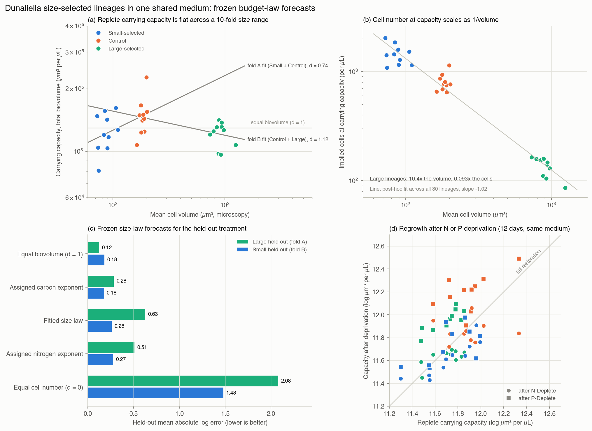

*Figure S5. Size-selected Dunaliella lineages regrown in one shared medium, from the data of
Malerba et al. (2018). (a) Replete carrying capacity in total biovolume against mean cell
volume, with the two cross-fitted size laws and the equal-biovolume law. (b) Implied cell
number at capacity. (c) Held-out errors of the frozen forecasts. (d) Capacity after N or P
deprivation against replete capacity. Generated from retained outputs by
[report_dunaliella_size_budget.py](../experiments/report_dunaliella_size_budget.py).*

### S5.4. Directly weighed coexisting plant stocks

Ten harvested herbaceous plots provide direct aboveground dry masses for coexisting ramets
or stem clusters (Dillon et al., 2019; [plant study](plant-biomass-profile.md)). Forest and
desert allometric masses are excluded. Five Ohio plots supply development fits; five Colorado
plots supply evaluation. The protocol, algorithms and forecasts were committed before formal
scoring, but raw rows had already been exposed during source inspection. This is a retrospective
transfer comparison. It identifies neither a limiting nutrient nor an opportunity budget;
$q(m)=m$ defines the measured stock rather than testing an independent cost law.

The frozen domain is 0.01–100 g, split into eight half-decade bins with empty classes retained.
The upper bound depends only on Ohio masses. Thirty missing mass records, 144 subthreshold
ramets and one above-domain ramet remain in the evaluation membership ledger. The latter
weighs 112.55 g and accounts for 24.50% of one plot's known biomass. In-domain mass coverage
is 75.48% there and 99.89–99.97% in the other four plots. Scores therefore describe the
declared domain; the excluded mass and unknown missing mass cannot be silently absorbed.

The primary score is equal-plot mean total variation between realized normalized biomass
and each expected-stock or empirical template. Bounded Pareto scores 0.470, logarithmic
neutrality 0.493, linear neutrality 0.507, the development histogram 0.510 and bounded
Weibull 0.531 (Figure S6). Pareto beats logarithmic neutrality in three of five plots;
large opposing plot differences leave a mean improvement of only 0.023. Count profiles
provide a different comparison: the development histogram, Pareto and Weibull score
0.260–0.271, versus 0.412 for linear and 0.495 for logarithmic neutrality. Their binned
count log losses are about 1.83, versus 2.08 and 2.42. These are point discrepancies,
without a calibrated ecological superiority or equivalence verdict. They also do not
contradict the original study's superior within-site Weibull fits: the models here transfer
across locales and share a development-fixed domain.

Synthetic calibration fixes census size and draws masses from $m^{-2}$ on the same domain,
so each bin has equal expected biomass before measurement rounding. At 160 independent ramets, mean realized stock TV
is 0.441 and every simulated census has an empty bin. The largest bin's average normalized
share is 3.13%, although its normalized expected stock is 12.50%. At 1,280 ramets these
values are 0.244, 87.2% and 9.12%. Thus
$E[R_i/\sum_jR_j]$ differs from $E[R_i]/\sum_jE[R_j]$. A separately generated iid 95% TV
envelope has exceedance rates 6.2% and 5.2%, but repeating masses in blocks of twenty raises
these to 97.8% and 99.9%. This stress test is not an ecological dependence model. Field
dependence, inclusion and independent regional replication remain unidentified, so the
ecological neutrality decision is unresolved. An uneven small census alone cannot settle
a claim about expected allocation.

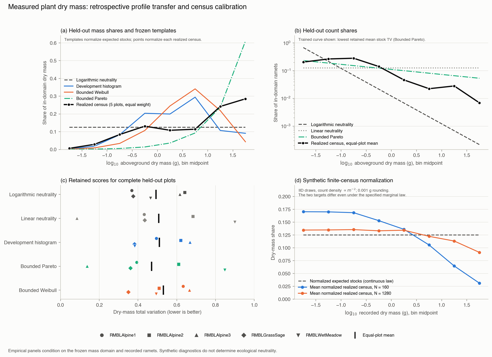

*Figure S6. Directly weighed plant profiles and synthetic observation limits. (a) Equal-plot
mean Colorado biomass shares and transferred stock templates. (b) Count shares and retained
count forecasts. (c) Each plot's biomass discrepancy and the five means. (d) Mean normalized
census shares under iid logarithmic neutrality, compared with normalized expected stocks.
All panels read retained outputs; [report_plant_biomass_profile.py](../experiments/report_plant_biomass_profile.py)
performs presentation only. Prior raw exposure and excluded biomass are retained.*

### S5.5. Linguistic resources and withheld genres

The linguistic study turns the inverse proposal into a measured transfer
comparison ([protocol and report](linguistic-resources.md)). Word occurrences
come from the pinned Universal Dependencies English EWT corpus, release 2.18;
letter counts $L$ come from original sentence text and phoneme counts $P$
from an independently pinned CMU pronunciation dictionary. The model uses a
counting measure on word types, with no fitted rank transformation or
post-hoc constraint factor.

Training uses only email, weblog and newsgroup texts: 83 documents and 83,635
retained tokens determine a vocabulary of 2,623 types with at least five
training occurrences and a dictionary pronunciation. All six forecasts share
this vocabulary. Conditional multinomial likelihood with nonnegative
exponents gives

$$\widehat Q_w\propto L_w^{0.5153}P_w^{1.8275},\qquad
\widehat p(w)\propto\widehat Q_w^{-1}.$$

Both exponents are interior. The log-feature correlation is 0.871 and the
model information condition number is 11.65; these diagnostics describe the
fitted model, without treating dependent tokens as independent measurements
of parameter precision. The protocol, code and fitted forecasts were hashed
before the official test file was acquired or decoded.

The primary target comprises withheld review and answer genres: 253 documents,
7,329 retained tokens and 77.65% vocabulary coverage after exact-duplicate
exclusion. The secondary target contains 63 new documents from the training
genres, with 9,618 retained tokens and 79.35% coverage. Ninety-three sentences
matching original training text were excluded by the frozen rule, and no
training/test document IDs overlap. Coverage is conditional on the tokenizer
and fixed vocabulary; excluded tokens remain in the ledger.

| Frozen forecast | New genres | Represented genres |
|---|---:|---:|
| Uniform word types | 7.872 | 7.872 |
| Inverse letter count | 7.405 | 7.457 |
| Fitted letter power | 7.239 | 7.328 |
| Fitted letter/phoneme product | 7.055 | 7.189 |
| Exponential letter cost | 7.195 | 7.304 |
| Smoothed training frequencies | 6.136 | 6.199 |

*Table S10. Held-out conditional log loss in nats per retained token; lower is
better. Every parameter and the vocabulary are fixed from training.*

The composite improves on letter power by 0.1843 nats per token in new genres;
the paired document-bootstrap 95% interval for composite minus letter-power
loss is [−0.1967, −0.1696]. The secondary improvement is 0.1387, with interval
[−0.1512, −0.1251], and the point difference favors the composite in all five
genres. The 2,000-resample intervals condition on the fitted forecasts and
exchangeability of documents within each evaluation group. They omit
training uncertainty and dependence between authors, threads or websites.

The gain demonstrates transferable information in the combined symbolic
features (Figure S7). Training word frequencies nevertheless predict much
better. Only 83 distinct $(L,P)$ pairs occur among the 2,623 vocabulary types,
so the resource model must give many different words identical probabilities.
Observed primary letter-resource and inferred-cost shares remain far from
uniform over word types, with descriptive total variations 0.693 and 0.689.
Within every individual genre the composite distance is larger than the
letter-resource distance, despite the small decrease after pooling.
These finite-corpus discrepancies are not calibrated neutrality tests.
The fitted combination is a predictive candidate; neither equal resource
allocation nor a unique physical linguistic cost has been established.
Sonority, duration, context and semantic requirements remain unmeasured here.

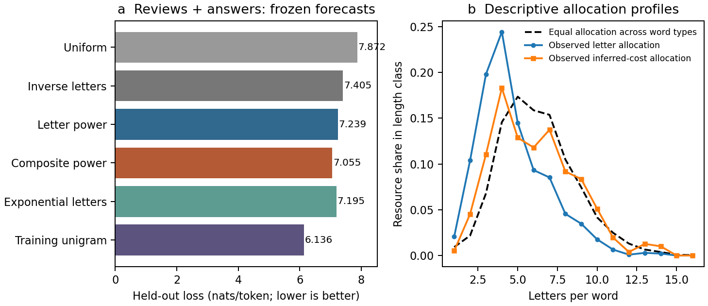

*Figure S7. Frozen linguistic predictions. (a) Loss on withheld review and answer
genres, including all six declared alternatives. (b) Observed letter and
inferred-cost allocation aggregated by word length. Equal allocation over word
types gives the dashed type-multiplicity profile, not a flat profile over length.
Aggregation conceals variation among words of the same length. The fitted
composite improves prediction over letter-only costs but trails training
word frequencies; its resource profile remains descriptive.*

### S5.6. Birth-calibrated bacterial population summaries

[Gangan and Athale (2017)](https://doi.org/10.1098/rsos.160417) measured
*E. coli* MG1655 in mother-machine and batch settings at 37°C. We transcribe
the printed arithmetic means and variances of their lognormal fits in
the source article’s Figure 2 (birth/division) and Figure 1 (batch snapshot),
using official NCBI images. The source authors retain credit for the experiments and original fits.

| Medium | Birth mean | Birth variance | Division mean | Division variance |
|---|---:|---:|---:|---:|
| LB | 2.7391 | 0.9419 | 5.2833 | 3.2094 |
| M9 + succinate | 1.4913 | 0.0540 | 3.2358 | 0.2084 |

*Table S11. Published bacterial birth/division calibration moments; lengths are in micrometres and variances in square micrometres.*

Means are in micrometres; variances in square micrometres. These are fitted
moments, not log-space parameters or the slightly different sample statistics
quoted in the article prose. Calibration sample counts are 153/110 (LB
birth/division) and 133/68 (M9). The source summaries do not establish independent
replicates, complete uncensored cycles, or common individual growth rates.

The division mean divided by twice the birth mean is 0.9644 in LB and 1.0849
in M9; division/birth CV ratios are 0.9570 and 0.9054. Exact symmetric stationary
compatibility is therefore not satisfied by the separately fitted laws. We do
not subtract those incompatible lognormal CDFs and clip negative tails. Instead,
the primary conditional model uses the birth fit and imposes $D\overset d=2B$;
a separate, declared sensitivity uses the division fit divided by two.

The [protocol](cell-division-protocol.md), implementation, calibration sources,
and all four forecasts were hashed in
[the freeze](../data/cell-division/2026-10-08/freeze.json) before acquisition
of the source article’s Figure 1. The source's qualitative findings and calibration measurements
had already been read. This separation protects the numerical comparison from
retuning; it is not external preregistration or global blinding. Dryad's raw
workbook returned HTTP 403, so raw-cell uncertainty and distribution fit are
not evaluated. The archived published summaries remain reproducible offline.

For birth mean $m$ and squared CV $c^2$, the lognormal model gives

$$E_P[x]=\frac{2m\ln2}{1+c^2},\qquad
\operatorname{CV}_P^2=\frac{1+c^2}{2(\ln2)^2}-1.$$

The chronological comparator gives $E_L[x]=m/\ln2$ and
$\operatorname{CV}_L^2=\tfrac32\ln2(1+c^2)-1$.
All forecasts retain the calibration length scale; no target-culture multiplier
is fitted. The fixed-birth comparator sets birth variance to zero.

#### Results, including the unsuccessful comparison

| Medium and quantity | Published target | Population | Lineage | Fixed birth | Division / 2 |
|---|---:|---:|---:|---:|---:|
| LB mean | 3.2842 | 3.3737 | 3.9517 | 3.7972 | 3.2845 |
| LB CV | 0.3957 | 0.4139 | 0.4126 | 0.2017 | 0.4004 |
| M9 mean | 2.0094 | 2.0184 | 2.1515 | 2.0674 | 2.1991 |
| M9 CV | 0.2146 | 0.2568 | 0.2549 | 0.2017 | 0.2478 |

*Table S12. Every frozen bacterial endpoint forecast; CV is dimensionless and mean length is in micrometres.*

Targets come from 1,217 and 3,665 reported cells respectively. Their printed
fit variances are 1.6888 and 0.1859. No inferential interval is manufactured
from those counts and rounded fitted moments.

The primary mean forecast is 2.72% high in LB and 0.447% high in M9, compared
with 20.32% and 7.07% for the lineage comparator. Absolute log errors are
0.02688/0.004456 for the population and 0.18502/0.06832 for the lineage.
Population CV is 4.61% and 19.69% high. The lineage CV errors are slightly
smaller, so the declared requirement of improvement on **both endpoints**
is not met in either medium. No pooled success verdict replaces that result.
The CV advantage is small and structural: the multipliers of $1+c^2$ in the
two squared-CV formulas are 1.04068449 and 1.03972077. This endpoint weakly
distinguishes the sampling schemes.

**Interpretation correction to the frozen protocol:** its statement that failure
"rejects this complete length-proxy transfer model" is too strong. The declared
descriptive criterion establishes no joint predictive superiority; it supplies
no statistical model rejection. The original protocol is preserved, with this
clarification also retained in the registry.

The fixed-birth model also predicts M9 variability more closely than the primary
model. Division-based calibration happens to match LB very closely but raises
the M9 mean error to 9.44%; it remains a sensitivity, not a selected winner.

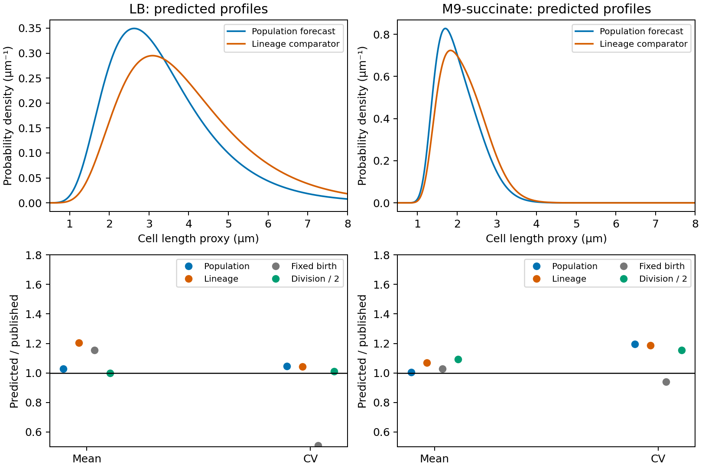

*Figure S8. Top panels are model predictions, not observed histograms. Bottom panels show
predicted/published endpoint ratios for every declared model; unity is exact
agreement.* The [machine-readable results](../results/cell-division/summary.json)
retain all errors and calibration diagnostics.

This adds a concrete natural-system mechanism and an independent-experiment
mean prediction to the framework. It does not establish accurate full-profile
transfer, independently verified neutral eligibility, or a general biological
allocation law. The variability discrepancy and calibration mismatch delimit
the model's explanatory scope. Resolving them requires growth, partition,
width and sampling information; naming them possible constraints is not a
measurement of their effects.

### S5.7. Geometric predictions and seismic eligibility

Separate repository registrations compare physical resource readings using
earthquake aftershocks, flare ribbons and lake geometry. They concern
log-orthopolic allocation per logarithmic size coordinate. Inputs, estimator
amendments, prior exposure and decision rules are retained in the
[test ledger](preregistered-tests.md). These studies supply negative or qualified
comparisons; the literal registered decisions remain distinct from whether an
interval excludes an individual predicted value.

| Comparison | Result | Scope of the decision |
|---|---|---|
| Aftershock productivity: rupture area predicts $\alpha=1$, moment predicts $1.5$ | Primary $\alpha=0.63$, 95% interval $[0.51,0.71]$; rupture-length-window sensitivity $0.90$, $[0.76,0.97]$ | Both predictions excluded under these counting schemes; registered verdict inconclusive; strong window dependence |
| Flare ribbon area: density exponents $2$ and $7/3$ | $\alpha=3.163$, $[2.962,3.457]$ | Both excluded; registered verdict inconclusive |
| Global lake radius: survival exponent $\zeta_R=2$ | Original geometry $1.930$, iid $[1.919,1.941]$; local-geometry follow-up $1.859$, basin $[1.785,1.924]$ | Original iid equivalence disappears with physical local geometry; follow-up inconclusive against the $[1.9,2.1]$ margin |

*Table S13. Retained geometric predictions. Intervals condition on each study's
declared sampling and measurement assumptions; they do not establish a universal
resource law.*

The [lake follow-up](lake-metric-followup-results-2026-10-09.md) independently
changes projection and quantifies basin dependence. Two local projections agree
closely, identifying the original global projection as a material source of
the change. Exact 2 lies outside the basin interval, while practical equivalence
and practical departure are both unestablished under the frozen margin.
Invalid source topology, unmatched basin outlets and an iid goodness-of-fit
diagnostic remain qualifications. The separately frozen UK result likewise
does not establish a robust spatial rejection: its iid interval excludes 2,
but its spatial interval includes it.

The seismic comparison predicts $b=D_2/2$ for rupture territory, using
hypocentre correlation dimension, against $b=1$ independent of that dimension.
The [Southern California qualification](seismic-qualification-results-2026-10-10.md)
uses published sequence memberships. Forty sequences have at least 200 raw
events; quality, completeness and location-resolution gates reduce this to six,
below the registered minimum ten. No b or $D_2$ was fitted.

A subsequent CLASS/HORUS source audit establishes 295,193 unambiguous Italian
location/provenance links, of which only 699 have direct moment-tensor magnitudes.
The calibrated proxies require an observation model. A separately frozen
[synthetic check](italian-magnitude-validation-results-2026-10-10.md), using
the published conversions of Lolli et al. (2020), fails its necessary validation
gate in 45 of 56 required scenarios, including 30 of 32 noiseless proxy cases.
For example, true $b=1.5$ gives mean $1.158$ under one earlier-ML conversion and
lower-support choice; exact source-bin integration gives $1.158$ as well.
Conversion leaves gaps in rounded magnitude classes which the uniform-bin
correction does not represent. This is a controlled counterexample to the
estimator's adequacy, not an observed Italian exponent or a test of either
physical relation. The Italian attempt therefore stops before real sequence
construction or response fitting. A revised likelihood would need to represent
original magnitude bins, detection and calibration uncertainty before another
physical comparison.

#### Complete lake geometry and spatial comparisons

The original global and UK outcomes were known before this follow-up was designed.
Its local Git freeze protects the declared follow-up against subsequent retuning;
it is not a new independent confirmation. The resource reading is territory per
$d\ln R$, and all intervals below retain their stated resampling assumptions.

All **1,427,688** original HydroLAKES features were processed. The inclusive
1–20 km range and equivalence band were held fixed.

| Geometry / population | Selected lakes | ζ | Iid 95% interval | Spatial 95% interval |
|---|---:|---:|---|---|
| Original EPSG:6933, largest ring | 119,683 | 1.9295 | [1.9185, 1.9408] | Country: [1.5945, 2.0296] |
| Local LAEA, largest exterior ring | 70,199 | 1.8614 | [1.8477, 1.8760] | Country: [1.6105, 1.9600] |
| Local LAEA, full lake geometry — primary | 70,486 | 1.8588 | [1.8443, 1.8739] | Country: [1.6071, 1.9539] |
| Local LAEA, catchment-matched lakes | 70,455 | 1.8585 | [1.8429, 1.8726] | Basin: [1.7851, 1.9244] |
| Local geodesic AEQD, full geometry | 70,486 | 1.8588 | [1.8444, 1.8726] | Country: [1.6073, 1.9453] |
| Separate UK regional study, full geometry in EPSG:27700 | 148 | 1.4413 | [1.1913, 1.7144] | 100-km grid: [1.1657, 2.0087] |

*Table S14. Global geometry and spatial sensitivities, plus the separate UK regional comparison. Survival exponent is ζ; interval assumptions differ by row.*

The original result and its literal decision remain preserved. The UK row comes
from its [separate regional protocol and report](lake-gyration-results-2026-10-09.md),
with 29 occupied spatial cells. Its frozen either-interval departure rule triggers
on the iid interval, while its grid interval includes 2; robust spatial rejection
is therefore not established. The table
compares completed calculations, not a menu from which to select a favourable
method. All follow-up choices were frozen before its fitted outcomes.

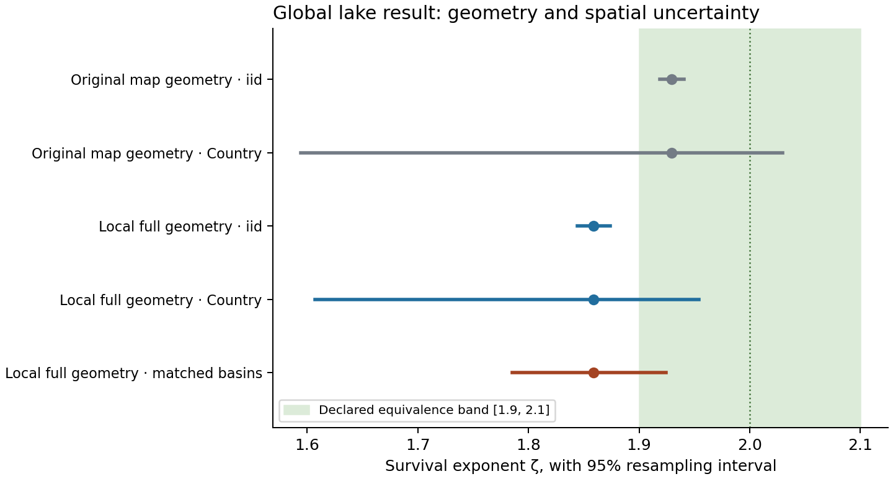

*Figure S9. Retained global lake geometry comparisons and their conditional uncertainty intervals.*

The local-largest-ring comparison attributes most of the exponent change to
the projection and consequent radius selection; accounting for holes has a
smaller effect. Relative to the original selection, 3,676 lakes enter and
52,873 leave. The full source contains 216,330 hole rings and exactly one
exterior ring per feature; 29,112 selected lakes contain holes.

LAEA and AEQD select **exactly the same lakes**. Their exponent estimates differ
by about 0.00000021, and their maximum selected radius discrepancy is only
9 parts per million. The longest centre-to-vertex distance in a selected lake
is 85.31 km, below the declared 200 km limit. Local projected areas differ from
independent geodesic polygon areas by at most about 1.8 parts per million on
the selected sample. These checks make residual local projection distortion a
poor explanation for the new exponent. They do not establish mapping
completeness or intrinsic geodesic exactness.

#### Spatial and distribution qualifications

The official **HydroBASINS level-3 v1.c** files were reachable. All nine
regional archives supply 292 major drainage regions. The deterministic outlet
join matches **70,455 of 70,486 lakes (99.956%)**, occupying **246 basins**.
There are 31 unmatched outlets and no ambiguous multiple matches. Unmatched
lakes remain in the global estimate; the basin interval explicitly describes
the matched population. Its point estimate differs from the all-lake estimate
by only 0.00023, but the declared complete-coverage gate still fails.

The largest occupied basin contains 7.17% of matched lakes. By contrast, the
largest Country block contains 53.67% of selected lakes. Different grouping
scales give different intervals; neither grouping guarantees independence
between blocks or accounts for mapping error.

**379 selected lake geometries (0.54%) are topologically invalid under GEOS.**
None triggers the corrected orphan-hole conversion check. Their signed moments
are retained, as declared; no lake is silently repaired or excluded. The
all-valid-topology gate therefore fails. The basin overlay's separate,
predeclared linework repair was needed for 209 of 292 basin features; source
archives were unchanged. A pre-fit audit found no basin conversion errors or
raw longitude jumps over 180°.

The bounded, refitted **iid** KS diagnostic gives D=0.004618 and
p=0.01399 (13 of 1,000 simulated statistics at least as large). This is a small
absolute CDF discrepancy but fails the declared diagnostic threshold. Spatial
dependence prevents interpreting its p-value as a calibrated spatial rejection.
It is another reason to describe a fitted exponent without claiming positive
power-law support.

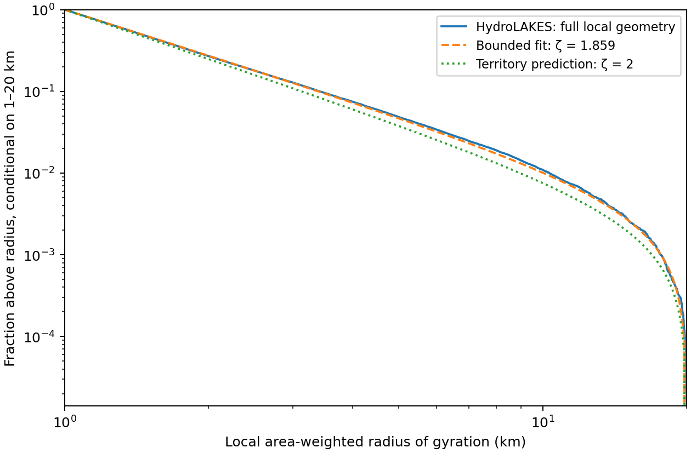

*Figure S10. Observed lake-radius survival and bounded fitted model; the iid adequacy diagnostic is qualified by spatial dependence.*

The declared `Lake_type == 1` point-only sensitivity gives ζ=1.9752 for 66,074
lakes. This means **not flagged as reservoir or regulated** in this source,
not independently verified natural lakes. No interval was declared for this
sensitivity, and its near-2 estimate does not replace the primary outcome.
Any further classification analysis must disclose that this result is known.

#### Seismic source and resolution eligibility

| Necessary condition, in order | Sequences remaining |
|---|---:|
| At least 200 published events | 40 |
| At least 200 after location/event-quality filtering | 28 |
| At least 200 above the frozen completeness rule | 16 |
| Distance interval spans a factor of at least 3 after the location-error floor | **6** |
| Required before any b/D2 comparison | **10** |

*Table S15. Southern California sequence eligibility gates, in their frozen order.*

The [published 1981–2018 catalogue](https://zaliapin.github.io/pubs/ZBZ_JGR2020_data.txt)
contains 123,275 events in 26,137 sequences. Membership follows the published
largest-event index without reclustering, merging or splitting. The source is
[Zaliapin and Ben-Zion (2020)](https://doi.org/10.1029/2018JB017120).
All event IDs join uniquely to the matching 634,252-event relocated catalogue
from [SCEDC](https://service.scedc.caltech.edu/ftp/catalogs/hauksson/Socal_DD/),
`hs_1981_all_comb_K4_A.cat_so_SCSN_v01`, associated with
[Hauksson, Yang and Shearer (2012)](https://doi.org/10.1785/0120120010).
Published latitude, longitude, depth and magnitude agree exactly with that source.

Three full downloads are pinned in the
[acquisition manifest](../data/seismic-regional/2026-10-09/acquisition.json):
the published labels (13.31 MB), their matching source (98.94 MB), and the newer
1981–2025 regional catalogue (152.81 MB). The last is retained for future work
and contributes no observations to this calculation. All byte counts and SHA256
digests pass. The raw files remain local and can be restored from publisher URLs.

The [execution supplement](seismic-qualification-protocol-2026-10-10.md),
[config](../configs/seismic_qualification_2026-10-10.json), parsers, qualification
code and 22 checks were committed as **`6ae7a8c` before real completeness or
distance-range calculations**. Structural source counts and the original
synthetic validation were already known and disclosed. This is a local Git
freeze, not an externally timestamped registration. The original hypotheses,
200-complete-event threshold, factor-three distance span and ten-sequence
minimum remain unchanged. The approximately 1,000/3,000 events needed in the
earlier planar/volumetric simulations were not imposed as extra hard thresholds.

#### What limits the calculation

Quality filtering retains 96,441 events. It requires cross-correlation locations,
earthquake types `le` or `eq`, and finite positive absolute horizontal and vertical
errors below the declared placeholder cutoff. The ledger retains every event,
including exclusions and overlapping reasons. One published clock record has
minute=60; it remains flagged and retained because this calculation uses the
published memberships and does not use event times.

For each candidate sequence, completeness is rounded MAXC+0.2, bounded by the
source's magnitude floor. Sixteen have enough complete events. Their median
quadrature absolute-error proxies range from **0.447 to 4.757 km**. With the
registered three-error lower radius and upper radius of one tenth of the
90th-percentile pair distance, only six have a factor-three span:

| Published sequence ID | Complete events | Mc | Available span |
|---|---:|---:|---:|
| 2112 | 365 | 2.4 | 3.415 |
| 15732 | 1,154 | 2.3 | 7.032 |
| 39006 | 1,095 | 2.4 | 7.943 |
| 41355 | 6,048 | 2.4 | 6.498 |
| 44940 | 1,147 | 2.4 | 7.603 |
| 76958 | 2,537 | 2.4 | 8.754 |

*Table S16. The six published sequences that pass the complete-event and spatial-resolution requirements.*

The hypocentre cap is 3,000; the location-error median uses all complete events.
Every sampled ID is retained. The ten failed ranges remain in the ledger.
Ignoring errors would admit all sixteen, but this was frozen as a diagnostic
only and cannot justify a response fit.

This error convention is conservative rather than a complete uncertainty model.
Absolute standard-error estimates lack covariance information; shared translation
errors can cancel within a relocation component. All sixteen complete sequences
span multiple waveform/processing components, so the within-component relative
errors cannot simply replace their absolute errors. The finding is about this
specified observation model, not proof that these earthquakes can never support
a dimension estimate.

Two other limits would remain even if more sequences qualified. Published
membership depends on magnitude as well as time and distance, so fixed external
labels do not provide magnitude-independent geometry. Also, preferred catalogue
magnitudes are not homogeneous Mw, and this source has no magnitude-type column.
The [SCSN catalogue history](https://scedc.caltech.edu/about/BSSA_2010_Hutton_SCSN_cat.pdf)
describes these magnitude distinctions. A physical test of the moment-based
conversion would need independently justified calibration. No D2 contrast,
regression slope, or hypothesis interval is claimed here.

#### Italian observation-model prerequisite and complete required scenarios

There are 400 independent repetitions of 7,000 events in each of 72 cells:
two true b-values, four lower magnitude supports and nine observation models.
Each eligible sample receives the original MAXC+0.2 and Aki–Utsu calculation,
with 500 conditional bootstrap resamples. All 28,800 samples pass the minimum
200-event population gate; the failures concern bias and uncertainty calibration.

The true b-values 1 and 1.5 distinguish the magnitude marginals of the proposed
**log-orthopolic** rupture-territory relation b=D2/2 and the b=1 alternative
on ideal planar/volumetric supports. This checks the magnitude component, not
the full geometry, sequence selection or Deming-regression decision.

The [HORUS paper](https://doi.org/10.1785/0220200148), Tables 7 and 9, supplies
the ML/Md conversion coefficients and ML scatter scales. Single-source scenarios
isolate their effects: simulate true exponential magnitudes, convert to the
source scale, optionally add Gaussian error, round the source to 0.1, convert
to Mw proxy and round to 0.01, then apply the registered 0.1 rounding. The normal
distribution, hard lower support and homogeneous source populations are explicit
simulation assumptions. We have not fitted their frequencies or detection law
to the Italian catalogue, reconstructed all HORUS averaging/switching rules,
or established that every real mixture has the simulated biases.

| Observation model | Cells passing / 8 | Mean-bias range | Coverage range |
|---|---:|---:|---:|
| Direct rounded Mw control | 7 | −0.017 to −0.003 | 88.3–95.5% |
| ML before 2011, no scatter | 1 | −0.342 to +0.067 | 0–94.5% |
| ML from 2011, no scatter | 1 | −0.216 to +0.035 | 0–90.8% |
| Md before April 2013, no scatter | 0 | −0.304 to +0.377 | 0–32.8% |
| Md from April 2013, no scatter | 0 | +0.035 to +0.347 | 0–45.8% |
| Earlier ML with source scatter 0.18 | 0 | −0.114 to +0.028 | 1.3–89.0% |
| Later ML with source scatter 0.16 | 2 | −0.067 to +0.037 | 22.5–95.0% |

*Table S17. All required Italian observation-model scenarios, grouped into eight cells per model; the two shared-slope sensitivities remain outside the necessary gate.*

The two additional shared-calibration-slope sensitivities are outside the gate;
their 16 cells remain in the output. The full
[cell table](../results/italian-magnitude-validation-2026-10-10/cells.csv) and
[summary](../results/italian-magnitude-validation-2026-10-10/summary.json)
include Monte Carlo errors, Wilson coverage intervals, every failure and the
independent population calculation. A single near-threshold control failure
could be sensitive to Monte Carlo variation; the large proxy failures are
not an inference from that borderline control.

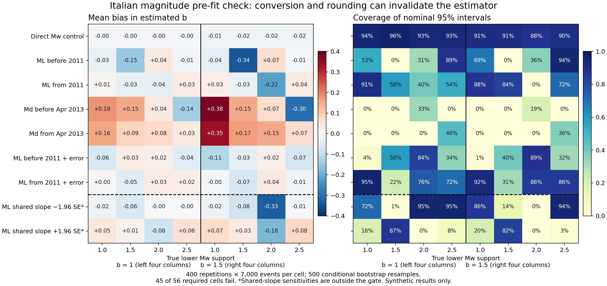

*Figure S11. Retained synthetic magnitude-validation cells. Bias and coverage refer to simulated observation models; no real Italian b or dimension was fitted.*

#### Why rounding matters

In the earlier ML conversion, a source grid 1.6, 1.7, 1.8 produces proxy
hundredths 1.54, 1.65, 1.75. Under the declared NumPy rounding, the registered
tenths are 1.5, 1.6, 1.8: **the 1.7 class is missing**. With true b=1.5 and
lower Mw support 1.5, the population MAXC+0.2 is 1.7. Events first appear in
the 1.8 bin, while the estimator subtracts `1.7−0.05` from their mean.

The resulting average b is **1.15785**, with Monte Carlo SE 0.00071; an
independent integration over source-bin probabilities gives **1.15791**.
None of its 400 diagnostic intervals covers 1.5. For the later ML conversion,
true b=1.5 above support 2.0 gives mean **1.28430**, compared with the population
limit **1.28507**, again with zero coverage. The largest positive nominal bias
is an earlier-Md case: mean **1.87694** for true b=1.5.

Even the direct control has the small known finite-bin approximation error:
for a complete 0.1 lattice, the population limit of the implemented correction
is $2\tanh[0.1b\ln(10)/2]/[0.1\ln(10)]$, or **1.48526** when b=1.5.
This remains a magnitude-estimator issue, not an observed earthquake result.

Some population-mode bins nearly tie. The sampled MAXC can then change between
repetitions, so an ensemble mean need not equal the single population-mode
limit. Mode gaps are retained explicitly; no mismatching cells are discarded.

#### What a repair would need

For noiseless, singly converted complete tails, an exact geometric likelihood
on the **original source bins** recovers b in the independent population
calculation. Its simulated point estimates also recover the nominal value.
This diagnoses the source of the problem; it is not a registered replacement.
With measurement error near a lower detection boundary, even that diagnostic
can remain biased (one earlier-ML b=1.5 scenario gives about 1.390).

A future attempt would need a likelihood that represents source-specific bins,
calibration, detection and source switching/averaging, plus uncertainty shared
by all events using a calibration. A deliberately narrower homogeneous cohort
is another design option, but would need fresh validation and unchanged
population/resolution gates. Neither option has been tested on real responses.

HORUS equation 4 also illustrates within-bin jitter using b=1. The retained
`_o` input files avoid this extra assumption. Table 9's post-2011 ML covariance,
as printed, violates the covariance bound for its two printed standard errors:
`0.0011 > 0.065*0.016`. We have neither diagnosed the cause nor repaired it.
The two marginal slope perturbations are sensitivities, not a joint calibration
uncertainty calculation. These issues strengthen the need for an observation
model; the noiseless failures already establish the present stop decision.

### S5.8. Scope of the retained comparisons

The positive results concern conditional budget closure: a separately measured or geometric
cost, declared shared resource conditions, and abundance or resource shares predicted from them. The runtime
experiment and the algal lineages are the clearest cases. In the lineages,
volume scaling supplies the cost exponent; the empirical content is the
similar attained biovolume at the small and large treatment extremes, together
with higher intermediate-control capacities and the retained held-out forecast scores.
The capacity theorem makes inverse-volume abundance conditional on that
common attained budget. The biological observation concerns whether the
lineages actually reach it.
A rule that goes beyond closure, by predicting how a restriction redistributes resource among
coexisting classes, failed in the grazed, dynamically changing food webs tested. The plant
study now observes coexisting class stocks directly, but it does not
establish equal expected allocation: the flat template is not best for biomass or counts,
and the ecological observation law is uncalibrated. No natural size-class study in S5
has independently identified neutral eligibility and a design sufficient for the
expected-allocation verdict.
Identifying such a regime, or independently characterizing its constrained
allocation, remains a central empirical task. The linguistic study separately
shows a gain from an inferred composite in a frozen genre transfer. Its lexical
baseline and uneven resource shares retain the limits of that candidate.
The bacterial comparison adds a mechanism-derived prediction between separate
experimental settings: mean length transfers closely, while variability and
the joint comparison fail. Its resource proxy and unverified growth assumptions
leave the natural-allocation qualification task open.

### S5.9. Data, code and provenance

Code, frozen inputs, configurations, and generated results are in this repository.
The make all target verifies input checksums, runs tests, and regenerates the empirical
analyses; see the [README](../README.md) for setup. Pilot estimates originate in
[results.json](../results/results.json); distribution diagnostics in
[gof.json](../results/gof.json); aquatic median, compatibility fractions, and ocean
intervals in [independent.json](../results/independent.json). Remaining JSON files contain
explicitly exploratory diagnostics. The studies of S5 are registered in an append-only
[run registry](run-registry.md) with their inputs, frozen protocols, archived algorithms and
outputs. The class-exchange demonstration and retrospective FIRAS calculation are also
registered; their reports give offline reproduction commands and interpretation limits.
The inverse-resource simulation and linguistic transfer likewise retain configurations,
algorithms, predictions, all scored outcomes and source hashes. The linguistic
protocol and training fit were frozen before test-file acquisition; this is a
retrospective public-corpus study, not external preregistration.
The bacterial summary transfer retains official figure images, manual numerical
transcriptions, calibration diagnostics and four frozen forecasts. Its numerical
target figure was retrieved after the freeze; qualitative outcomes were already known.
The geometric tests, seismic eligibility assessment and Italian synthetic
magnitude validation retain separate configurations, source receipts and
reproduction targets. Their outputs preserve failures and stopping decisions;
no real Italian b/D2 result is implied by the simulation record.
Plant sources are pinned to author commit defccc3dcbbbf3ba57ff1572377de88fba83ff7f,
with acquisition checksums and complete inclusion ledgers. The registry-verify target audits
the registry offline, and each study report gives its replay
command; source errata found during those audits are recorded there. Source-specific conditions
are recorded in
[data/NOTICE.md](../data/NOTICE.md); there is no blanket licence for all inputs.
The supplied 2017 manuscript was inspected privately and is not redistributed.

The reports cited in this supplement, rather than this editorial compilation, retain the exact historical protocols and outputs. Numerical corrections to interpretation here do not amend a frozen forecast or relabel a failed comparison. See [the status and handoff](status.md) for subsequent work and current verification counts.

### S5.10. Chemostat capacity diagnosis with changing quotas

The retrospective follow-up completed on 11 October 2026 asks whether the
earlier chemostat failure can be explained by a different path of resource
prices. Its [design](chemostat-capacity-followup-protocol-2026-10-10.md) and
tested algorithms were frozen at `13374c5` before this calculation. Outcomes
were already known; this is a conditional diagnosis, not a new blinded test.
The [full report](chemostat-capacity-followup-results-2026-10-11.md) records
every comparison, assumption and reproduction command.

For group biovolume $V_j(t)$, fixed nonnegative opportunities $w_j$ and
positive elemental densities $\rho_{Nj},\rho_{Cj}$, consider

$$V_j(t)=c_t\frac{w_j}{a_t\rho_{Nj}(t)+b_t\rho_{Cj}(t)},\qquad
a_t,b_t\ge0,\quad a_t+b_t>0.$$

Writing $r_j=\rho_{Cj}/\rho_{Nj}$, the normalized nitrogen shares satisfy
$p_j(t)\propto p_j(0)f_j$, with
$f_j=[a_0+b_0r_j(0)]/[a_t+b_tr_j(t)]$. For every distinct pair,

$$\frac{f_i}{f_j}\le
\max\left(1,\frac{r_i(0)}{r_j(0)}\right)
\max\left(1,\frac{r_j(t)}{r_i(t)}\right).$$

Let $K$ bound all such ratios, allowing all pooled-species ratio endpoints.
An event with initial probability $x$ can gain at most
$Kx/[1+(K-1)x]-x$. Maximizing over $x$ proves

$$\operatorname{TV}(p(t),p(0))\le U=\frac{\sqrt K-1}{\sqrt K+1}.$$

The bound allows arbitrary prices at both dates and all starting shares.
It can be conservative for a particular baseline. All Monoraphidium/Chlorella
mixtures are admitted independently at both observations. Possible observed
nitrogen shares form line segments; minimizing their TV gives the smallest
departure compatible with any mixture. A feasible dual witness certifies a
lower bound on that minimum. An exceedance is declared only when this lower
bound exceeds $U$ by more than $10^{-8}$.

Twenty preliminary quota records cover four species at days −4, 0, 1, 2 and 3.
Day-0 main-vessel composition is compared with exact days 1–3, without quota
extrapolation. Changing quotas give $U=0.190065,0.174899,0.154853$; keeping
pre-pulse quotas fixed gives $U=0.154853$ throughout. All 144 planned entries
are usable. The primary group comprises twelve rotifer-polyculture vessels;
the secondary group has twelve single-rotifer-species vessels. Both contain
multiple algal species.

| Quotas and cohort | Exceeding comparisons | Vessels exceeding at least once |
|---|---:|---:|
| Measured changes, polycultures (primary) | 17/36 | 8/12 |
| Fixed pre-pulse, polycultures | 15/36 | 8/12 |
| Measured changes, monocultures | 9/36 | 8/12 |
| Fixed pre-pulse, monocultures | 6/36 | 6/12 |

*Table S18. Complete descriptive comparisons on days 1–3. Repeated days in a
vessel are dependent; these are not independent statistical tests.*

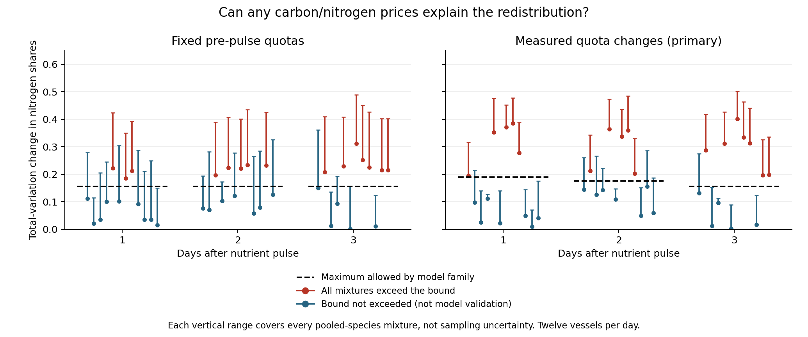

*Figure S12. Each vertical range spans all possible observed nitrogen-share
changes over pooled-species mixtures, with the minimum marked by a dot.
Within each day, vessels run 1–12 from left to right. Dashed segments bound
all model price choices. These are mixture envelopes, not confidence
intervals. Every red interval lies beyond the corresponding bound.*

Price adjustment alone cannot accommodate those eight primary vessels under
the transferred quotas and fixed opportunities. Preliminary semi-continuous
cultures do not measure the mixed vessels' physiology, however, and assay
uncertainty is unavailable. The finding excludes that conjunction at the
recorded values, not orthopolity generally, and does not identify which
assumption failed. Non-exceedance is a necessary-condition result, not model
validation. This finite-group calculation makes no size-spectrum neutrality
claim. Its next discriminating study requires main-vessel quotas and a model
of changing opportunities or dynamics, followed by an independent prediction.

Ten synthetic tests preceded execution. A separate verifier recomputes all
minima by enumerating vertices of the zero-residual line arrangement rather
than using the LP solver. It reproduces quota conversions, checks extreme
prices, source identities and every verdict. The maximum numerical difference
in the minima is $5.6\times10^{-17}$. Frozen prior results remain intact.

### S5.11. Independent phosphorus assays and a failed count transfer

The [paired-phosphorus pilot](paired-phosphorus-results-2026-10-12.md) uses
Filella and colleagues' same-experiment culture counts/bulk phosphorus
([BCO-DMO 1005084](https://doi.org/10.26008/1912/bco-dmo.1005084.1)) and
single-cell X-ray microanalysis
([BCO-DMO 1005186](https://doi.org/10.26008/1912/bco-dmo.1005186.1)). The
single-cell quota is independent of the Coulter count it predicts; it is not
bulk chemistry divided by that response. The finite measure counts cells in
one monoculture, so this is a resource-accounting transfer, not an equal-
allocation or log-size-spectrum test.

Of 12 culture/day samples, complete phosphorus assays and unambiguous identity
checks leave only High-P/day 1/bottle c (35 assayed cells) and Low-P/day 2/bottle
b (33). Ten samples are excluded for missing assays or conflicting/nonunique
identifiers; none is relabelled using its values. The first culture calibrates
and the second tests. Individual assayed cells are not independent population
responses, and the completeness-selected pair cannot establish a treatment
effect. Metadata and identifiers were inspected before the local design freeze
at `83a8c36`. A missing-volume stop led to a documented amendment at `1569c4f`
removing the optional size comparator before numerical response exposure.
The two retained cost predictions were unchanged.

Let $Q$ be measured bulk particulate P and $q$ the mean XRMA quota. The fixed-
quota forecast is $\widehat N_1=N_0Q_1/Q_0$; the measured-quota forecast is
$\widehat N_1=N_0(Q_1/Q_0)(q_0/q_1)$. These condition on current stock, not
feed supply or future resource availability. $Q$ changes from 7.677 to 0.782
micromoles/L, while $q$ changes from 1.061 to 1.389 fg/cell.

| Prediction | Million cells/mL | Predicted / observed | Absolute log error |
|---|---:|---:|---:|
| Fixed phosphorus quota | 5.552 | 0.1591 | 1.8384 |
| Independent XRMA quota | 4.241 | 0.1215 | 2.1077 |

*Table S19. One independent test culture contained 34.9 million cells/mL.
Both predictions miss the declared factor-1.25 accuracy target; the independently
assayed quota worsens this prediction. This is a descriptive pilot, not an
equivalence test or a population-level rejection.*

Raw accounting, $N=10^6(30.973761998)Q/q$ in the reported units, implies
4.112 times the observed calibration count but 0.500 times the test count.
Thus a constant cross-method calibration cannot reconcile the point estimates.
Unrepresented particles, preparation losses, cell sampling, sample correspondence
or other assay effects remain possible; none is identified by this comparison.
Bulk-assay uncertainties are unavailable, and dilution rates also differ between
treatments. Independent costs must be compatible with the populations and stocks
they explain before allocation can be assessed. A separate Decimal-arithmetic
verification reproduces 16 numerical quantities to relative error below
$1.7\times10^{-16}$ and checks the unchanged qualification ledger. The
[protocol](paired-phosphorus-protocol-2026-10-12.md),
[amendment](paired-phosphorus-amendment-2026-10-12.md), full source audit and
original unsuccessful predictions are retained.

### S5.12. Independently assayed field quotas and partial-stock compatibility

Lomas and Martiny's [sorted-cell quota archive](https://www.bco-dmo.org/dataset/849153)
divides elemental chemistry by direct post-sort counts, distinct from ambient
seawater abundance. Its combination with
[Pacific](https://www.bco-dmo.org/dataset/829895) and
[Atlantic](https://www.bco-dmo.org/dataset/538091) bulk/count archives therefore
avoids defining quota as bulk stock divided by the response. These are published
observations: Lomas et al. (2021) already analysed their stoichiometry and modelled
community contributions. Our [new audit](field-resources-results-2026-10-12.md)
asks whether the independently measured inputs satisfy a necessary stock bound.
It is not a new collection or a test of equal allocation. The finite measure
counts cells, without imposing equal opportunities on named taxa.

The [protocol](field-resources-protocol-2026-10-12.md), inputs, matching audit,
code and 13 synthetic checks were frozen at `52d2cc2` before numerical response
comparison; public findings and metadata were already exposed. Of 96 quota
records, nine have a unique exact cruise/station/depth match, the same reported
calendar date and coordinate differences each at most 0.02 degrees. Eight
additional records pass only with a one-day date offset. These are nominal
sampling matches, not proven common aliquots or time-zone corrections. All
other rows remain in the exclusion ledger. Only Prochlorococcus and
Synechococcus have usable group definitions across the files.

For available groups, $S_e=10^{-6}\sum_jN_jq_{je}$ converts ambient counts
(cells/mL) and quotas (fmol/cell) to partial standing stock (micromol/L).
Missing groups are recorded, not imputed as zero. With accurate representative
inputs and complete capture, filtered bulk stock $B_e$ must satisfy $S_e\leq B_e$.
More generally, if every included group retains at least elemental fraction $r$,
the necessary condition is $rS_e\leq B_e$. Counts describe whole water while
bulk chemistry uses GF/F filtration; complete capture is not established.

| Records | Element | Scored | Partial/bulk range | Above bulk |
|---|---|---:|---:|---:|
| Primary, same reported date | C | 9 | 0.0669--0.4397 | 0 |
| Primary, same reported date | N | 9 | 0.0397--0.2717 | 0 |
| Additional one-day offsets | C | 8 | 0.1356--1.0554 | 1 |
| Additional one-day offsets | N | 7 | 0.1099--0.8114 | 0 |

*Table S20. Carbon/nitrogen compatibility at nine primary sampling records
(eight stations), plus eight date-offset records (12 stations combined).
Only three primary records contain both cyanobacterial groups; the others
contain Synechococcus alone. One additional N record has no usable quota.
Repeated elements and depths are not independent inferential replicates.*

The sole C/N excess is Pacific station 7, 5 m, with quota and bulk dates differing
by one day: Prochlorococcus alone implies 1.80481 micromol C/L against bulk 1.71.
Its ratio 1.05544 allows a common minimum elemental retention no greater than
$\min(1,B/S)=0.94747$. The minimum symmetric relative adjustment to the two
aggregate quantities is $\max(0,(S-B)/(S+B))=0.02697$. Neither quantity is a
measured recovery or confidence interval. Other particulate material makes the
bound conservative; the comparison identifies no unique cause of the excess.

Phosphorus remains unit-unqualified. Atlantic P was excluded before execution
because the metadata use micromol/kg. The frozen Pacific calculation follows
the printed micromolar label and records nine ratios below one, but inspection
then exposed bulk C:P near 0.1, far below the original study's scale. An nM
interpretation would change those ratios by 1,000; it is not an independently
confirmed correction. The literal calculation and this post-run qualification
are both retained. No P result is counted as physically qualified evidence.

The primary C/N comparisons clear a necessary observation check without
establishing full-community closure, assay accuracy or a binding resource.
Incomplete taxon coverage makes the check permissive. Independently specified
opportunities and constraints, followed by another abundance prediction, remain
necessary for a natural-community allocation test. Sorting and shared assay
effects, nominal sample identity, missingness and unresolved units cannot be
replaced by a target-fitted resource or calibration.

## References

Arranz, I., Fournier, B., Lester, N. P., Shuter, B. J., and Peres-Neto, P. R. (2022).
Species compositions mediate biomass conservation: The case of lake fish communities.
*Ecology*, 103, e3608. <https://doi.org/10.1002/ecy.3608>.

Bishop, C. J., and Peres, Y. (2017). *Fractals in Probability and Analysis*.
Cambridge University Press. Section 1.1.
<https://www.math.stonybrook.edu/~bishop/fractalbook.pdf>.

Boyd, S., and Vandenberghe, L. (2004). *Convex Optimization*. Cambridge University Press.
Sections 4.7 and 5.6. <https://web.stanford.edu/~boyd/cvxbook/>.

CMU Sphinx contributors (accessed 7 October 2026). *CMU Pronouncing Dictionary*.
[Pinned source](https://github.com/cmusphinx/cmudict/tree/74790861f652b15e4ac49015a90074ad62a27690).

Clauset, A., Shalizi, C. R., and Newman, M. E. J. (2009). Power-law distributions in
empirical data. *SIAM Review*, 51, 661–703. <https://doi.org/10.1137/070710111>.

Condon, J. J., and Ransom, S. M. (2016). *Essential Radio Astronomy*.
Princeton University Press. Chapter 2, radiation and absorption.
<https://www.cv.nrao.edu/~sransom/web/Ch2.html>.

Cuesta, J. A., Delius, G. W., and Law, R. (2018). Sheldon spectrum and the plankton paradox:
two sides of the same coin—a trait-based plankton size-spectrum model.
*Journal of Mathematical Biology*, 76, 67–96. <https://arxiv.org/abs/1607.04158>.

Damuth, J. (1981). Population density and body size in mammals. *Nature*, 290, 699–700.
<https://doi.org/10.1038/290699a0>.

Dillon, K. T., et al. (2019). On the relationships between size and abundance in plants:
beyond forest communities. *Ecosphere*, 10, e02856. <https://doi.org/10.1002/ecs2.2856>.

Edwards, A. M., Robinson, J. P. W., Plank, M. J., Baum, J. K., and Blanchard, J. L. (2017).
Testing and recommending methods for fitting size spectra to data.
*Methods in Ecology and Evolution*, 8, 57–67. <https://doi.org/10.1111/2041-210X.12641>.

Edwards, A. M., Robinson, J. P. W., Blanchard, J. L., Baum, J. K., and Plank, M. J. (2020).
Accounting for the bin structure of data removes bias when fitting size spectra.
*Marine Ecology Progress Series*, 636, 19–33. <https://doi.org/10.3354/meps13230>.

Eeckhout, J. (2004). Gibrat's law for (all) cities. *American Economic Review*,
94(5), 1429--1451. <https://doi.org/10.1257/0002828043052303>.

Ersoy, Z., et al. (2025). GLOSSAQUA: A global dataset of size spectra across aquatic
ecosystems. *Ecology*, 106, e70050. <https://doi.org/10.1002/ecy.70050>.

Fabbri, R., and Oliveira Jr., O. N. (2017). *A simple model that explains why inequality
is ubiquitous*. Supplied manuscript dated 17 March 2017, 13 pp.; publication status unverified.

Fabbri, R. (2024). The Orthopolity cosmological principle and the Natural distribution law.
Author's essay, 14 August. <https://ttm.github.io/2024/08/14/power.html>.

Fixsen, D. J., Cheng, E. S., Gales, J. M., Mather, J. C., Shafer, R. A., and Wright,
E. L. (1996). The cosmic microwave background spectrum from the full COBE FIRAS data set.
*The Astrophysical Journal*, 473, 576. <https://doi.org/10.1086/178173>.
Source article: <https://arxiv.org/abs/astro-ph/9605054>.

Gabaix, X. (1999). Zipf's law for cities: An explanation. *The Quarterly Journal of
Economics*, 114(3), 739--767. <https://doi.org/10.1162/003355399556133>.

Gaedke, U. (1993). Ecosystem analysis based on biomass size distributions: A case study
of a plankton community in a large lake. *Limnology and Oceanography*, 38, 112–127.
<https://doi.org/10.4319/lo.1993.38.1.0112>.

Gangan, M. S., and Athale, C. A. (2017). Threshold effect of growth rate on
population variability of *Escherichia coli* cell lengths.
*Royal Society Open Science*, 4, 160417. <https://doi.org/10.1098/rsos.160417>.

Genthon, A. (2022). Analytical cell size distribution: lineage-population bias
and parameter inference. *Journal of the Royal Society Interface*, 19, 20220405.
<https://doi.org/10.1098/rsif.2022.0405>. Revised exposition:
<https://arxiv.org/abs/2206.06146v2>.

Harcourt, R., Garcia, N. S., and Martiny, A. C. (2024). *Synechococcus* batch culture data
(cell quotas and ratios (C, N, P), size, and diameter) from laboratory experiments in 2021 to
2022 with related isolates cultured across a range of temperatures. BCO-DMO dataset 926311,
version 1. <https://doi.org/10.26008/1912/bco-dmo.926311.1>.

Hatton, I. A., Heneghan, R. F., Bar-On, Y. M., and Galbraith, E. D. (2021). The global
ocean size spectrum from bacteria to whales. *Science Advances*, 7, eabh3732.
<https://doi.org/10.1126/sciadv.abh3732>.

Habeck, M. (2014). Bayesian approach to inverse statistical mechanics.
*Physical Review E*, 89, 052113. <https://doi.org/10.1103/PhysRevE.89.052113>.

Haus, H. A., and Melcher, J. R. (1989). *Electromagnetic Fields and Energy*.
Prentice-Hall. Section 11.2, Poynting's theorem.
<https://web.mit.edu/6.013_book/www/chapter11/11.2.html>.

Ioannides, Y. M., and Skouras, S. (2013). US city size distribution: Robustly Pareto,
but only in the tail. *Journal of Urban Economics*, 73(1), 18--29.
<https://doi.org/10.1016/j.jue.2012.06.005>.

Jaynes, E. T. (1957). Information theory and statistical mechanics. *Physical Review*,
106, 620–630. <https://doi.org/10.1103/PhysRev.106.620>.

Jaynes, E. T. (1968). Prior probabilities. *IEEE Transactions on Systems Science and
Cybernetics*, 4(3), 227–241. <https://bayes.wustl.edu/etj/articles/prior.pdf>.

Keshavarz, A., Wang, Y., and Boyd, S. (2011). Imputing a Convex Objective Function.
*Proceedings IEEE Multi-Conference on Systems and Control*, 613–619.
<https://stanford.edu/~boyd/papers/imputed_objective.html>.

Levin, D. A., and Peres, Y. (2017). *Markov Chains and Mixing Times*, second edition,
with contributions by E. L. Wilmer. American Mathematical Society.
<https://pages.uoregon.edu/dlevin/MARKOV/mcmt2e.pdf>.

Lolli, B., Randazzo, D., Vannucci, G., and Gasperini, P. (2020). The Homogenized
Instrumental Seismic Catalog (HORUS) of Italy from 1960 to Present.
*Seismological Research Letters*. <https://doi.org/10.1785/0220200148>.

Lomas, M. W., Baer, S. E., Mouginot, C., Terpis, K. X., Lomas, D. A., Altabet,
M. A., and Martiny, A. C. (2021). Varying influence of phytoplankton biodiversity
and stoichiometric plasticity on bulk particulate stoichiometry across ocean
basins. *Communications Earth & Environment*, 2, 143.
<https://doi.org/10.1038/s43247-021-00212-9>.

Malerba, M. E., Palacios, M. M., and Marshall, D. J. (2018). Do larger individuals cope with
resource fluctuations better? An artificial selection approach. *Proceedings of the Royal
Society B*, 285, 20181347. <https://doi.org/10.1098/rspb.2018.1347>. Data:
<https://doi.org/10.5061/dryad.4mh47r7>.

Marshall, D. J., et al. (2022). Long-term experimental evolution decouples size and
production costs in *Escherichia coli*. *Proceedings of the National Academy of Sciences*,
119, e2200713119. <https://doi.org/10.1073/pnas.2200713119>.

Newman, M. E. J. (2005). Power laws, Pareto distributions and Zipf's law.
*Contemporary Physics*, 46, 323–351. <https://arxiv.org/abs/cond-mat/0412004>.

Piantadosi, S. T., Tily, H., and Gibson, E. (2011). Word lengths are optimized for
efficient communication. *Proceedings of the National Academy of Sciences*,
108(9), 3526–3529. <https://doi.org/10.1073/pnas.1012551108>.

NASA LAMBDA (accessed 6 October 2026). COBE FIRAS CMB monopole spectrum, version 1.
Product description and reconstruction provenance.
<https://lambda.gsfc.nasa.gov/product/cobe/firas_monopole_spect.html>.

Planck, M. (1901). Ueber das Gesetz der Energieverteilung im Normalspectrum.
*Annalen der Physik*, 309, 553--563. <https://doi.org/10.1002/andp.19013090310>.

Perkins, D. M., et al. (2018). Bending the rules: exploitation of allochthonous resources
by a top-predator modifies size-abundance scaling in stream food webs.
*Ecology Letters*, 21, 1771–1780. <https://doi.org/10.1111/ele.13147>.

Poynting, J. H. (1884). On the transfer of energy in the electromagnetic field.
*Philosophical Transactions of the Royal Society of London*, 175, 343–361.
<https://doi.org/10.1098/rstl.1884.0016>.

Sheldon, R. W., Prakash, A., and Sutcliffe, W. H., Jr. (1972). The size distribution of
particles in the ocean. *Limnology and Oceanography*, 17, 327–340.
<https://doi.org/10.4319/lo.1972.17.3.0327>.

Tao, T. (2011). *An Introduction to Measure Theory*. Graduate Studies in
Mathematics, 126. American Mathematical Society. Exercise 1.4.34.
<https://terrytao.wordpress.com/wp-content/uploads/2012/12/gsm-126-tao5-measure-book.pdf>.

Tong, D. (n.d.). *Statistical Physics*. University of Cambridge Part II Mathematical
Tripos lecture notes, Sections 1.3, 2.2.1 and 3.2. Accessed 6 October 2026.
<https://davidtong.org/pdfs/teaching/statistical-physics/statphys.pdf>.

Visser, M. (2013). Zipf's law, power laws and maximum entropy. *New Journal of Physics*,
15, 043021. <https://arxiv.org/abs/1212.5567>.

Wojcik, L. A. M., Pfennig, A., Flamm, S., Klauschies, T., Rosenbaum, B., Weithoff, G., and
Gaedke, U. (2025). Top-down control and species composition influence nonlinearly the
short-term response of experimental food webs to a nutrient pulse perturbation. *Proceedings
of the Royal Society B*. <https://doi.org/10.1098/rspb.2025.1969>. Data:
<https://doi.org/10.5061/dryad.51c59zwj5>.

Universal Dependencies contributors (2026). *English EWT*, release 2.18.
[Corpus description](https://universaldependencies.org/treebanks/en_ewt/) and
[pinned source](https://github.com/UniversalDependencies/UD_English-EWT/tree/b7711cce01cdd4f5fcc0a8199b8a50d951b16c0c).
